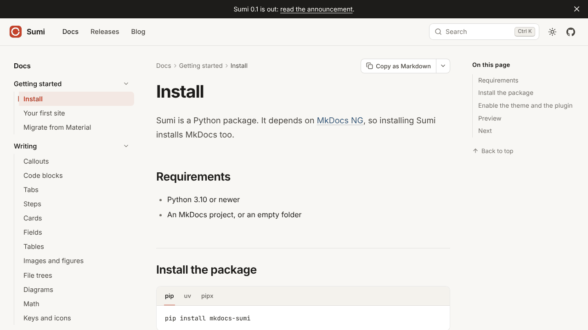

<!-- markdownlint-disable -->
<p align="center">
    <a href="https://github.com/mkdocs-ng"></a>
</p>

<h1 align="center">MkDocs Catalog</h1>

<p align="center">
    <strong>470 plugins, themes and Markdown extensions for <a href="https://github.com/mkdocs-ng/mkdocs">MkDocs NG</a> and MkDocs, ranked and updated every week.</strong>
    <br>
    <em>MkDocs NG: Write Markdown. Ship docs.</em>
</p>

<p align="center">
    <a href="#contents" title="Project count"></a>
    <a href="https://github.com/mkdocs-ng/catalog/releases" title="Catalog updates"></a>
    <a href="https://github.com/mkdocs-ng/mkdocs/actions/workflows/compat.yml" title="Plugin compatibility test"></a>
    <a href="#contribution" title="Contributions are welcome"></a>
</p>

This catalog lists 470 open-source projects in 18 categories. Projects are ranked by a quality score computed from GitHub and PyPI metrics. Projects marked  build on MkDocs NG in the weekly [plugin compatibility test](https://github.com/mkdocs-ng/mkdocs/actions/workflows/compat.yml).

Search and browse the catalog on its website: **[catalog.mkdocs-ng.org](https://catalog.mkdocs-ng.org/)**.

Get started with MkDocs NG, a drop-in replacement for MkDocs 1.x:

```sh
pip install mkdocs-ng
```

Read the [MkDocs NG documentation](https://mkdocs-ng.org/) for more. To add or update a project, open an [issue](https://github.com/mkdocs-ng/catalog/issues/new/choose) or edit [projects.yaml](https://github.com/mkdocs-ng/catalog/edit/main/projects.yaml).

## From the MkDocs NG team

- [**Sumi**](https://sumi.mkdocs-ng.org/): a local-first documentation theme with a landing page, blog, releases and print edition. `pip install mkdocs-sumi`
- [**MkDocs NG Material**](https://github.com/mkdocs-ng/mkdocs-material): Material for MkDocs, maintained for MkDocs NG with security and bug fixes. `pip install mkdocs-ng-material`

Both are also listed, and ranked like any other project, under [Theming](#-theming).

## Contents

- [🎨 Theming](#-theming) _46 projects_
- [💻 API documentation building](#-api-documentation-building) _32 projects_
- [💬 Blogging](#-blogging) _8 projects_
- [📊 Charts, Images, Tables & Graphs](#-charts-images-tables--graphs) _58 projects_
- [🤖 Code execution, variables & templating](#-code-execution-variables--templating) _35 projects_
- [🌲 Git repos & info](#-git-repos--info) _17 projects_
- [🌈 HTML processing & CSS styling](#-html-processing--css-styling) _24 projects_
- [🧠 AI & LLMs](#-ai--llms) _18 projects_
- [📎 Integrations with other tools](#-integrations-with-other-tools) _18 projects_
- [🌍 Internationalization & localization](#-internationalization--localization) _6 projects_
- [🔗 Links & references](#-links--references) _34 projects_
- [🧩 Markdown extensions](#-markdown-extensions) _45 projects_
- [🧭 Navigation & page building](#-navigation--page-building) _43 projects_
- [✅ Quality checks (code blocks, spelling, etc.)](#-quality-checks-code-blocks-spelling-etc) _6 projects_
- [🔍 Search & tables of content](#-search--tables-of-content) _10 projects_
- [🍱 Site conversion (PDF/ePUB/etc.)](#-site-conversion-pdfepubetc) _21 projects_
- [🔧 Site building, site management](#-site-building-site-management) _35 projects_
- [📁 Snippets & includes (reusing contents)](#-snippets--includes-reusing-contents) _18 projects_

## Explanation
- 🥇🥈🥉&nbsp; Combined project-quality score
- ⭐️&nbsp; Star count from GitHub
- 🐣&nbsp; New project _(less than 6 months old)_
- 💤&nbsp; Inactive project _(12 months no activity)_
- 📈📉&nbsp; Project is trending up or down
- ➕&nbsp; Project was recently added
- ❗️&nbsp; Warning _(e.g. missing/risky license)_
- 👨‍💻&nbsp; Contributors count from GitHub
- 🔀&nbsp; Fork count from GitHub
- 📋&nbsp; Issue count from GitHub
- ⏱️&nbsp; Last update timestamp on package manager
- 📥&nbsp; Download count from package manager
- 📦&nbsp; Number of dependent projects
- &nbsp; MkDocs plugin
- &nbsp; MkDocs theme
- &nbsp; MkDocs-based project (website, templates, etc.)
- &nbsp; Markdown extension(s)
- &nbsp; Builds on MkDocs NG in the weekly <a href="https://github.com/mkdocs-ng/mkdocs/actions/workflows/compat.yml">plugin compatibility test</a>

<br>

## 🎨 Theming

<a href="#contents"></a>

<details><summary><b><a href="https://github.com/squidfunk/mkdocs-material">Material for MkDocs</a></b>  - 🥇42 ·  ⭐ 28K · <code><a href="http://bit.ly/34MBwT8">MIT</a></code> · <code></code> · <code></code> · <code></code><br>Documentation that simply works.</summary>

<a href="https://pawamoy.github.io/mkdocs-gallery/themes/material/">

</a>

- [GitHub](https://github.com/squidfunk/mkdocs-material) (👨‍💻 330 · 🔀 4K · 📦 97K · 📋 2.7K - 0% open · ⏱️ 30.10.2026)
- [PyPi](https://pypi.org/project/mkdocs-material) (📥 12M / month):
	```
	pip install mkdocs-material
	```
- Add to [mkdocs.yml](https://mkdocs-ng.org/user-guide/configuration/#theme):
   ```yaml
   theme: material
   ```
   Extras:
   ```yaml
   plugins:
     - blog
     - group
     - offline
     - search
     - social
     - tags
   ```
</details>
<details><summary><b><a href="https://github.com/asiffer/mkdocs-shadcn">Shadcn</a></b>  - 🥇24 ·  ⭐ 220 · <code><a href="http://bit.ly/34MBwT8">MIT</a></code> · <code></code> · <code></code><br>Documentation that also shines.</summary>

- [GitHub](https://github.com/asiffer/mkdocs-shadcn) (👨‍💻 9 · 🔀 28 · 📥 380 · 📦 100 · 📋 65 - 20% open · ⏱️ 03.11.2026)
- [PyPi](https://pypi.org/project/mkdocs-shadcn) (📥 36K / month):
	```
	pip install mkdocs-shadcn
	```
- Add to [mkdocs.yml](https://mkdocs-ng.org/user-guide/configuration/#theme):
   ```yaml
   theme: shadcn
   ```
   Extras:
   ```yaml
   plugins:
     - search
     - excalidraw
   ```
</details>
<details><summary><b><a href="https://github.com/chrissimpkins/cinder">Cinder</a></b>  - 🥇22 ·  ⭐ 220 · 💤 · <code><a href="http://bit.ly/34MBwT8">MIT</a></code> · <code></code> · <code></code><br>A clean, responsive MkDocs theme.</summary>

<a href="https://pawamoy.github.io/mkdocs-gallery/themes/cinder/">

</a>

- [GitHub](https://github.com/chrissimpkins/cinder) (👨‍💻 23 · 🔀 100 · 📥 1K · 📦 710 · 📋 51 - 31% open · ⏱️ 05.01.2021)
- [PyPi](https://pypi.org/project/mkdocs-cinder) (📥 5K / month):
	```
	pip install mkdocs-cinder
	```
- Add to [mkdocs.yml](https://mkdocs-ng.org/user-guide/configuration/#theme):
   ```yaml
   theme: cinder
   ```
</details>
<details><summary><b><a href="https://github.com/jaywhj/mkdocs-materialx">mkdocs-materialx</a></b>  - 🥇22 ·  ⭐ 170 · ➕ · <code><a href="http://bit.ly/34MBwT8">MIT</a></code> · <code></code> · <code></code><br>MaterialX, the next generation of mkdocs-material.</summary>

<a href="https://pawamoy.github.io/mkdocs-gallery/themes/materialx/">

</a>

- [GitHub](https://github.com/jaywhj/mkdocs-materialx) (👨‍💻 330 · 🔀 8 · ⏱️ 02.11.2026)
- [PyPi](https://pypi.org/project/mkdocs-materialx) (📥 16K / month):
	```
	pip install mkdocs-materialx
	```
- Add to [mkdocs.yml](https://mkdocs-ng.org/user-guide/configuration/#theme):
   ```yaml
   theme: materialx
   ```
   Extras:
   ```yaml
   plugins:
     - blog
     - group
     - info
     - meta
     - offline
     - optimize
     - privacy
     - search
     - social
     - tags
   ```
</details>
<details><summary><b><a href="https://github.com/mkdocs/mkdocs-bootswatch">Bootswatch</a></b>  - 🥇20 ·  ⭐ 150 · 💤 · <code><a href="http://bit.ly/3rqEWVr">BSD-2</a></code> · <code></code><br>MkDocs Bootswatch Themes.</summary>

<a href="https://pawamoy.github.io/mkdocs-gallery/themes/cerulean/">

</a>

- [GitHub](https://github.com/mkdocs/mkdocs-bootswatch) (👨‍💻 10 · 🔀 58 · 📦 1.3K · 📋 33 - 9% open · ⏱️ 29.12.2023)
- [PyPi](https://pypi.org/project/mkdocs-bootswatch) (📥 18K / month):
	```
	pip install mkdocs-bootswatch
	```
- Add to [mkdocs.yml](https://mkdocs-ng.org/user-guide/configuration/#theme):
   ```yaml
   theme: cerulean
   # or: cosmo, cyborg, darkly, flatly, journal, litera, lumen, lux, materia, minty, pulse, sandstone, simplex, slate, solar, spacelab, superhero, united, yeti
   ```
</details>
<details><summary><b><a href="https://github.com/FernandoCelmer/mkdocs-simple-blog">Simple Blog</a></b>  - 🥇20 ·  ⭐ 130 · <code><a href="http://bit.ly/34MBwT8">MIT</a></code> · <code></code><br>Blog Template for Mkdocs.</summary>

<a href="https://pawamoy.github.io/mkdocs-gallery/themes/simple-blog/">

</a>

- [GitHub](https://github.com/FernandoCelmer/mkdocs-simple-blog) (👨‍💻 6 · 🔀 13 · 📦 98 · 📋 50 - 6% open · ⏱️ 18.09.2026)
- [PyPi](https://pypi.org/project/mkdocs-simple-blog) (📥 680 / month):
	```
	pip install mkdocs-simple-blog
	```
- Add to [mkdocs.yml](https://mkdocs-ng.org/user-guide/configuration/#theme):
   ```yaml
   theme: simple-blog
   ```
</details>
<details><summary><b><a href="https://github.com/ntno/mkdocs-terminal">Terminal for MkDocs</a></b>  - 🥈19 ·  ⭐ 320 · <code><a href="http://bit.ly/34MBwT8">MIT</a></code> · <code></code><br>monospace theme for MkDocs.</summary>

<a href="https://pawamoy.github.io/mkdocs-gallery/themes/terminal/">

</a>

- [GitHub](https://github.com/ntno/mkdocs-terminal) (👨‍💻 4 · 🔀 21 · 📦 180 · 📋 68 - 41% open · ⏱️ 26.03.2026)
- [PyPi](https://pypi.org/project/mkdocs-terminal) (📥 4.3K / month):
	```
	pip install mkdocs-terminal
	```
- Add to [mkdocs.yml](https://mkdocs-ng.org/user-guide/configuration/#theme):
   ```yaml
   theme: terminal
   ```
   Extras:
   ```yaml
   plugins:
     - md-to-html
   ```
</details>
<details><summary><b><a href="https://github.com/dracula/mkdocs">Dracula</a></b>  - 🥈19 ·  ⭐ 120 · <code><a href="http://bit.ly/34MBwT8">MIT</a></code> · <code></code><br>Dark theme for Mkdocs.</summary>

<a href="https://pawamoy.github.io/mkdocs-gallery/themes/dracula/">

</a>

- [GitHub](https://github.com/dracula/mkdocs) (👨‍💻 5 · 🔀 14 · 📦 160 · ⏱️ 16.08.2026)
- [PyPi](https://pypi.org/project/mkdocs-dracula-theme) (📥 6.8K / month):
	```
	pip install mkdocs-dracula-theme
	```
- Add to [mkdocs.yml](https://mkdocs-ng.org/user-guide/configuration/#theme):
   ```yaml
   theme: dracula
   ```
</details>
<details><summary><b><a href="https://github.com/mkdocs/mkdocs-bootstrap">Bootstrap</a></b>  - 🥈17 ·  ⭐ 95 · 💤 · <code><a href="http://bit.ly/3rqEWVr">BSD-2</a></code> · <code></code><br>MkDocs Bootstrap Theme.</summary>

<a href="https://pawamoy.github.io/mkdocs-gallery/themes/bootstrap/">

</a>

- [GitHub](https://github.com/mkdocs/mkdocs-bootstrap) (👨‍💻 6 · 🔀 33 · 📦 530 · 📋 16 - 6% open · ⏱️ 29.12.2023)
- [PyPi](https://pypi.org/project/mkdocs-bootstrap) (📥 19K / month):
	```
	pip install mkdocs-bootstrap
	```
- Add to [mkdocs.yml](https://mkdocs-ng.org/user-guide/configuration/#theme):
   ```yaml
   theme: bootstrap
   ```
</details>
<details><summary><b><a href="https://github.com/ansible/mkdocs-ansible">mkdocs-ansible</a></b>  - 🥈17 ·  ⭐ 12 · ➕ · <code>❗Unlicensed</code> · <code></code><br>Ansible MkDocs Theme based on Material.</summary>

<a href="https://pawamoy.github.io/mkdocs-gallery/themes/ansible/">

</a>

- [GitHub](https://github.com/ansible/mkdocs-ansible) (👨‍💻 14 · 🔀 15 · 📦 190 · 📋 5 - 40% open · ⏱️ 27.10.2026)
- [PyPi](https://pypi.org/project/mkdocs-ansible) (📥 7K / month):
	```
	pip install mkdocs-ansible
	```
- Add to [mkdocs.yml](https://mkdocs-ng.org/user-guide/configuration/#theme):
   ```yaml
   theme: ansible
   ```
</details>
<details><summary><b><a href="https://github.com/gristlabs/mkdocs-windmill">Windmill</a></b>  - 🥈16 ·  ⭐ 130 · 💤 · <code><a href="http://bit.ly/34MBwT8">MIT</a></code> · <code></code><br>Outstanding mkdocs theme with a focus on navigation and usability.</summary>

<a href="https://pawamoy.github.io/mkdocs-gallery/themes/windmill/">

</a>

- [GitHub](https://github.com/gristlabs/mkdocs-windmill) (👨‍💻 8 · 🔀 53 · 📦 370 · 📋 31 - 48% open · ⏱️ 11.03.2022)
- [PyPi](https://pypi.org/project/mkdocs-windmill) (📥 6.6K / month):
	```
	pip install mkdocs-windmill
	```
- Add to [mkdocs.yml](https://mkdocs-ng.org/user-guide/configuration/#theme):
   ```yaml
   theme: windmill
   ```
</details>
<details><summary><b><a href="https://github.com/olegshulyakov/mkdocs-primer">mkdocs-primer</a></b>  - 🥈16 ·  ⭐ 3 · 🐣 · <code><a href="http://bit.ly/34MBwT8">MIT</a></code> · <code></code><br>A Primer theme for MkDocs like GitHub Pages.</summary>

<a href="https://pawamoy.github.io/mkdocs-gallery/themes/primer/">

</a>

- [GitHub](https://github.com/olegshulyakov/mkdocs-primer) (⏱️ 24.10.2026)
- [PyPi](https://pypi.org/project/mkdocs-primer) (📥 560 / month):
	```
	pip install mkdocs-primer
	```
- Add to [mkdocs.yml](https://mkdocs-ng.org/user-guide/configuration/#theme):
   ```yaml
   theme: primer
   ```
</details>
<details><summary><b><a href="https://github.com/buvis/mkdocs-zettelkasten">Zettelkasten</a></b>  - 🥈15 ·  ⭐ 27 · <code><a href="http://bit.ly/34MBwT8">MIT</a></code> · <code></code><br>This is a Zettelkasten theme and plugin for MkDocs. It renders the MkDocs pages as cards (zettels).</summary>

- [GitHub](https://github.com/buvis/mkdocs-zettelkasten) (👨‍💻 5 · 🔀 3 · 📥 89 · 📦 7 · ⏱️ 28.10.2026)
- [PyPi](https://pypi.org/project/mkdocs-zettelkasten) (📥 120 / month):
	```
	pip install mkdocs-zettelkasten
	```
- Add to [mkdocs.yml](https://mkdocs-ng.org/user-guide/configuration/#theme):
   ```yaml
   theme: zettelkasten
   ```
   Extras:
   ```yaml
   plugins:
     - zettelkasten
   ```
</details>
<details><summary><b><a href="https://github.com/wsoft-ws/lantana">Lantana</a></b>  - 🥈14 ·  ⭐ 26 · 💤 · <code><a href="http://bit.ly/34MBwT8">MIT</a></code> · <code></code><br>Lantana MKDocsHTML.</summary>

<a href="https://pawamoy.github.io/mkdocs-gallery/themes/lantana/">

</a>

- [GitHub](https://github.com/wsoft-ws/lantana) (👨‍💻 6 · 🔀 2 · 📥 460 · 📦 8 · 📋 20 - 10% open · ⏱️ 03.07.2025)
- [PyPi](https://pypi.org/project/lantana) (📥 350 / month):
	```
	pip install lantana
	```
- Add to [mkdocs.yml](https://mkdocs-ng.org/user-guide/configuration/#theme):
   ```yaml
   theme: lantana
   ```
</details>
<details><summary><b><a href="https://github.com/swan-cern/mkdocs-swan">SWAN</a></b>  - 🥈14 ·  ⭐ 8 · <code><a href="http://bit.ly/3pwmjO5">❗️AGPL-3.0</a></code> · <code></code><br>SWAN MkDocs theme.</summary>

<a href="https://pawamoy.github.io/mkdocs-gallery/themes/swan/">

</a>

- [GitHub](https://github.com/swan-cern/mkdocs-swan) (👨‍💻 8 · 🔀 6 · 📦 13 · ⏱️ 24.09.2026)
- [PyPi](https://pypi.org/project/mkdocs-swan) (📥 1.7K / month):
	```
	pip install mkdocs-swan
	```
- Add to [mkdocs.yml](https://mkdocs-ng.org/user-guide/configuration/#theme):
   ```yaml
   theme: swan
   ```
</details>
<details><summary><b><a href="https://github.com/mkdocs-ng/mkdocs-material">MkDocs NG Material</a></b>  - 🥈14 ·  ⭐ 3 · 📈 · <code><a href="http://bit.ly/34MBwT8">MIT</a></code> · <code></code> · <code></code><br>Material for MkDocs, maintained for MkDocs NG with security and bug fixes.</summary>

<a href="https://pawamoy.github.io/mkdocs-gallery/themes/material/">

</a>

- [GitHub](https://github.com/mkdocs-ng/mkdocs-material) (👨‍💻 330 · 📋 2 - 50% open · ⏱️ 02.11.2026)
- [PyPi](https://pypi.org/project/mkdocs-ng-material) (📥 210 / month):
	```
	pip install mkdocs-ng-material
	```
- Add to [mkdocs.yml](https://mkdocs-ng.org/user-guide/configuration/#theme):
   ```yaml
   theme: material
   ```
   Extras:
   ```yaml
   plugins:
     - blog
     - group
     - offline
     - search
     - social
     - tags
   ```
</details>
<details><summary><b><a href="https://github.com/TEParsons/torillic">Torillic</a></b>  - 🥈12 ·  ⭐ 140 · 💤 · <code><a href="https://tldrlegal.com/search?query=CC0-1.0">❗️CC0-1.0</a></code> · <code></code><br>A D&D inspired theme for styling TTRPG notes and resources.</summary>

<a href="https://pawamoy.github.io/mkdocs-gallery/themes/torillic/">

</a>

- [GitHub](https://github.com/TEParsons/torillic) (👨‍💻 4 · 🔀 82 · 📥 8K · 📋 13 - 15% open · ⏱️ 21.04.2025)
- [PyPi](https://pypi.org/project/mkdocs-torillic) (📥 220 / month):
	```
	pip install mkdocs-torillic
	```
- Add to [mkdocs.yml](https://mkdocs-ng.org/user-guide/configuration/#theme):
   ```yaml
   theme: torillic
   ```
</details>
<details><summary><b><a href="https://github.com/kpn/mkdocs-kpn-theme">KPN for MkDocs</a></b>  - 🥈12 ·  ⭐ 10 · <code><a href="http://bit.ly/34MBwT8">MIT</a></code> · <code></code><br>KPN theme for MkDocs, ProperDocs and Zensical | owner=des.</summary>

<a href="https://pawamoy.github.io/mkdocs-gallery/themes/kpn/">

</a>

- [GitHub](https://github.com/kpn/mkdocs-kpn-theme) (👨‍💻 9 · 📦 8 · ⏱️ 12.05.2026)
- [PyPi](https://pypi.org/project/mkdocs-kpn) (📥 460 / month):
	```
	pip install mkdocs-kpn
	```
- Add to [mkdocs.yml](https://mkdocs-ng.org/user-guide/configuration/#theme):
   ```yaml
   theme: kpn
   ```
</details>
<details><summary><b><a href="https://github.com/trained-by-humans/mkdocs-pixel-lab">mkdocs-pixel-lab</a></b>  - 🥈12 ·  ⭐ 4 · 🐣 · <code><a href="http://bit.ly/3nYMfla">Apache-2</a></code> · <code></code> · <code></code><br>A Retroesque MkDocs documentation theme.</summary>

<a href="https://pawamoy.github.io/mkdocs-gallery/themes/pixel-lab/">

</a>

- [GitHub](https://github.com/trained-by-humans/mkdocs-pixel-lab) (👨‍💻 2 · 🔀 1 · 📥 72 · 📋 19 - 78% open · ⏱️ 04.11.2026)
- [PyPi](https://pypi.org/project/mkdocs-pixel-lab) (📥 200 / month):
	```
	pip install mkdocs-pixel-lab
	```
- Add to [mkdocs.yml](https://mkdocs-ng.org/user-guide/configuration/#theme):
   ```yaml
   theme: pixel-lab
   ```
   Extras:
   ```yaml
   plugins:
     - git-lastmod
     - metadata
     - robots
   ```
</details>
<details><summary><b><a href="https://github.com/rkriad585/mkdocs-void">mkdocs-void</a></b>  - 🥈12 ·  ⭐ 2 · 🐣 · <code><a href="http://bit.ly/34MBwT8">MIT</a></code> · <code></code> · <code></code><br>Void is a new design language for MkDocs themes: a drop-in theme (name: void) and companion plugin on top of MkDocs.</summary>

<a href="https://pawamoy.github.io/mkdocs-gallery/themes/void/">

</a>

- [GitHub](https://github.com/rkriad585/mkdocs-void) (👨‍💻 3 · 🔀 1 · 📥 14 · ⏱️ 20.09.2026)
- [PyPi](https://pypi.org/project/mkdocs-void) (📥 480 / month):
	```
	pip install mkdocs-void
	```
- Add to [mkdocs.yml](https://mkdocs-ng.org/user-guide/configuration/#theme):
   ```yaml
   theme: void
   ```
   Extras:
   ```yaml
   plugins:
     - void
   ```
</details>
<details><summary><b><a href="https://github.com/LukeCarrier/mkdocs-theme-bootstrap4">Bootstrap 4</a></b>  - 🥉10 ·  ⭐ 8 · 💤 · <code><a href="http://bit.ly/34MBwT8">MIT</a></code> · <code></code><br>A vanilla Bootstrap 4 theme for MkDocs.</summary>

<a href="https://pawamoy.github.io/mkdocs-gallery/themes/bootstrap4/">

</a>

- [GitHub](https://github.com/LukeCarrier/mkdocs-theme-bootstrap4) (👨‍💻 3 · 📋 6 - 16% open · ⏱️ 23.11.2024)
- [PyPi](https://pypi.org/project/mkdocs-theme-bootstrap4) (📥 210 / month):
	```
	pip install mkdocs-theme-bootstrap4
	```
- Add to [mkdocs.yml](https://mkdocs-ng.org/user-guide/configuration/#theme):
   ```yaml
   theme: bootstrap4
   ```
   Extras:
   ```yaml
   plugins:
     - bootstrap4-blockquotes
     - bootstrap4-tables
   ```
</details>
<details><summary><b><a href="https://github.com/Paul-Riviere/mkdocs-curriculum-vitae">mkdocs-curriculum-vitae</a></b>  - 🥉10 ·  ⭐ 7 · <code><a href="http://bit.ly/34MBwT8">MIT</a></code> · <code></code><br>A simple MkDocs theme, designed to make your curriculum vitae (CV) with minimal configuration, and several themes.</summary>

- [GitHub](https://github.com/Paul-Riviere/mkdocs-curriculum-vitae) (👨‍💻 3 · 🔀 1 · 📦 3 · 📋 47 - 23% open · ⏱️ 12.11.2025)
- [PyPi](https://pypi.org/project/mkdocs-curriculum-vitae) (📥 45 / month):
	```
	pip install mkdocs-curriculum-vitae
	```
- Add to [mkdocs.yml](https://mkdocs-ng.org/user-guide/configuration/#theme):
   ```yaml
   theme: curriculum-vitae
   ```
</details>
<details><summary><b><a href="https://github.com/TEParsons/mkdocs-landing">Landing</a></b>  - 🥉9 ·  ⭐ 29 · <code><a href="https://tldrlegal.com/search?query=CC0-1.0">❗️CC0-1.0</a></code> · <code></code><br>An mkdocs theme geared towards making a personal landing page, with simpler navigation and heavily customisable style..</summary>

<a href="https://pawamoy.github.io/mkdocs-gallery/themes/landing/">

</a>

- [GitHub](https://github.com/TEParsons/mkdocs-landing) (👨‍💻 5 · 🔀 3 · 📥 7 · 📦 8 · 📋 2 - 50% open · ⏱️ 01.10.2026)
- [PyPi](https://pypi.org/project/mkdocs-landing) (📥 72 / month):
	```
	pip install mkdocs-landing
	```
- Add to [mkdocs.yml](https://mkdocs-ng.org/user-guide/configuration/#theme):
   ```yaml
   theme: landing
   ```
</details>
<details><summary><b><a href="https://github.com/Siphalor/mkdocs-custommill">CustomMill</a></b>  - 🥉9 ·  ⭐ 19 · 💤 · <code>❗Unlicensed</code> · <code></code><br>Outstanding mkdocs theme with a focus on navigation, customization and usability.</summary>

<a href="https://pawamoy.github.io/mkdocs-gallery/themes/custommill/">

</a>

- [GitHub](https://github.com/Siphalor/mkdocs-custommill) (👨‍💻 8 · 🔀 7 · 📦 24 · ⏱️ 10.03.2022)
- [PyPi](https://pypi.org/project/mkdocs-custommill) (📥 380 / month):
	```
	pip install mkdocs-custommill
	```
- Add to [mkdocs.yml](https://mkdocs-ng.org/user-guide/configuration/#theme):
   ```yaml
   theme: custommill
   ```
</details>
<details><summary><b><a href="https://github.com/waylan/mkdocs-nature">Nature</a></b>  - 🥉9 ·  ⭐ 5 · 💤 · <code>❗Unlicensed</code> · <code></code><br>A MkDocs theme.</summary>

<a href="https://pawamoy.github.io/mkdocs-gallery/themes/nature/">

</a>

- [GitHub](https://github.com/waylan/mkdocs-nature) (👨‍💻 3 · 🔀 1 · 📦 52 · ⏱️ 04.09.2025)
- [PyPi](https://pypi.org/project/mkdocs-nature) (📥 1.3K / month):
	```
	pip install mkdocs-nature
	```
- Add to [mkdocs.yml](https://mkdocs-ng.org/user-guide/configuration/#theme):
   ```yaml
   theme: nature
   ```
</details>
<details><summary><b><a href="https://github.com/dpoulopoulos/mkdocs-mini-blog">mkdocs-mini-blog</a></b>  - 🥉9 · 💤 · <code><a href="http://bit.ly/34MBwT8">MIT</a></code> · <code></code><br>Blog Template for Mkdocs.</summary>

<a href="https://pawamoy.github.io/mkdocs-gallery/themes/mini-blog/">

</a>

- [GitHub](https://github.com/dpoulopoulos/mkdocs-mini-blog) (👨‍💻 4 · ⏱️ 12.09.2025)
- [PyPi](https://pypi.org/project/mkdocs-mini-blog) (📥 10 / month):
	```
	pip install mkdocs-mini-blog
	```
- Add to [mkdocs.yml](https://mkdocs-ng.org/user-guide/configuration/#theme):
   ```yaml
   theme: mini-blog
   ```
</details>
<details><summary><b><a href="https://gitlab.com/lramage/mkdocs-gitbook-theme">GitBook</a></b>  - 🥉8 ·  ⭐ 30 · 💤 · <code>❗Unlicensed</code> · <code></code><br>Default theme for GitBook for Mkdocs https://lramage.gitlab.io/mkdocs-gitbook-theme.</summary>

<a href="https://pawamoy.github.io/mkdocs-gallery/themes/gitbook/">

</a>

- [PyPi](https://pypi.org/project/mkdocs-gitbook) (📥 21K / month):
	```
	pip install mkdocs-gitbook
	```
- [GitLab](https://gitlab.com/lramage/mkdocs-gitbook-theme) (🔀 15 · 📋 19 - 47% open · ⏱️ 17.12.2018)
- Add to [mkdocs.yml](https://mkdocs-ng.org/user-guide/configuration/#theme):
   ```yaml
   theme: gitbook
   ```
</details>
<details><summary><b><a href="https://github.com/daizutabi/mkdocs-ivory">Ivory</a></b>  - 🥉8 ·  ⭐ 10 · 💤 · <code><a href="http://bit.ly/34MBwT8">MIT</a></code> · <code></code><br>Ivory theme for MkDocs.</summary>

<a href="https://pawamoy.github.io/mkdocs-gallery/themes/ivory/">

</a>

- [GitHub](https://github.com/daizutabi/mkdocs-ivory) (👨‍💻 2 · 🔀 6 · 📋 6 - 50% open · ⏱️ 16.06.2020)
- [PyPi](https://pypi.org/project/mkdocs-ivory) (📥 1.7K / month):
	```
	pip install mkdocs-ivory
	```
- Add to [mkdocs.yml](https://mkdocs-ng.org/user-guide/configuration/#theme):
   ```yaml
   theme: ivory
   ```
</details>
<details><summary><b><a href="https://github.com/mkdocs-ng/mkdocs-sumi">Sumi</a></b>  - 🥉8 · 🐣 · <code><a href="http://bit.ly/3nYMfla">Apache-2</a></code> · <code></code> · <code></code><br>Local-first documentation theme for MkDocs NG with a landing page, blog, releases and print edition.</summary>

<a href="https://github.com/mkdocs-ng/mkdocs-sumi">

</a>

- [GitHub](https://github.com/mkdocs-ng/mkdocs-sumi) (👨‍💻 2 · ⏱️ 05.11.2026)
- [PyPi](https://pypi.org/project/mkdocs-sumi):
	```
	pip install mkdocs-sumi
	```
- Add to [mkdocs.yml](https://mkdocs-ng.org/user-guide/configuration/#theme):
   ```yaml
   theme: sumi
   ```
   Extras:
   ```yaml
   plugins:
     - sumi
   ```
</details>
<details><summary><b><a href="https://github.com/smallzh/mkdocs-smzhbook-theme">mkdocs-smzhbook-theme</a></b>  - 🥉8 · ➕ · <code><a href="http://bit.ly/3rqEWVr">BSD-2</a></code> · <code></code><br>MkDocsTheme.</summary>

<a href="https://pawamoy.github.io/mkdocs-gallery/themes/smzhbook/">

</a>

- [GitHub](https://github.com/smallzh/mkdocs-smzhbook-theme) (⏱️ 22.09.2026)
- [PyPi](https://pypi.org/project/mkdocs-smzhbook-theme) (📥 260 / month):
	```
	pip install mkdocs-smzhbook-theme
	```
- Add to [mkdocs.yml](https://mkdocs-ng.org/user-guide/configuration/#theme):
   ```yaml
   theme: smzhbook
   ```
</details>
<details><summary><b><a href="https://github.com/noraj/mkdocs-windmill-dark">Windmill Dark</a></b>  - 🥉7 ·  ⭐ 38 · 💤 · <code>❗Unlicensed</code> · <code></code><br>Outstanding mkdocs theme with a focus on navigation and usability.</summary>

<a href="https://pawamoy.github.io/mkdocs-gallery/themes/windmill-dark/">

</a>

- [GitHub](https://github.com/noraj/mkdocs-windmill-dark) (👨‍💻 4 · 🔀 11 · ⏱️ 12.05.2022)
- [PyPi](https://pypi.org/project/mkdocs-windmill-dark) (📥 400 / month):
	```
	pip install mkdocs-windmill-dark
	```
- Add to [mkdocs.yml](https://mkdocs-ng.org/user-guide/configuration/#theme):
   ```yaml
   theme: windmill-dark
   ```
</details>
<details><summary><b><a href="https://github.com/notpushkin/mkdocs-alabaster">Alabaster</a></b>  - 🥉7 ·  ⭐ 36 · 💤 · <code>❗Unlicensed</code> · <code></code><br>Alabaster port for MkDocs.</summary>

<a href="https://pawamoy.github.io/mkdocs-gallery/themes/alabaster/">

</a>

- [GitHub](https://github.com/notpushkin/mkdocs-alabaster) (👨‍💻 10 · 🔀 11 · 📋 17 - 17% open · ⏱️ 16.06.2020)
- [PyPi](https://pypi.org/project/mkdocs-alabaster) (📥 540 / month):
	```
	pip install mkdocs-alabaster
	```
- Add to [mkdocs.yml](https://mkdocs-ng.org/user-guide/configuration/#theme):
   ```yaml
   theme: alabaster
   ```
</details>
<details><summary><b><a href="https://github.com/g3xx/mkdocs-Github">GitHub</a></b>  - 🥉7 ·  ⭐ 6 · 💤 · <code><a href="http://bit.ly/34MBwT8">MIT</a></code> · <code></code><br>Theme Mkdocs Like a Github. DEMO =.</summary>

<a href="https://pawamoy.github.io/mkdocs-gallery/themes/github/">

</a>

- [GitHub](https://github.com/g3xx/mkdocs-Github) (📦 13 · ⏱️ 25.02.2020)
- [PyPi](https://pypi.org/project/mkdocs-github) (📥 140 / month):
	```
	pip install mkdocs-github
	```
- Add to [mkdocs.yml](https://mkdocs-ng.org/user-guide/configuration/#theme):
   ```yaml
   theme: github
   ```
</details>
<details><summary><b><a href="https://github.com/unverbuggt/mkdocs-risonia-theme">Risonia</a></b>  - 🥉7 ·  ⭐ 4 · <code>❗Unlicensed</code> · <code></code><br>A simple theme for MkDocs, using the w3.css framework and configurable color schemes.</summary>

<a href="https://pawamoy.github.io/mkdocs-gallery/themes/risonia/">

</a>

- [GitHub](https://github.com/unverbuggt/mkdocs-risonia-theme) (🔀 1 · 📦 4 · ⏱️ 31.12.2025)
- [PyPi](https://pypi.org/project/mkdocs-risonia-theme) (📥 45 / month):
	```
	pip install mkdocs-risonia-theme
	```
- Add to [mkdocs.yml](https://mkdocs-ng.org/user-guide/configuration/#theme):
   ```yaml
   theme: risonia
   ```
   Extras:
   ```yaml
   plugins:
     - color-theme
     - w3css-classes
   ```
</details>
<details><summary><b><a href="https://gitlab.com/lramage/mkdocs-bootstrap386">BOOTSTRAP386</a></b>  - 🥉6 ·  ⭐ 37 · 💤 · <code>❗Unlicensed</code> · <code></code><br>A vintage 1980s DOS inspired Twitter Bootstrap theme for MkDocs https://lramage.gitlab.io/mkdocs-bootstrap386.</summary>

<a href="https://pawamoy.github.io/mkdocs-gallery/themes/bootstrap386/">

</a>

- [PyPi](https://pypi.org/project/mkdocs-bootstrap386) (📥 220 / month):
	```
	pip install mkdocs-bootstrap386
	```
- [GitLab](https://gitlab.com/lramage/mkdocs-bootstrap386) (🔀 3 · 📋 7 - 57% open · ⏱️ 06.06.2018)
- Add to [mkdocs.yml](https://mkdocs-ng.org/user-guide/configuration/#theme):
   ```yaml
   theme: bootstrap386
   ```
</details>
<details><summary><b><a href="https://github.com/kuri65536/mkdocs-theme-topdf">mkdocs-theme-topdf</a></b>  - 🥉6 ·  ⭐ 17 · 💤 · <code><a href="http://bit.ly/3postzC">MPL-2.0</a></code> · <code></code><br>A mkdocs theme for create PDF and printing with paged.js.</summary>

<a href="https://pawamoy.github.io/mkdocs-gallery/themes/topdf/">

</a>

- [GitHub](https://github.com/kuri65536/mkdocs-theme-topdf) (🔀 1 · 📦 4 · ⏱️ 22.05.2025)
- [PyPi](https://pypi.org/project/mkdocs-theme-topdf) (📥 34 / month):
	```
	pip install mkdocs-theme-topdf
	```
- Add to [mkdocs.yml](https://mkdocs-ng.org/user-guide/configuration/#theme):
   ```yaml
   theme: topdf
   ```
</details>
<details><summary><b><a href="https://github.com/byrnereese/mkdocs-moonstone">Moonstone</a></b>  - 🥉6 ·  ⭐ 8 · 💤 · <code>❗Unlicensed</code> · <code></code><br>A documentation theme for mkdocs.</summary>

<a href="https://pawamoy.github.io/mkdocs-gallery/themes/moonstone/">

</a>

- [GitHub](https://github.com/byrnereese/mkdocs-moonstone) (🔀 1 · 📦 18 · ⏱️ 15.06.2021)
- [PyPi](https://pypi.org/project/mkdocs-moonstone) (📥 78 / month):
	```
	pip install mkdocs-moonstone
	```
- Add to [mkdocs.yml](https://mkdocs-ng.org/user-guide/configuration/#theme):
   ```yaml
   theme: moonstone
   ```
</details>
<details><summary><b><a href="https://github.com/durera/mkdocs-carbon">mkdocs-carbon</a></b>  - 🥉6 ·  ⭐ 5 · ➕ · <code>❗Unlicensed</code> · <code></code></summary>

<a href="https://pawamoy.github.io/mkdocs-gallery/themes/carbon/">

</a>

- [GitHub](https://github.com/durera/mkdocs-carbon) (🔀 1 · 📋 3 - 66% open · ⏱️ 17.01.2026)
- [PyPi](https://pypi.org/project/mkdocs-carbon) (📥 3.2K / month):
	```
	pip install mkdocs-carbon
	```
- Add to [mkdocs.yml](https://mkdocs-ng.org/user-guide/configuration/#theme):
   ```yaml
   theme: carbon
   ```
</details>
<details><summary><b><a href="https://github.com/sharifndlovu123/mkdocs-blueprint">mkdocs-blueprint</a></b>  - 🥉6 · 🐣 · <code><a href="http://bit.ly/34MBwT8">MIT</a></code> · <code></code><br>Blueprint / drafting-sheet skin for Material for MkDocs.</summary>

<a href="https://pawamoy.github.io/mkdocs-gallery/themes/blueprint/">

</a>

- [GitHub](https://github.com/sharifndlovu123/mkdocs-blueprint) (⏱️ 29.10.2026)
- [PyPi](https://pypi.org/project/mkdocs-blueprint):
	```
	pip install mkdocs-blueprint
	```
- Add to [mkdocs.yml](https://mkdocs-ng.org/user-guide/configuration/#theme):
   ```yaml
   theme: blueprint
   ```
</details>
<details><summary><b><a href="https://github.com/hfagerlund/mkdocs-docskimmer">docSkimmer</a></b>  - 🥉5 ·  ⭐ 20 · <code>❗Unlicensed</code> · <code></code><br>An accessible, skimmable theme for MkDocs.</summary>

<a href="https://pawamoy.github.io/mkdocs-gallery/themes/docskimmer/">

</a>

- [GitHub](https://github.com/hfagerlund/mkdocs-docskimmer) (⏱️ 17.12.2025)
- Add to [mkdocs.yml](https://mkdocs-ng.org/user-guide/configuration/#theme):
   ```yaml
   theme: docskimmer
   ```
</details>
<details><summary><b><a href="https://github.com/lodgev/mkdocs-docs-hub">mkdocs-docs-hub</a></b>  - 🥉5 · 🐣 · <code><a href="http://bit.ly/3nYMfla">Apache-2</a></code> · <code></code><br>MkDOcs personal theme.</summary>

<a href="https://pawamoy.github.io/mkdocs-gallery/themes/docs-hub/">

</a>

- [GitHub](https://github.com/lodgev/mkdocs-docs-hub) (⏱️ 13.05.2026)
- [PyPi](https://pypi.org/project/mkdocs-docs-hub) (📥 9 / month):
	```
	pip install mkdocs-docs-hub
	```
- Add to [mkdocs.yml](https://mkdocs-ng.org/user-guide/configuration/#theme):
   ```yaml
   theme: docs-hub
   ```
</details>
<details><summary><b><a href="https://github.com/catwatchdog/mkdocs-cwd">mkdocs-cwd</a></b>  - 🥉5 · ➕ · <code><a href="http://bit.ly/34MBwT8">MIT</a></code> · <code></code><br>CWD theme for MkDocs.</summary>

<a href="https://pawamoy.github.io/mkdocs-gallery/themes/cwd/">

</a>

- [GitHub](https://github.com/catwatchdog/mkdocs-cwd) (⏱️ 31.03.2026)
- [PyPi](https://pypi.org/project/mkdocs-cwd) (📥 19 / month):
	```
	pip install mkdocs-cwd
	```
- Add to [mkdocs.yml](https://mkdocs-ng.org/user-guide/configuration/#theme):
   ```yaml
   theme: cwd
   ```
</details>
<details><summary><b><a href="https://github.com/ruslanlap/Catppuccin-MkDocs">mkdocs-catppuccin</a></b>  - 🥉5 · ➕ · <code><a href="http://bit.ly/34MBwT8">MIT</a></code> · <code></code><br>Soothing pastel theme for MkDocs based on the Catppuccin color palette.</summary>

<a href="https://pawamoy.github.io/mkdocs-gallery/themes/catppuccin/">

</a>

- [GitHub](https://github.com/ruslanlap/Catppuccin-MkDocs) (⏱️ 24.11.2025)
- [PyPi](https://pypi.org/project/mkdocs-catppuccin) (📥 18 / month):
	```
	pip install mkdocs-catppuccin
	```
- Add to [mkdocs.yml](https://mkdocs-ng.org/user-guide/configuration/#theme):
   ```yaml
   theme: catppuccin
   ```
</details>
<details><summary><b><a href="https://github.com/mberneti/mkdocs-rtl">mkdocs-rtl</a></b>  - 🥉4 ·  ⭐ 25 · 💤 · <code><a href="http://bit.ly/34MBwT8">MIT</a></code><br>mkdocs rtl theme based on mkdocs-material.</summary>

- [GitHub](https://github.com/mberneti/mkdocs-rtl) (👨‍💻 2 · 🔀 4 · 📋 2 - 50% open · ⏱️ 22.10.2017)
</details>
<details><summary><b><a href="https://github.com/RyanPoy/mkdocs-tale">mkdocs-tale</a></b>  - 🥉4 · 💤 · <code>❗Unlicensed</code> · <code></code> · <code></code><br>a theme of mkdocs.</summary>

<a href="https://pawamoy.github.io/mkdocs-gallery/themes/tale/">

</a>

- [GitHub](https://github.com/RyanPoy/mkdocs-tale) (⏱️ 07.08.2025)
- [PyPi](https://pypi.org/project/mkdocs-tale) (📥 8 / month):
	```
	pip install mkdocs-tale
	```
- Add to [mkdocs.yml](https://mkdocs-ng.org/user-guide/configuration/#theme):
   ```yaml
   theme: tale
   ```
   Extras:
   ```yaml
   plugins:
     - tale
   ```
</details>
<details><summary><b><a href="https://gitlab.com/kaliko/mkdocs-cluster">Cluster</a></b>  - 🥉3 ·  ⭐ 6 · 💤 · <code>❗Unlicensed</code> · <code></code><br>Another bootstrap theme for MkDocs.</summary>

<a href="https://pawamoy.github.io/mkdocs-gallery/themes/cluster/">

</a>

- [PyPi](https://pypi.org/project/mkdocs-cluster) (📥 330 / month):
	```
	pip install mkdocs-cluster
	```
- [GitLab](https://gitlab.com/kaliko/mkdocs-cluster) (🔀 2 · ⏱️ 02.06.2016)
- Add to [mkdocs.yml](https://mkdocs-ng.org/user-guide/configuration/#theme):
   ```yaml
   theme: cluster
   ```
</details>
<br>

## 💻 API documentation building

<a href="#contents"></a>

<details><summary><b><a href="https://github.com/mkdocstrings/mkdocstrings">mkdocstrings</a></b>  - 🥇34 ·  ⭐ 2.1K · <code><a href="http://bit.ly/3hkKRql">ISC</a></code> · <code></code> · <code></code><br>Automatic documentation from sources, for MkDocs.</summary>

- [GitHub](https://github.com/mkdocstrings/mkdocstrings) (👨‍💻 56 · 🔀 120 · 📦 32K · ⏱️ 23.10.2026)
- [PyPi](https://pypi.org/project/mkdocstrings) (📥 5.8M / month):
	```
	pip install mkdocstrings
	```
- Add to [mkdocs.yml](https://mkdocs-ng.org/user-guide/configuration/#plugins):
   ```yaml
   plugins:
     - mkdocstrings
   ```
</details>
<details><summary><b><a href="https://github.com/mkdocstrings/python">mkdocstrings-python</a></b>  - 🥇25 ·  ⭐ 280 · <code><a href="http://bit.ly/3hkKRql">ISC</a></code><br>A Python handler for mkdocstrings.</summary>

- [GitHub](https://github.com/mkdocstrings/python) (👨‍💻 32 · 🔀 53 · 📋 220 - 2% open · ⏱️ 23.10.2026)
- [PyPi](https://pypi.org/project/mkdocstrings-python) (📥 5.8M / month):
	```
	pip install mkdocstrings-python
	```
</details>
<details><summary><b><a href="https://github.com/mkdocs/mkdocs-click">mkdocs-click</a></b>  - 🥇23 ·  ⭐ 150 · 💤 · <code><a href="http://bit.ly/3nYMfla">Apache-2</a></code> · <code></code> · <code></code><br>An MkDocs extension to generate documentation for Click command line applications.</summary>

- [GitHub](https://github.com/mkdocs/mkdocs-click) (👨‍💻 16 · 🔀 21 · 📦 1.4K · 📋 36 - 55% open · ⏱️ 18.06.2025)
- [PyPi](https://pypi.org/project/mkdocs-click) (📥 480K / month):
	```
	pip install mkdocs-click
	```
- Add to [mkdocs.yml](https://mkdocs-ng.org/user-guide/configuration/#markdown_extensions):
   ```yaml
   markdown_extensions:
     - mkdocs-click
   ```
</details>
<details><summary><b><a href="https://github.com/Neoteroi/mkdocs-plugins">MkDocsOAD</a></b>  - 🥇20 ·  ⭐ 180 · <code><a href="http://bit.ly/34MBwT8">MIT</a></code> · <code></code> · <code></code> · <code></code><br>Plugin for MkDocs to generate human readable documentation from OpenAPI Documentation Version 3 (also known as Swagger..</summary>

- [GitHub](https://github.com/Neoteroi/mkdocs-plugins) (👨‍💻 13 · 🔀 13 · 📥 25K · 📦 550 · 📋 47 - 42% open · ⏱️ 23.11.2025)
- [PyPi](https://pypi.org/project/neoteroi-mkdocs) (📥 160K / month):
	```
	pip install neoteroi-mkdocs
	```
- Add to [mkdocs.yml](https://mkdocs-ng.org/user-guide/configuration/#plugins):
   ```yaml
   plugins:
     - neoteroi.mkdocsoad
     - neoteroi.contribs
   markdown_extensions:
     - neoteroi.cards
     - neoteroi.timeline
     - neoteroi.projects
     - neoteroi.spantable
   ```
</details>
<details><summary><b><a href="https://github.com/JakubAndrysek/MkDoxy">mkdoxy</a></b>  - 🥇20 ·  ⭐ 130 · <code><a href="http://bit.ly/34MBwT8">MIT</a></code> · <code></code><br>Automatically generates API documentation for your project based on Doxygen comments and code snippets in your..</summary>

- [GitHub](https://github.com/JakubAndrysek/MkDoxy) (👨‍💻 18 · 🔀 32 · 📦 84 · 📋 75 - 33% open · ⏱️ 01.11.2026)
- [PyPi](https://pypi.org/project/mkdoxy) (📥 40K / month):
	```
	pip install mkdoxy
	```
- Add to [mkdocs.yml](https://mkdocs-ng.org/user-guide/configuration/#plugins):
   ```yaml
   plugins:
     - mkdoxy
   ```
</details>
<details><summary><b><a href="https://github.com/daizutabi/mkapi">MkApi</a></b>  - 🥈18 ·  ⭐ 130 · <code><a href="http://bit.ly/34MBwT8">MIT</a></code> · <code></code><br>MkDocs plugin for automatic API documentation generation from Python docstrings.</summary>

- [GitHub](https://github.com/daizutabi/mkapi) (👨‍💻 6 · 🔀 17 · 📦 270 · 📋 150 - 2% open · ⏱️ 30.03.2026)
- [PyPi](https://pypi.org/project/mkapi) (📥 5.7K / month):
	```
	pip install mkapi
	```
- Add to [mkdocs.yml](https://mkdocs-ng.org/user-guide/configuration/#plugins):
   ```yaml
   plugins:
     - mkapi
   ```
</details>
<details><summary><b><a href="https://github.com/tlambert03/mkdocs-api-autonav">mkdocs-api-autonav</a></b>  - 🥈16 ·  ⭐ 42 · <code><a href="http://bit.ly/3aKzpTv">BSD-3</a></code> · <code></code><br>MkDocs plugin for autogenerating API docs with navigation.</summary>

- [GitHub](https://github.com/tlambert03/mkdocs-api-autonav) (👨‍💻 2 · 🔀 2 · 📥 160 · 📦 380 · 📋 17 - 11% open · ⏱️ 28.09.2026)
- [PyPi](https://pypi.org/project/mkdocs-api-autonav) (📥 95K / month):
	```
	pip install mkdocs-api-autonav
	```
- Add to [mkdocs.yml](https://mkdocs-ng.org/user-guide/configuration/#plugins):
   ```yaml
   plugins:
     - api-autonav
   ```
</details>
<details><summary><b><a href="https://github.com/jcayers20/mkdocs-autoapi">mkdocs-autoapi</a></b>  - 🥈16 ·  ⭐ 22 · <code><a href="http://bit.ly/34MBwT8">MIT</a></code> · <code></code><br>MkDocs plugin providing automatic API reference generation.</summary>

- [GitHub](https://github.com/jcayers20/mkdocs-autoapi) (👨‍💻 2 · 🔀 1 · 📥 10 · 📦 150 · 📋 37 - 21% open · ⏱️ 29.01.2026)
- [PyPi](https://pypi.org/project/mkdocs-autoapi) (📥 23K / month):
	```
	pip install mkdocs-autoapi
	```
- Add to [mkdocs.yml](https://mkdocs-ng.org/user-guide/configuration/#plugins):
   ```yaml
   plugins:
     - mkdocs-autoapi
   ```
</details>
<details><summary><b><a href="https://github.com/syn54x/mkdocs-typer2">mkdocs-typer2</a></b>  - 🥈15 ·  ⭐ 22 · <code><a href="http://bit.ly/3nYMfla">Apache-2</a></code> · <code></code><br>Mkdocs Plugin For Typer CLIs.</summary>

- [GitHub](https://github.com/syn54x/mkdocs-typer2) (👨‍💻 2 · 🔀 2 · 📦 62 · ⏱️ 17.06.2026)
- [PyPi](https://pypi.org/project/mkdocs-typer2) (📥 6.2K / month):
	```
	pip install mkdocs-typer2
	```
- Add to [mkdocs.yml](https://mkdocs-ng.org/user-guide/configuration/#plugins):
   ```yaml
   plugins:
     - mkdocs-typer2
   ```
</details>
<details><summary><b><a href="https://github.com/mkdocstrings/crystal">mkdocstrings-crystal</a></b>  - 🥈14 ·  ⭐ 31 · <code><a href="http://bit.ly/34MBwT8">MIT</a></code><br>Crystal language doc generator for https://github.com/mkdocstrings/mkdocstrings.</summary>

- [GitHub](https://github.com/mkdocstrings/crystal) (👨‍💻 3 · 🔀 2 · 📋 8 - 37% open · ⏱️ 08.11.2025)
- [PyPi](https://pypi.org/project/mkdocstrings-crystal) (📥 14K / month):
	```
	pip install mkdocstrings-crystal
	```
</details>
<details><summary><b><a href="https://github.com/watermarkhu/mkdocstrings-matlab">mkdocstrings-matlab</a></b>  - 🥈14 ·  ⭐ 18 · <code><a href="http://bit.ly/3hkKRql">ISC</a></code><br>A MATLAB handler for mkdocstrings, automatic documentation from sources.</summary>

- [GitHub](https://github.com/watermarkhu/mkdocstrings-matlab) (👨‍💻 5 · 🔀 4 · 📥 77 · 📦 2 · 📋 17 - 35% open · ⏱️ 04.11.2026)
- [PyPi](https://pypi.org/project/mkdocstrings-matlab) (📥 540 / month):
	```
	pip install mkdocstrings-matlab
	```
</details>
<details><summary><b><a href="https://github.com/bruce-szalwinski/mkdocs-typer">mkdocs-typer</a></b>  - 🥈13 ·  ⭐ 33 · 💤 · <code><a href="http://bit.ly/3nYMfla">Apache-2</a></code> · <code></code><br>An MkDocs extension to generate documentation for Typer command line applications.</summary>

- [GitHub](https://github.com/bruce-szalwinski/mkdocs-typer) (🔀 4 · 📋 10 - 70% open · ⏱️ 21.06.2023)
- [PyPi](https://pypi.org/project/mkdocs-typer) (📥 11K / month):
	```
	pip install mkdocs-typer
	```
- Add to [mkdocs.yml](https://mkdocs-ng.org/user-guide/configuration/#markdown_extensions):
   ```yaml
   markdown_extensions:
     - mkdocs-typer
   ```
</details>
<details><summary><b><a href="https://github.com/mkdocstrings/vba">mkdocstrings-vba</a></b>  - 🥈13 ·  ⭐ 4 · <code><a href="http://bit.ly/3hkKRql">ISC</a></code><br>VBA handler for mkdocstrings.</summary>

- [GitHub](https://github.com/mkdocstrings/vba) (👨‍💻 3 · 🔀 1 · 📦 3 · ⏱️ 13.10.2026)
- [PyPi](https://pypi.org/project/mkdocstrings-vba) (📥 240 / month):
	```
	pip install mkdocstrings-vba
	```
</details>
<details><summary><b><a href="https://github.com/blueswen/mkdocs-redoc-tag">mkdocs-redoc-tag</a></b>  - 🥉12 ·  ⭐ 3 · 💤 · <code><a href="http://bit.ly/34MBwT8">MIT</a></code> · <code></code><br>A MkDocs plugin supports adding Redoc to the page.</summary>

- [GitHub](https://github.com/blueswen/mkdocs-redoc-tag) (👨‍💻 2 · 🔀 3 · 📦 22 · ⏱️ 05.04.2025)
- [PyPi](https://pypi.org/project/mkdocs-redoc-tag) (📥 48K / month):
	```
	pip install mkdocs-redoc-tag
	```
- Add to [mkdocs.yml](https://mkdocs-ng.org/user-guide/configuration/#plugins):
   ```yaml
   plugins:
     - redoc-tag
   ```
</details>
<details><summary><b><a href="https://github.com/jonas-haeusler/mkdocs-asyncapi">mkdocs-asyncapi</a></b>  - 🥉12 · 🐣 · <code><a href="http://bit.ly/34MBwT8">MIT</a></code> · <code></code><br>MkDocs plugin that renders asyncapi specs inside your documentation.</summary>

- [GitHub](https://github.com/jonas-haeusler/mkdocs-asyncapi) (👨‍💻 3 · ⏱️ 05.11.2026)
- [PyPi](https://pypi.org/project/mkdocs-asyncapi) (📥 860 / month):
	```
	pip install mkdocs-asyncapi
	```
- Add to [mkdocs.yml](https://mkdocs-ng.org/user-guide/configuration/#plugins):
   ```yaml
   plugins:
     - asyncapi
   ```
</details>
<details><summary><b><a href="https://github.com/lovelydinosaur/mkautodoc">MkAutoDoc</a></b>  - 🥉11 ·  ⭐ 230 · 💤 · <code><a href="https://tldrlegal.com/search?query=BSD">❗️BSD</a></code> · <code></code><br>Auto documentation for MkDocs.</summary>

- [GitHub](https://github.com/lovelydinosaur/mkautodoc) (👨‍💻 7 · 🔀 18 · 📋 18 - 38% open · ⏱️ 26.09.2022)
- [PyPi](https://pypi.org/project/mkautodoc) (📥 18K / month):
	```
	pip install mkautodoc
	```
- Add to [mkdocs.yml](https://mkdocs-ng.org/user-guide/configuration/#markdown_extensions):
   ```yaml
   markdown_extensions:
     - mkautodoc
   ```
</details>
<details><summary><b><a href="https://github.com/mkdocstrings/shell">mkdocstrings-shell</a></b>  - 🥉11 ·  ⭐ 5 · <code><a href="http://bit.ly/3hkKRql">ISC</a></code><br>A shell scripts/libraries handler for mkdocstrings.</summary>

- [GitHub](https://github.com/mkdocstrings/shell) (👨‍💻 2 · 📦 83 · 📋 5 - 20% open · ⏱️ 23.10.2026)
</details>
<details><summary><b><a href="https://github.com/greenape/mktheapidocs">mktheapidocs</a></b>  - 🥉10 ·  ⭐ 12 · 💤 · <code><a href="http://bit.ly/34MBwT8">MIT</a></code> · <code></code><br>Numpydocs - mkdocs friendly markdown.</summary>

- [GitHub](https://github.com/greenape/mktheapidocs) (👨‍💻 6 · 🔀 3 · 📋 16 - 62% open · ⏱️ 10.06.2022)
- [PyPi](https://pypi.org/project/mktheapidocs) (📥 640 / month):
	```
	pip install mktheapidocs
	```
- Add to [mkdocs.yml](https://mkdocs-ng.org/user-guide/configuration/#plugins):
   ```yaml
   plugins:
     - mktheapidocs
   ```
</details>
<details><summary><b><a href="https://github.com/Kl0ven/mkdocs-material-adr">mkdocs-material-adr</a></b>  - 🥉9 ·  ⭐ 17 · 💤 · <code><a href="http://bit.ly/3nYMfla">Apache-2</a></code> · <code></code><br>ADR for MkDocss Material Theme.</summary>

- [GitHub](https://github.com/Kl0ven/mkdocs-material-adr) (👨‍💻 2 · 🔀 2 · 📦 12 · 📋 5 - 60% open · ⏱️ 03.04.2025)
- [PyPi](https://pypi.org/project/mkdocs-material-adr) (📥 2.2K / month):
	```
	pip install mkdocs-material-adr
	```
- Add to [mkdocs.yml](https://mkdocs-ng.org/user-guide/configuration/#plugins):
   ```yaml
   plugins:
     - mkdocs-material-adr/adr
   ```
</details>
<details><summary><b><a href="https://github.com/i-VRESSE/mkdocs_rich_argparse">mkdocs-rich-argparse</a></b>  - 🥉9 ·  ⭐ 2 · ➕ · <code><a href="http://bit.ly/3nYMfla">Apache-2</a></code> · <code></code><br>An MkDocs plugin to generate documentation for a rich argparse parser.</summary>

- [GitHub](https://github.com/i-VRESSE/mkdocs_rich_argparse) (🔀 1 · 📋 5 - 60% open · ⏱️ 26.10.2026)
- [PyPi](https://pypi.org/project/mkdocs-rich-argparse) (📥 260 / month):
	```
	pip install mkdocs-rich-argparse
	```
- Add to [mkdocs.yml](https://mkdocs-ng.org/user-guide/configuration/#plugins):
   ```yaml
   plugins:
     - mkdocs-rich-argparse
   ```
</details>
<details><summary><b><a href="https://github.com/techdocs-owl/mkdocs-owl-api">mkdocs-owl-api</a></b>  - 🥉9 ·  ⭐ 1 · 🐣 · <code><a href="http://bit.ly/34MBwT8">MIT</a></code> · <code></code></summary>

- [GitHub](https://github.com/techdocs-owl/mkdocs-owl-api) (⏱️ 15.09.2026)
- [PyPi](https://pypi.org/project/mkdocs-owl-api) (📥 130 / month):
	```
	pip install mkdocs-owl-api
	```
- Add to [mkdocs.yml](https://mkdocs-ng.org/user-guide/configuration/#plugins):
   ```yaml
   plugins:
     - owl-api
   ```
</details>
<details><summary><b><a href="https://github.com/byrnereese/mkdocs-openapi">mkdocs-openapi</a></b>  - 🥉8 · 🐣 · <code><a href="http://bit.ly/34MBwT8">MIT</a></code> · <code></code><br>Generates a static HTML API reference in a mkdocs site given an OpenAPI specification.</summary>

- [GitHub](https://github.com/byrnereese/mkdocs-openapi) (⏱️ 03.11.2026)
- [PyPi](https://pypi.org/project/mkdocs-openapi) (📥 4.2K / month):
	```
	pip install mkdocs-openapi
	```
- Add to [mkdocs.yml](https://mkdocs-ng.org/user-guide/configuration/#plugins):
   ```yaml
   plugins:
     - openapi
   ```
</details>
<details><summary><b><a href="https://github.com/AlexandreKempf/automacdoc">automacdoc</a></b>  - 🥉7 ·  ⭐ 44 · 💤 · <code><a href="http://bit.ly/34MBwT8">MIT</a></code><br>Automatic generation of documentation for mkdocs.</summary>

- [GitHub](https://github.com/AlexandreKempf/automacdoc) (👨‍💻 6 · 🔀 11 · 📋 5 - 80% open · ⏱️ 29.12.2020)
- [PyPi](https://pypi.org/project/automacdoc) (📥 180 / month):
	```
	pip install automacdoc
	```
</details>
<details><summary><b><a href="https://github.com/Wesztman/mkdocs-azure-pipelines">mkdocs-azure-pipelines</a></b>  - 🥉7 ·  ⭐ 10 · <code><a href="http://bit.ly/34MBwT8">MIT</a></code> · <code></code><br>Generate mkdocs documentation from Azure Pipelines yaml files.</summary>

- [GitHub](https://github.com/Wesztman/mkdocs-azure-pipelines) (👨‍💻 3 · 🔀 1 · 📦 2 · 📋 2 - 50% open · ⏱️ 30.04.2026)
- [PyPi](https://pypi.org/project/mkdocs-azure-pipelines) (📥 28 / month):
	```
	pip install mkdocs-azure-pipelines
	```
- Add to [mkdocs.yml](https://mkdocs-ng.org/user-guide/configuration/#plugins):
   ```yaml
   plugins:
     - mkdocs-azure-pipelines
   ```
</details>
<details><summary><b><a href="https://github.com/obegron/mkdocs-pipeline-visualizer">mkdocs-pipeline-visualizer</a></b>  - 🥉7 ·  ⭐ 2 · <code><a href="http://bit.ly/3rqEWVr">BSD-2</a></code> · <code></code><br>Generates MD documentation from tekton pipelines and tasks.</summary>

- [GitHub](https://github.com/obegron/mkdocs-pipeline-visualizer) (👨‍💻 4 · 📦 3 · ⏱️ 28.10.2026)
- [PyPi](https://pypi.org/project/mkdocs-pipeline-visualizer) (📥 100 / month):
	```
	pip install mkdocs-pipeline-visualizer
	```
- Add to [mkdocs.yml](https://mkdocs-ng.org/user-guide/configuration/#plugins):
   ```yaml
   plugins:
     - pipeline-visualizer
   ```
</details>
<details><summary><b><a href="https://github.com/JakubAndrysek/mkdocs-typedoc">mkdocs-typedoc</a></b>  - 🥉6 ·  ⭐ 9 · 💤 · <code><a href="http://bit.ly/34MBwT8">MIT</a></code> · <code></code><br>The MkDocs-Typedoc Plugin is a MkDocs plugin that allows you to include TypeDoc documentation in your MkDocs site.</summary>

- [GitHub](https://github.com/JakubAndrysek/mkdocs-typedoc) (👨‍💻 2 · 🔀 2 · 📋 3 - 33% open · ⏱️ 03.05.2024)
- [PyPi](https://pypi.org/project/mkdocs-typedoc) (📥 620 / month):
	```
	pip install mkdocs-typedoc
	```
- Add to [mkdocs.yml](https://mkdocs-ng.org/user-guide/configuration/#plugins):
   ```yaml
   plugins:
     - typedoc
   ```
</details>
<details><summary><b><a href="https://github.com/tkamenoko/inari">inari</a></b>  - 🥉6 ·  ⭐ 6 · 💤 · <code><a href="http://bit.ly/34MBwT8">MIT</a></code> · <code></code><br>Write docstrings in markdown!.</summary>

- [GitHub](https://github.com/tkamenoko/inari) (📦 9 · 📋 2 - 50% open · ⏱️ 10.07.2021)
- [PyPi](https://pypi.org/project/inari) (📥 78 / month):
	```
	pip install inari
	```
- Add to [mkdocs.yml](https://mkdocs-ng.org/user-guide/configuration/#plugins):
   ```yaml
   plugins:
     - inari
   ```
</details>
<details><summary><b><a href="https://github.com/idlesign/mkdocs-apidescribed-plugin">mkdocs-apidescribed-plugin</a></b>  - 🥉6 ·  ⭐ 1 · 💤 · <code><a href="http://bit.ly/3aKzpTv">BSD-3</a></code> · <code></code><br>mkdocs plugin to generate API documentation for Python programs.</summary>

- [GitHub](https://github.com/idlesign/mkdocs-apidescribed-plugin) (📦 2 · ⏱️ 24.05.2025)
- [PyPi](https://pypi.org/project/mkdocs-apidescribed-plugin) (📥 160 / month):
	```
	pip install mkdocs-apidescribed-plugin
	```
- Add to [mkdocs.yml](https://mkdocs-ng.org/user-guide/configuration/#plugins):
   ```yaml
   plugins:
     - apidescribed
   ```
</details>
<details><summary><b><a href="https://github.com/pieterdavid/mkdocs-doxygen-plugin">doxygen</a></b>  - 🥉5 ·  ⭐ 18 · 💤 · <code><a href="http://bit.ly/34MBwT8">MIT</a></code> · <code></code><br>A Doxygen plugin for MkDocs.</summary>

- [GitHub](https://github.com/pieterdavid/mkdocs-doxygen-plugin) (👨‍💻 3 · 🔀 5 · ⏱️ 04.12.2020)
- Add to [mkdocs.yml](https://mkdocs-ng.org/user-guide/configuration/#plugins):
   ```yaml
   plugins:
     - doxygen
   ```
</details>
<details><summary><b><a href="https://github.com/vrerv/mkdocs-openapi-markdown-plugin">mkdocs-openapi-markdown-plugin</a></b>  - 🥉4 ·  ⭐ 1 · 💤 · <code><a href="http://bit.ly/3nYMfla">Apache-2</a></code> · <code></code></summary>

- [GitHub](https://github.com/vrerv/mkdocs-openapi-markdown-plugin) (📦 3 · ⏱️ 15.11.2024)
- [PyPi](https://pypi.org/project/mkdocs-openapi-markdown-plugin) (📥 92 / month):
	```
	pip install mkdocs-openapi-markdown-plugin
	```
- Add to [mkdocs.yml](https://mkdocs-ng.org/user-guide/configuration/#plugins):
   ```yaml
   plugins:
     - openapi_markdown
   ```
</details>
<details><summary><b><a href="https://github.com/g6123/mkdocs-yaarg-plugin">mkdocs-yaarg-plugin</a></b>  - 🥉2 ·  ⭐ 2 · 💤 · <code>❗Unlicensed</code> · <code></code><br>Yet Another API Reference Generator plugin for MKDocs.</summary>

- [GitHub](https://github.com/g6123/mkdocs-yaarg-plugin) (📦 2 · ⏱️ 14.03.2021)
- [PyPi](https://pypi.org/project/mkdocs-yaarg-plugin) (📥 32 / month):
	```
	pip install mkdocs-yaarg-plugin
	```
- Add to [mkdocs.yml](https://mkdocs-ng.org/user-guide/configuration/#plugins):
   ```yaml
   plugins:
     - yaarg
   ```
</details>
<details><summary><b><a href="https://pypi.org/project/ansible-mkdocs/">ansible-document</a></b>  - 🥉1 · <code>❗Unlicensed</code><br>Auto-generate ansible role documentation.</summary>

- [PyPi](https://pypi.org/project/ansible-mkdocs) (📥 20 / month):
	```
	pip install ansible-mkdocs
	```
</details>
<br>

## 💬 Blogging

<a href="#contents"></a>

<details><summary><b><a href="https://github.com/Guts/mkdocs-rss-plugin">rss</a></b>  - 🥇23 ·  ⭐ 140 · 📈 · <code><a href="http://bit.ly/34MBwT8">MIT</a></code> · <code></code> · <code></code><br>MkDocs plugin to generate a RSS feeds for created and updated pages, using git log and YAML frontmatter (page.meta).</summary>

- [GitHub](https://github.com/Guts/mkdocs-rss-plugin) (👨‍💻 22 · 🔀 33 · 📥 510 · 📋 62 - 22% open · ⏱️ 02.11.2026)
- [PyPi](https://pypi.org/project/mkdocs-rss-plugin) (📥 75K / month):
	```
	pip install mkdocs-rss-plugin
	```
- Add to [mkdocs.yml](https://mkdocs-ng.org/user-guide/configuration/#plugins):
   ```yaml
   plugins:
     - rss
   ```
</details>
<details><summary><b><a href="https://github.com/liang2kl/mkdocs-blogging-plugin">mkdocs-blogging-plugin</a></b>  - 🥈20 ·  ⭐ 92 · <code><a href="http://bit.ly/34MBwT8">MIT</a></code> · <code></code><br>Add blogging feature to your MkDocs site.</summary>

- [GitHub](https://github.com/liang2kl/mkdocs-blogging-plugin) (👨‍💻 8 · 🔀 16 · 📥 25 · 📦 320 · 📋 41 - 12% open · ⏱️ 25.09.2026)
- [PyPi](https://pypi.org/project/mkdocs-blogging-plugin) (📥 8.7K / month):
	```
	pip install mkdocs-blogging-plugin
	```
- Add to [mkdocs.yml](https://mkdocs-ng.org/user-guide/configuration/#plugins):
   ```yaml
   plugins:
     - blogging
   ```
</details>
<details><summary><b><a href="https://github.com/mkdocs-publisher/mkdocs-publisher">Publisher for MkDocs - blog</a></b>  - 🥈16 ·  ⭐ 130 · <code><a href="http://bit.ly/34MBwT8">MIT</a></code> · <code></code><br>Blogging engine with support for categories, tags and archive.</summary>

- [GitHub](https://github.com/mkdocs-publisher/mkdocs-publisher) (👨‍💻 4 · 🔀 13 · 📥 140 · 📦 100 · 📋 31 - 25% open · ⏱️ 26.11.2025)
- [PyPi](https://pypi.org/project/mkdocs-publisher) (📥 4.2K / month):
	```
	pip install mkdocs-publisher
	```
- Add to [mkdocs.yml](https://mkdocs-ng.org/user-guide/configuration/#plugins):
   ```yaml
   plugins:
     - pub-blog
   ```
</details>
<details><summary><b><a href="https://github.com/fmaida/mkdocs-blog-plugin">Blogs for MkDocs</a></b>  - 🥉12 ·  ⭐ 20 · 💤 · <code><a href="http://bit.ly/34MBwT8">MIT</a></code> · <code></code><br>This plugin for MkDocs allows to keeps a really simple blog section inside your documentation site.</summary>

- [GitHub](https://github.com/fmaida/mkdocs-blog-plugin) (🔀 3 · 📦 230 · 📋 2 - 50% open · ⏱️ 13.04.2020)
- [PyPi](https://pypi.org/project/mkdocs-blog-plugin) (📥 4.1K / month):
	```
	pip install mkdocs-blog-plugin
	```
- Add to [mkdocs.yml](https://mkdocs-ng.org/user-guide/configuration/#plugins):
   ```yaml
   plugins:
     - blog
   ```
</details>
<details><summary><b><a href="https://github.com/lyz-code/mkdocs-newsletter">newsletter</a></b>  - 🥉10 ·  ⭐ 35 · 💤 · <code><a href="http://bit.ly/2M0xdwT">❗️GPL-3.0</a></code> · <code></code><br>Automatically create newsletters from the changes in a mkdocs repository.</summary>

- [GitHub](https://github.com/lyz-code/mkdocs-newsletter) (👨‍💻 3 · 🔀 2 · 📦 81 · 📋 10 - 30% open · ⏱️ 27.05.2024)
- [PyPi](https://pypi.org/project/mkdocs-newsletter) (📥 55 / month):
	```
	pip install mkdocs-newsletter
	```
- Add to [mkdocs.yml](https://mkdocs-ng.org/user-guide/configuration/#plugins):
   ```yaml
   plugins:
     - mkdocs-newsletter
   ```
</details>
<details><summary><b><a href="https://github.com/liWanr/mkdocs-feed">mkdocs-feed</a></b>  - 🥉6 ·  ⭐ 1 · 🐣 · <code><a href="http://bit.ly/34MBwT8">MIT</a></code> · <code></code></summary>

- [GitHub](https://github.com/liWanr/mkdocs-feed) (⏱️ 29.07.2026)
- [PyPi](https://pypi.org/project/mkdocs-feed) (📥 45 / month):
	```
	pip install mkdocs-feed
	```
- Add to [mkdocs.yml](https://mkdocs-ng.org/user-guide/configuration/#plugins):
   ```yaml
   plugins:
     - feed
   ```
</details>
<details><summary><b><a href="https://github.com/derJD/python-mkblog">python-mkblog</a></b>  - 🥉4 ·  ⭐ 3 · 💤 · <code><a href="http://bit.ly/34MBwT8">MIT</a></code> · <code></code><br>This is a MkDocs Plugin adding basic blogging functionality by parsing a `blog` directory ontop of your usual `docs`..</summary>

- [GitHub](https://github.com/derJD/python-mkblog) (👨‍💻 2 · 🔀 1 · ⏱️ 14.04.2021)
- [PyPi](https://pypi.org/project/mkblog) (📥 47 / month):
	```
	pip install mkblog
	```
- Add to [mkdocs.yml](https://mkdocs-ng.org/user-guide/configuration/#plugins):
   ```yaml
   plugins:
     - mkblog
   ```
</details>
<details><summary><b><a href="https://github.com/andyoakley/mkdocs-blog">blog</a></b>  - 🥉2 ·  ⭐ 15 · 💤 · <code>❗Unlicensed</code> · <code></code><br>Blogging in mkdocs.</summary>

- [GitHub](https://github.com/andyoakley/mkdocs-blog) (🔀 6 · 📋 6 - 83% open · ⏱️ 02.11.2020)
- Add to [mkdocs.yml](https://mkdocs-ng.org/user-guide/configuration/#plugins):
   ```yaml
   plugins:
     - blog
   ```
</details>
<br>

## 📊 Charts, Images, Tables & Graphs

<a href="#contents"></a>

<details><summary><b><a href="https://github.com/mikitex70/plantuml-markdown">plantuml-markdown</a></b>  - 🥇29 ·  ⭐ 230 · <code><a href="http://bit.ly/3rqEWVr">BSD-2</a></code> · <code></code> · <code></code><br>PlantUML plugin for Python-Markdown.</summary>

- [GitHub](https://github.com/mikitex70/plantuml-markdown) (👨‍💻 30 · 🔀 53 · 📦 1.9K · 📋 74 - 1% open · ⏱️ 26.10.2026)
- [PyPi](https://pypi.org/project/plantuml-markdown) (📥 700K / month):
	```
	pip install plantuml-markdown
	```
- Add to [mkdocs.yml](https://mkdocs-ng.org/user-guide/configuration/#markdown_extensions):
   ```yaml
   markdown_extensions:
     - plantuml_markdown
   ```
</details>
<details><summary><b><a href="https://github.com/blueswen/mkdocs-glightbox">MkDocs GLightbox</a></b>  - 🥇27 ·  ⭐ 190 · <code><a href="http://bit.ly/34MBwT8">MIT</a></code> · <code></code> · <code></code><br>A MkDocs plugin supports image lightbox (zoom effect) with GLightbox.</summary>

- [GitHub](https://github.com/blueswen/mkdocs-glightbox) (👨‍💻 10 · 🔀 28 · 📥 50 · 📦 6.7K · 📋 60 - 40% open · ⏱️ 25.10.2026)
- [PyPi](https://pypi.org/project/mkdocs-glightbox) (📥 990K / month):
	```
	pip install mkdocs-glightbox
	```
- Add to [mkdocs.yml](https://mkdocs-ng.org/user-guide/configuration/#plugins):
   ```yaml
   plugins:
     - glightbox
   ```
</details>
<details><summary><b><a href="https://github.com/fralau/mkdocs-mermaid2-plugin">mermaid2</a></b>  - 🥇24 ·  ⭐ 290 · <code><a href="http://bit.ly/34MBwT8">MIT</a></code> · <code></code> · <code></code><br>A Mermaid graphs plugin for mkdocs.</summary>

- [GitHub](https://github.com/fralau/mkdocs-mermaid2-plugin) (👨‍💻 17 · 🔀 34 · 📦 4.1K · 📋 89 - 17% open · ⏱️ 14.05.2026)
- [PyPi](https://pypi.org/project/mkdocs-mermaid2-plugin) (📥 790K / month):
	```
	pip install mkdocs-mermaid2-plugin
	```
- Add to [mkdocs.yml](https://mkdocs-ng.org/user-guide/configuration/#plugins):
   ```yaml
   plugins:
     - mermaid2
   ```
</details>
<details><summary><b><a href="https://github.com/AVATEAM-IT-SYSTEMHAUS/mkdocs-kroki-plugin">kroki</a></b>  - 🥇23 ·  ⭐ 63 · <code><a href="http://bit.ly/34MBwT8">MIT</a></code> · <code></code> · <code></code><br>MkDocs plugin for Kroki-Diagrams.</summary>

- [GitHub](https://github.com/AVATEAM-IT-SYSTEMHAUS/mkdocs-kroki-plugin) (👨‍💻 19 · 🔀 27 · 📦 99 · ⏱️ 22.10.2026)
- [PyPi](https://pypi.org/project/mkdocs-kroki-plugin) (📥 65K / month):
	```
	pip install mkdocs-kroki-plugin
	```
- Add to [mkdocs.yml](https://mkdocs-ng.org/user-guide/configuration/#plugins):
   ```yaml
   plugins:
     - kroki
   ```
</details>
<details><summary><b><a href="https://github.com/PLAYG0N/mkdocs-panzoom">panzoom</a></b>  - 🥇22 ·  ⭐ 71 · <code><a href="http://bit.ly/34MBwT8">MIT</a></code> · <code></code><br>MkDocs Plugin to enable pan & zoom on images and mermaid/d2 diagrams.</summary>

- [GitHub](https://github.com/PLAYG0N/mkdocs-panzoom) (👨‍💻 8 · 🔀 3 · 📥 71 · 📦 86 · 📋 34 - 17% open · ⏱️ 24.10.2026)
- [PyPi](https://pypi.org/project/mkdocs-panzoom-plugin) (📥 480K / month):
	```
	pip install mkdocs-panzoom-plugin
	```
- Add to [mkdocs.yml](https://mkdocs-ng.org/user-guide/configuration/#plugins):
   ```yaml
   plugins:
     - panzoom
   ```
</details>
<details><summary><b><a href="https://github.com/timvink/mkdocs-table-reader-plugin">table-reader</a></b>  - 🥇21 ·  ⭐ 160 · <code><a href="http://bit.ly/34MBwT8">MIT</a></code> · <code></code><br>MkDocs plugin that enables a markdown tag like {{ read_csv(table.csv) }} to directly insert various table formats into..</summary>

- [GitHub](https://github.com/timvink/mkdocs-table-reader-plugin) (👨‍💻 11 · 🔀 27 · ⏱️ 29.10.2026)
- [PyPi](https://pypi.org/project/mkdocs-table-reader-plugin) (📥 140K / month):
	```
	pip install mkdocs-table-reader-plugin
	```
- Add to [mkdocs.yml](https://mkdocs-ng.org/user-guide/configuration/#plugins):
   ```yaml
   plugins:
     - table-reader
   ```
</details>
<details><summary><b><a href="https://github.com/MikhailKravets/mkdocs_puml">mkdocs_puml</a></b>  - 🥈19 ·  ⭐ 63 · <code><a href="http://bit.ly/34MBwT8">MIT</a></code> · <code></code><br>Inline PlantUML diagrams in your MkDocs documentation.</summary>

- [GitHub](https://github.com/MikhailKravets/mkdocs_puml) (👨‍💻 10 · 🔀 18 · 📦 81 · 📋 34 - 32% open · ⏱️ 03.03.2026)
- [PyPi](https://pypi.org/project/mkdocs-puml) (📥 40K / month):
	```
	pip install mkdocs-puml
	```
- Add to [mkdocs.yml](https://mkdocs-ng.org/user-guide/configuration/#plugins):
   ```yaml
   plugins:
     - plantuml
   ```
</details>
<details><summary><b><a href="https://github.com/tuunit/mkdocs-drawio">mkdocs-drawio</a></b>  - 🥈19 ·  ⭐ 46 · ➕ · <code><a href="http://bit.ly/34MBwT8">MIT</a></code> · <code></code><br>MkDocs Plugin for embedding Drawio files.</summary>

- [GitHub](https://github.com/tuunit/mkdocs-drawio) (👨‍💻 15 · 🔀 14 · 📦 73 · 📋 23 - 17% open · ⏱️ 25.07.2026)
- [PyPi](https://pypi.org/project/mkdocs-drawio) (📥 98K / month):
	```
	pip install mkdocs-drawio
	```
- Add to [mkdocs.yml](https://mkdocs-ng.org/user-guide/configuration/#plugins):
   ```yaml
   plugins:
     - drawio
   ```
</details>
<details><summary><b><a href="https://github.com/soulless-viewer/mkdocs-video">MkDocs Video</a></b>  - 🥈18 ·  ⭐ 83 · 💤 · <code><a href="http://bit.ly/34MBwT8">MIT</a></code> · <code></code><br>MkDocs Video plugin.</summary>

- [GitHub](https://github.com/soulless-viewer/mkdocs-video) (👨‍💻 5 · 🔀 15 · 📥 84 · 📦 1.2K · ⏱️ 04.01.2024)
- [PyPi](https://pypi.org/project/mkdocs-video) (📥 100K / month):
	```
	pip install mkdocs-video
	```
- Add to [mkdocs.yml](https://mkdocs-ng.org/user-guide/configuration/#plugins):
   ```yaml
   plugins:
     - mkdocs-video
   ```
</details>
<details><summary><b><a href="https://github.com/christo-ph/mkdocs_build_plantuml">build-plantuml</a></b>  - 🥈18 ·  ⭐ 78 · <code><a href="http://bit.ly/34MBwT8">MIT</a></code> · <code></code><br>MkDocs plugin to help generate your plantuml images locally or remotely as files (NOT inline).</summary>

- [GitHub](https://github.com/christo-ph/mkdocs_build_plantuml) (👨‍💻 14 · 🔀 17 · 📦 150 · 📋 28 - 3% open · ⏱️ 24.02.2026)
- [PyPi](https://pypi.org/project/mkdocs-build-plantuml-plugin) (📥 34K / month):
	```
	pip install mkdocs-build-plantuml-plugin
	```
- Add to [mkdocs.yml](https://mkdocs-ng.org/user-guide/configuration/#plugins):
   ```yaml
   plugins:
     - build_plantuml
   ```
</details>
<details><summary><b><a href="https://github.com/ZhuchkaTriplesix/mkdocs-dbml">mkdocs-dbml-plugin</a></b>  - 🥈17 ·  ⭐ 11 · ➕ · <code><a href="http://bit.ly/34MBwT8">MIT</a></code> · <code></code><br>MkDocs plugin render DBML as interactive ERD diagrams with drag, zoom, and export.</summary>

- [GitHub](https://github.com/ZhuchkaTriplesix/mkdocs-dbml) (👨‍💻 4 · 🔀 2 · 📋 61 - 6% open · ⏱️ 23.10.2026)
- [PyPi](https://pypi.org/project/mkdocs-dbml-plugin) (📥 2.5K / month):
	```
	pip install mkdocs-dbml-plugin
	```
- Add to [mkdocs.yml](https://mkdocs-ng.org/user-guide/configuration/#plugins):
   ```yaml
   plugins:
     - dbml
   ```
</details>
<details><summary><b><a href="https://github.com/gisce/markdown-blockdiag">Markdown blockdiag</a></b>  - 🥈16 ·  ⭐ 30 · 💤 · <code><a href="http://bit.ly/34MBwT8">MIT</a></code> · <code></code><br>blockdiag extension for Python Markdown.</summary>

- [GitHub](https://github.com/gisce/markdown-blockdiag) (👨‍💻 5 · 🔀 8 · 📦 150 · 📋 6 - 50% open · ⏱️ 22.11.2023)
- [PyPi](https://pypi.org/project/markdown-blockdiag) (📥 2.7K / month):
	```
	pip install markdown-blockdiag
	```
- Add to [mkdocs.yml](https://mkdocs-ng.org/user-guide/configuration/#markdown_extensions):
   ```yaml
   markdown_extensions:
     - markdown_blockdiag
   ```
</details>
<details><summary><b><a href="https://github.com/landmaj/mkdocs-d2-plugin">mkdocs-d2-plugin</a></b>  - 🥈15 ·  ⭐ 38 · <code><a href="http://bit.ly/34MBwT8">MIT</a></code> · <code></code><br>A plugin for embedding D2 diagrams in MkDocs.</summary>

- [GitHub](https://github.com/landmaj/mkdocs-d2-plugin) (👨‍💻 4 · 🔀 8 · 📦 41 · 📋 20 - 5% open · ⏱️ 09.04.2026)
- [PyPi](https://pypi.org/project/mkdocs-d2-plugin) (📥 25K / month):
	```
	pip install mkdocs-d2-plugin
	```
- Add to [mkdocs.yml](https://mkdocs-ng.org/user-guide/configuration/#plugins):
   ```yaml
   plugins:
     - d2
   ```
</details>
<details><summary><b><a href="https://github.com/daxcore/mkdocs-obsidian-interactive-graph-plugin">Interactive Graph</a></b>  - 🥈15 ·  ⭐ 35 · <code><a href="http://bit.ly/34MBwT8">MIT</a></code> · <code></code><br>interactive graph for Material for MkDocs like Obsidian, refer demo:.</summary>

- [GitHub](https://github.com/daxcore/mkdocs-obsidian-interactive-graph-plugin) (👨‍💻 4 · 🔀 7 · 📦 53 · 📋 6 - 16% open · ⏱️ 10.02.2026)
- [PyPi](https://pypi.org/project/mkdocs-obsidian-interactive-graph-plugin) (📥 1.4K / month):
	```
	pip install mkdocs-obsidian-interactive-graph-plugin
	```
- Add to [mkdocs.yml](https://mkdocs-ng.org/user-guide/configuration/#plugins):
   ```yaml
   plugins:
     - obsidian-interactive-graph
   ```
</details>
<details><summary><b><a href="https://github.com/LukeCarrier/mkdocs-drawio-exporter">drawio-exporter</a></b>  - 🥈14 ·  ⭐ 85 · 💤 · <code><a href="http://bit.ly/34MBwT8">MIT</a></code> · <code></code><br>Exports your Draw.io diagrams at build time for easier embedding into your documentation.</summary>

- [GitHub](https://github.com/LukeCarrier/mkdocs-drawio-exporter) (👨‍💻 5 · 🔀 9 · 📋 35 - 14% open · ⏱️ 25.05.2025)
- [PyPi](https://pypi.org/project/mkdocs-drawio-exporter) (📥 8.7K / month):
	```
	pip install mkdocs-drawio-exporter
	```
- Add to [mkdocs.yml](https://mkdocs-ng.org/user-guide/configuration/#plugins):
   ```yaml
   plugins:
     - drawio-exporter
   ```
</details>
<details><summary><b><a href="https://github.com/g-provost/lightgallery-markdown">Lightgallery</a></b>  - 🥈14 ·  ⭐ 26 · 💤 · <code><a href="http://bit.ly/34MBwT8">MIT</a></code> · <code></code><br>Markdown extension to wrap images in a lightbox.</summary>

- [GitHub](https://github.com/g-provost/lightgallery-markdown) (👨‍💻 6 · 🔀 5 · 📦 110 · 📋 11 - 54% open · ⏱️ 07.10.2023)
- [PyPi](https://pypi.org/project/lightgallery) (📥 3.8K / month):
	```
	pip install lightgallery
	```
- Add to [mkdocs.yml](https://mkdocs-ng.org/user-guide/configuration/#markdown_extensions):
   ```yaml
   markdown_extensions:
     - lightgallery
   ```
</details>
<details><summary><b><a href="https://github.com/timvink/mkdocs-charts-plugin">charts</a></b>  - 🥈13 ·  ⭐ 90 · 💤 · <code><a href="http://bit.ly/34MBwT8">MIT</a></code> · <code></code><br>Mkdocs plugin to add plots from data using vegalite.</summary>

- [GitHub](https://github.com/timvink/mkdocs-charts-plugin) (👨‍💻 5 · 🔀 7 · 📋 20 - 15% open · ⏱️ 02.09.2025)
- [PyPi](https://pypi.org/project/mkdocs-charts-plugin) (📥 15K / month):
	```
	pip install mkdocs-charts-plugin
	```
- Add to [mkdocs.yml](https://mkdocs-ng.org/user-guide/configuration/#plugins):
   ```yaml
   plugins:
     - charts
   ```
</details>
<details><summary><b><a href="https://github.com/asadarafat/topoviewer">mkdocs-topoviewer</a></b>  - 🥈13 ·  ⭐ 25 · ➕ · <code><a href="http://bit.ly/3nYMfla">Apache-2</a></code> · <code></code></summary>

- [GitHub](https://github.com/asadarafat/topoviewer) (👨‍💻 2 · 🔀 6 · 📥 5 · 📦 1 · 📋 31 - 6% open · ⏱️ 11.10.2026)
- [PyPi](https://pypi.org/project/mkdocs-topoviewer) (📥 84 / month):
	```
	pip install mkdocs-topoviewer
	```
- Add to [mkdocs.yml](https://mkdocs-ng.org/user-guide/configuration/#plugins):
   ```yaml
   plugins:
     - topoviewer
   ```
</details>
<details><summary><b><a href="https://oembedpy.readthedocs.io/en/stable/integrations/mkdocs/">oEmbedPy</a></b>  - 🥈13 ·  ⭐ 8 · <code><a href="http://bit.ly/3nYMfla">Apache-2</a></code> · <code></code><br>MkDocs plugin to render rich contents from URL by oEmbed API.</summary>

- [GitHub](https://github.com/attakei/oEmbedPy) (👨‍💻 2 · 🔀 1 · 📥 46 · 📦 17 · 📋 9 - 66% open · ⏱️ 27.12.2025)
- [PyPi](https://pypi.org/project/oEmbedPy) (📥 1.2K / month):
	```
	pip install oEmbedPy
	```
- Add to [mkdocs.yml](https://mkdocs-ng.org/user-guide/configuration/#plugins):
   ```yaml
   plugins:
     - oembedpy
   ```
</details>
<details><summary><b><a href="https://github.com/zoni/mkdocs-diagrams">mkdocs-diagrams</a></b>  - 🥈12 ·  ⭐ 33 · 💤 · <code><a href="http://bit.ly/34MBwT8">MIT</a></code> · <code></code><br>MkDocs plugin to render Diagrams files.</summary>

- [GitHub](https://github.com/zoni/mkdocs-diagrams) (🔀 3 · 📦 87 · 📋 3 - 33% open · ⏱️ 04.09.2020)
- [PyPi](https://pypi.org/project/mkdocs-diagrams) (📥 47K / month):
	```
	pip install mkdocs-diagrams
	```
- Add to [mkdocs.yml](https://mkdocs-ng.org/user-guide/configuration/#plugins):
   ```yaml
   plugins:
     - diagrams
   ```
</details>
<details><summary><b><a href="https://github.com/qdeli187/mkdocs-excalidraw">mkdocs-excalidraw</a></b>  - 🥈12 ·  ⭐ 8 · ➕ · <code><a href="http://bit.ly/3nYMfla">Apache-2</a></code> · <code></code><br>A simple mkdocs plugin to easily embed your excalidraw drawings into your docs.</summary>

- [GitHub](https://github.com/qdeli187/mkdocs-excalidraw) (👨‍💻 2 · 📋 13 - 15% open · ⏱️ 11.10.2026)
- [PyPi](https://pypi.org/project/mkdocs-excalidraw) (📥 2.3K / month):
	```
	pip install mkdocs-excalidraw
	```
- Add to [mkdocs.yml](https://mkdocs-ng.org/user-guide/configuration/#plugins):
   ```yaml
   plugins:
     - excalidraw
   ```
</details>
<details><summary><b><a href="https://github.com/AKonyshev/dbml-studio">mkdocs-dbml</a></b>  - 🥈12 ·  ⭐ 1 · 🐣 · <code><a href="http://bit.ly/34MBwT8">MIT</a></code> · <code></code><br>A Visual Studio Code extension to visualize database schemas as Entity Relationship Diagrams (ERD) from DBML files..</summary>

- [GitHub](https://github.com/AKonyshev/dbml-studio) (👨‍💻 6 · 📥 60 · ⏱️ 13.10.2026)
- [PyPi](https://pypi.org/project/mkdocs-dbml):
	```
	pip install mkdocs-dbml
	```
- Add to [mkdocs.yml](https://mkdocs-ng.org/user-guide/configuration/#plugins):
   ```yaml
   plugins:
     - dbml
   ```
</details>
<details><summary><b><a href="https://github.com/pugong/mkdocs-mermaid-plugin">markdownmermaid</a></b>  - 🥈11 ·  ⭐ 27 · 💤 · <code><a href="http://bit.ly/34MBwT8">MIT</a></code> · <code></code><br>A MkDocs plugin that support mermaid graph in markdown file.</summary>

- [GitHub](https://github.com/pugong/mkdocs-mermaid-plugin) (👨‍💻 2 · 🔀 15 · 📦 140 · 📋 6 - 33% open · ⏱️ 26.05.2019)
- [PyPi](https://pypi.org/project/mkdocs-mermaid-plugin) (📥 2.2K / month):
	```
	pip install mkdocs-mermaid-plugin
	```
- Add to [mkdocs.yml](https://mkdocs-ng.org/user-guide/configuration/#plugins):
   ```yaml
   plugins:
     - markdownmermaid
   ```
</details>
<details><summary><b><a href="https://github.com/Evidlo/markdown_captions">markdown-captions</a></b>  - 🥈11 ·  ⭐ 12 · 💤 · <code><a href="http://bit.ly/2M0xdwT">❗️GPL-3.0</a></code> · <code></code><br>Python-Markdown plugin for image captions.</summary>

- [GitHub](https://github.com/Evidlo/markdown_captions) (👨‍💻 2 · 🔀 5 · 📦 200 · 📋 8 - 12% open · ⏱️ 24.05.2023)
- [PyPi](https://pypi.org/project/markdown-captions) (📥 21K / month):
	```
	pip install markdown-captions
	```
- Add to [mkdocs.yml](https://mkdocs-ng.org/user-guide/configuration/#markdown_extensions):
   ```yaml
   markdown_extensions:
     - markdown_captions
   ```
</details>
<details><summary><b><a href="https://github.com/bczsalba/Termage">Termage</a></b>  - 🥉10 ·  ⭐ 30 · 💤 · <code><a href="http://bit.ly/34MBwT8">MIT</a></code> · <code></code><br>Generate SVGs from any Python code, even in your documentation.</summary>

- [GitHub](https://github.com/bczsalba/Termage) (🔀 1 · 📦 3 · 📋 5 - 20% open · ⏱️ 23.08.2022)
- [PyPi](https://pypi.org/project/Termage) (📥 54 / month):
	```
	pip install Termage
	```
- Add to [mkdocs.yml](https://mkdocs-ng.org/user-guide/configuration/#plugins):
   ```yaml
   plugins:
     - termage
   ```
</details>
<details><summary><b><a href="https://github.com/AnH0ang/mkdocs-matplotlib">mkdocs-matplotlib</a></b>  - 🥉10 ·  ⭐ 4 · 💤 · <code><a href="http://bit.ly/34MBwT8">MIT</a></code> · <code></code><br>A mkdocs plugin to automatically render matplotlib figure in your documenation.</summary>

- [GitHub](https://github.com/AnH0ang/mkdocs-matplotlib) (👨‍💻 2 · 🔀 3 · 📥 180 · ⏱️ 20.06.2022)
- [PyPi](https://pypi.org/project/mkdocs-matplotlib) (📥 1.3K / month):
	```
	pip install mkdocs-matplotlib
	```
- Add to [mkdocs.yml](https://mkdocs-ng.org/user-guide/configuration/#plugins):
   ```yaml
   plugins:
     - mkdocs_matplotlib
   ```
</details>
<details><summary><b><a href="https://github.com/nuitsjp/mkdocs-mermaid-to-svg">mkdocs-mermaid-to-svg</a></b>  - 🥉10 ·  ⭐ 3 · ➕ · <code><a href="http://bit.ly/34MBwT8">MIT</a></code> · <code></code></summary>

- [GitHub](https://github.com/nuitsjp/mkdocs-mermaid-to-svg) (👨‍💻 2 · 🔀 1 · 📥 42 · ⏱️ 10.03.2026)
- [PyPi](https://pypi.org/project/mkdocs-mermaid-to-svg) (📥 2.2K / month):
	```
	pip install mkdocs-mermaid-to-svg
	```
- Add to [mkdocs.yml](https://mkdocs-ng.org/user-guide/configuration/#plugins):
   ```yaml
   plugins:
     - mermaid-to-svg
   ```
</details>
<details><summary><b><a href="https://github.com/markgrafhq/mkdocs-markgraf">mkdocs-markgraf</a></b>  - 🥉10 · 🐣 · <code><a href="http://bit.ly/34MBwT8">MIT</a></code> · <code></code><br>MkDocs plugin that renders markgraf animations as Canvas2D players.</summary>

- [GitHub](https://github.com/markgrafhq/mkdocs-markgraf) (👨‍💻 3 · ⏱️ 01.11.2026)
- [PyPi](https://pypi.org/project/mkdocs-markgraf) (📥 560 / month):
	```
	pip install mkdocs-markgraf
	```
- Add to [mkdocs.yml](https://mkdocs-ng.org/user-guide/configuration/#plugins):
   ```yaml
   plugins:
     - markgraf
   ```
</details>
<details><summary><b><a href="https://github.com/haoda-li/mkdocs-plotly-plugin">plotly charts</a></b>  - 🥉9 ·  ⭐ 13 · <code><a href="http://bit.ly/34MBwT8">MIT</a></code> · <code></code><br>Mkdocs plugin to add interactive charts with Plotly.js.</summary>

- [GitHub](https://github.com/haoda-li/mkdocs-plotly-plugin) (👨‍💻 4 · 🔀 1 · 📋 4 - 25% open · ⏱️ 11.09.2026)
- [PyPi](https://pypi.org/project/mkdocs-plotly-plugin) (📥 3.7K / month):
	```
	pip install mkdocs-plotly-plugin
	```
- Add to [mkdocs.yml](https://mkdocs-ng.org/user-guide/configuration/#plugins):
   ```yaml
   plugins:
     - plotly
   ```
</details>
<details><summary><b><a href="https://github.com/mbarkhau/markdown-svgbob">svgbob extension for Python Markdown</a></b>  - 🥉9 ·  ⭐ 8 · 💤 · <code><a href="http://bit.ly/34MBwT8">MIT</a></code> · <code></code><br>svgbob extension for Python Markdown.</summary>

- [GitHub](https://github.com/mbarkhau/markdown-svgbob) (👨‍💻 2 · 🔀 2 · 📦 10 · 📋 3 - 66% open · ⏱️ 21.06.2024)
- [PyPi](https://pypi.org/project/markdown-svgbob) (📥 1.5K / month):
	```
	pip install markdown-svgbob
	```
- Add to [mkdocs.yml](https://mkdocs-ng.org/user-guide/configuration/#markdown_extensions):
   ```yaml
   markdown_extensions:
     - markdown_svgbob
   ```
</details>
<details><summary><b><a href="https://github.com/JakubAndrysek/mkdocs-resize-images">mkdocs-resize-images</a></b>  - 🥉9 ·  ⭐ 5 · 💤 · <code><a href="http://bit.ly/34MBwT8">MIT</a></code> · <code></code><br>MkDocs plugin to resize images according to the configuration.</summary>

- [GitHub](https://github.com/JakubAndrysek/mkdocs-resize-images) (🔀 1 · 📦 13 · ⏱️ 04.11.2023)
- [PyPi](https://pypi.org/project/mkdocs-resize-images) (📥 460 / month):
	```
	pip install mkdocs-resize-images
	```
- Add to [mkdocs.yml](https://mkdocs-ng.org/user-guide/configuration/#plugins):
   ```yaml
   plugins:
     - resize-images
   ```
</details>
<details><summary><b><a href="https://github.com/axiros/docutools">docutools</a></b>  - 🥉8 ·  ⭐ 27 · <code><a href="http://bit.ly/3rqEWVr">BSD-2</a></code> · <code></code><br>Dev Centric Tools for Mkdocs Based Documentation.</summary>

- [GitHub](https://github.com/axiros/docutools) (👨‍💻 5 · 📋 2 - 50% open · ⏱️ 09.11.2025)
- [PyPi](https://pypi.org/project/docutools) (📥 120 / month):
	```
	pip install docutools
	```
- Add to [mkdocs.yml](https://mkdocs-ng.org/user-guide/configuration/#plugins):
   ```yaml
   plugins:
     - lcd-find-pages
     - lcd-custom-dir
     - lcd-blacklist
     - lcd-lp
     - lcd-md-replace
     - lcd-page-tree
     - lcd-stats
   ```
</details>
<details><summary><b><a href="https://github.com/six-two/mkdocs-badges">badges</a></b>  - 🥉8 ·  ⭐ 16 · <code><a href="http://bit.ly/34MBwT8">MIT</a></code> · <code></code><br>Add badges to your mkdocs page.</summary>

- [GitHub](https://github.com/six-two/mkdocs-badges) (👨‍💻 2 · 🔀 3 · ⏱️ 23.05.2026)
- [PyPi](https://pypi.org/project/mkdocs-badges) (📥 1.7K / month):
	```
	pip install mkdocs-badges
	```
- Add to [mkdocs.yml](https://mkdocs-ng.org/user-guide/configuration/#plugins):
   ```yaml
   plugins:
     - badges
   ```
</details>
<details><summary><b><a href="https://github.com/kuri65536/mkdocs-wavedrom-plugin">markdownwavedrom</a></b>  - 🥉8 ·  ⭐ 10 · 💤 · <code><a href="http://bit.ly/3postzC">MPL-2.0</a></code> · <code></code><br>A MkDocs plugin for support wavedrom charts in markdown file.</summary>

- [GitHub](https://github.com/kuri65536/mkdocs-wavedrom-plugin) (🔀 3 · 📦 16 · 📋 3 - 33% open · ⏱️ 02.05.2025)
- [PyPi](https://pypi.org/project/mkdocs-wavedrom-plugin) (📥 83 / month):
	```
	pip install mkdocs-wavedrom-plugin
	```
- Add to [mkdocs.yml](https://mkdocs-ng.org/user-guide/configuration/#plugins):
   ```yaml
   plugins:
     - markdownwavedrom
   ```
</details>
<details><summary><b><a href="https://github.com/madebyherzblut/mkdocs-bpmn-js">mkdocs-bpmn-js</a></b>  - 🥉8 ·  ⭐ 3 · 💤 · <code><a href="http://bit.ly/34MBwT8">MIT</a></code> · <code></code><br>MkDocs plugin to embed BPMN diagrams.</summary>

- [GitHub](https://github.com/madebyherzblut/mkdocs-bpmn-js) (🔀 1 · 📥 12 · 📦 1 · ⏱️ 01.08.2025)
- [PyPi](https://pypi.org/project/mkdocs-bpmn-js) (📥 820 / month):
	```
	pip install mkdocs-bpmn-js
	```
- Add to [mkdocs.yml](https://mkdocs-ng.org/user-guide/configuration/#plugins):
   ```yaml
   plugins:
     - bpmn-js
   ```
</details>
<details><summary><b><a href="https://github.com/stuebersystems/mkdocs-img2fig-plugin">MkDocs Img2Fig Plugin</a></b>  - 🥉7 ·  ⭐ 23 · 💤 · <code><a href="http://bit.ly/34MBwT8">MIT</a></code> · <code></code><br>A MkDocs plugin that converts markdown encoded images into figure elements.</summary>

- [GitHub](https://github.com/stuebersystems/mkdocs-img2fig-plugin) (👨‍💻 2 · 🔀 6 · 📋 3 - 66% open · ⏱️ 14.07.2020)
- [PyPi](https://pypi.org/project/mkdocs-img2fig-plugin) (📥 3.3K / month):
	```
	pip install mkdocs-img2fig-plugin
	```
- Add to [mkdocs.yml](https://mkdocs-ng.org/user-guide/configuration/#plugins):
   ```yaml
   plugins:
     - img2fig
   ```
</details>
<details><summary><b><a href="https://gitlab.com/rod2ik/mkdocs-graphviz">MkDocs Graphviz</a></b>  - 🥉7 ·  ⭐ 6 · 💤 · <code>❗Unlicensed</code> · <code></code><br>A mkdocs Extension that automatically renders Graphviz images, in SVG or PNG format, within your markdown file.</summary>

- [PyPi](https://pypi.org/project/mkdocs-graphviz) (📥 9.7K / month):
	```
	pip install mkdocs-graphviz
	```
- [GitLab](https://gitlab.com/rod2ik/mkdocs-graphviz) (🔀 1 · 📋 12 - 58% open · ⏱️ 03.05.2021)
- Add to [mkdocs.yml](https://mkdocs-ng.org/user-guide/configuration/#plugins):
   ```yaml
   plugins:
     - mkdocs_graphviz
   ```
</details>
<details><summary><b><a href="https://github.com/lijma/mkdocs-mermaid-zooming">mkdocs-mermaid-zoom</a></b>  - 🥉7 ·  ⭐ 6 · 💤 · <code><a href="http://bit.ly/34MBwT8">MIT</a></code> · <code></code><br>A MkDocs plugin that adds zoom, pan, and lightbox functionality to Mermaid diagrams.</summary>

- [GitHub](https://github.com/lijma/mkdocs-mermaid-zooming) (👨‍💻 2 · ⏱️ 26.07.2025)
- [PyPi](https://pypi.org/project/mkdocs-mermaid-zoom) (📥 3.3K / month):
	```
	pip install mkdocs-mermaid-zoom
	```
- Add to [mkdocs.yml](https://mkdocs-ng.org/user-guide/configuration/#plugins):
   ```yaml
   plugins:
     - mermaid-zoom
   ```
</details>
<details><summary><b><a href="https://github.com/APinchofDill/mkdocs-image-gallery-plugin">mkdocs-image-gallery-plugin</a></b>  - 🥉6 ·  ⭐ 4 · 💤 · <code><a href="http://bit.ly/34MBwT8">MIT</a></code> · <code></code><br>MKDocs plugin to autogenerate a gallery based on a folder of images.</summary>

- [GitHub](https://github.com/APinchofDill/mkdocs-image-gallery-plugin) (📦 1 · ⏱️ 19.08.2025)
- [PyPi](https://pypi.org/project/mkdocs-image-gallery-plugin) (📥 72 / month):
	```
	pip install mkdocs-image-gallery-plugin
	```
- Add to [mkdocs.yml](https://mkdocs-ng.org/user-guide/configuration/#plugins):
   ```yaml
   plugins:
     - image-gallery
   ```
</details>
<details><summary><b><a href="https://github.com/nuitsjp/mkdocs-svg-to-png">mkdocs-svg-to-png</a></b>  - 🥉6 ·  ⭐ 2 · ➕ · <code><a href="http://bit.ly/34MBwT8">MIT</a></code> · <code></code></summary>

- [GitHub](https://github.com/nuitsjp/mkdocs-svg-to-png) (👨‍💻 2 · 🔀 1 · 📥 19 · ⏱️ 23.03.2026)
- [PyPi](https://pypi.org/project/mkdocs-svg-to-png) (📥 350 / month):
	```
	pip install mkdocs-svg-to-png
	```
- Add to [mkdocs.yml](https://mkdocs-ng.org/user-guide/configuration/#plugins):
   ```yaml
   plugins:
     - svg-to-png
   ```
</details>
<details><summary><b><a href="https://github.com/bertpl/mkdocs-gitsvg">mkdocs-gitsvg</a></b>  - 🥉6 ·  ⭐ 1 · 🐣 · <code><a href="http://bit.ly/34MBwT8">MIT</a></code> · <code></code><br>MkDocs plugin that renders gitsvg git-graph diagrams from fenced code blocks to inline SVG.</summary>

- [GitHub](https://github.com/bertpl/mkdocs-gitsvg) (⏱️ 30.06.2026)
- [PyPi](https://pypi.org/project/mkdocs-gitsvg) (📥 17 / month):
	```
	pip install mkdocs-gitsvg
	```
- Add to [mkdocs.yml](https://mkdocs-ng.org/user-guide/configuration/#plugins):
   ```yaml
   plugins:
     - gitsvg
   ```
</details>
<details><summary><b><a href="https://github.com/TomMeHo/mkdocs_puml_file">mkdocs-puml-file</a></b>  - 🥉6 ·  ⭐ 1 · 💤 · <code><a href="http://bit.ly/3rvuUlR">Unlicense</a></code> · <code></code><br>Include PlantUML (.puml) files in MkDocs (requires mkdocs-puml).</summary>

- [GitHub](https://github.com/TomMeHo/mkdocs_puml_file) (👨‍💻 2 · ⏱️ 27.01.2025)
- [PyPi](https://pypi.org/project/mkdocs-puml-file) (📥 210 / month):
	```
	pip install mkdocs-puml-file
	```
- Add to [mkdocs.yml](https://mkdocs-ng.org/user-guide/configuration/#plugins):
   ```yaml
   plugins:
     - puml-file
   ```
</details>
<details><summary><b><a href="https://github.com/mbarkhau/markdown-aafigure">Markdown aafigure</a></b>  - 🥉5 ·  ⭐ 6 · 💤 · <code><a href="http://bit.ly/34MBwT8">MIT</a></code> · <code></code><br>aafigure extension for Python Markdown.</summary>

- [GitHub](https://github.com/mbarkhau/markdown-aafigure) (👨‍💻 2 · 📋 3 - 33% open · ⏱️ 04.05.2024)
- [PyPi](https://pypi.org/project/markdown-aafigure) (📥 65 / month):
	```
	pip install markdown-aafigure
	```
- Add to [mkdocs.yml](https://mkdocs-ng.org/user-guide/configuration/#markdown_extensions):
   ```yaml
   markdown_extensions:
     - markdown_aafigure
   ```
</details>
<details><summary><b><a href="https://github.com/normanlorrain/mkdocs-thumbnails">thumbnails</a></b>  - 🥉5 ·  ⭐ 4 · 💤 · <code><a href="http://bit.ly/34MBwT8">MIT</a></code> · <code></code><br>MkDocs plugin for thumbnail images generated automatically.</summary>

- [GitHub](https://github.com/normanlorrain/mkdocs-thumbnails) (📋 2 - 50% open · ⏱️ 05.06.2023)
- [PyPi](https://pypi.org/project/mkdocs-thumbnails) (📥 55 / month):
	```
	pip install mkdocs-thumbnails
	```
- Add to [mkdocs.yml](https://mkdocs-ng.org/user-guide/configuration/#plugins):
   ```yaml
   plugins:
     - thumbnails
   ```
</details>
<details><summary><b><a href="https://github.com/fmaida/pico8-mkdocs-plugin">pico-8</a></b>  - 🥉5 ·  ⭐ 2 · 💤 · <code><a href="http://bit.ly/34MBwT8">MIT</a></code> · <code></code><br>A MKDocs plugin that allows to embed a Pico-8 web player in a page.</summary>

- [GitHub](https://github.com/fmaida/pico8-mkdocs-plugin) (📦 3 · ⏱️ 17.03.2019)
- [PyPi](https://pypi.org/project/pico8-mkdocs-plugin) (📥 37 / month):
	```
	pip install pico8-mkdocs-plugin
	```
- Add to [mkdocs.yml](https://mkdocs-ng.org/user-guide/configuration/#plugins):
   ```yaml
   plugins:
     - pico-8
   ```
</details>
<details><summary><b><a href="https://github.com/yonge123/mkdocs-nodegraph">mkdocs-nodegraph</a></b>  - 🥉5 ·  ⭐ 2 · ➕ · <code><a href="http://bit.ly/34MBwT8">MIT</a></code> · <code></code></summary>

- [GitHub](https://github.com/yonge123/mkdocs-nodegraph) (🔀 1 · 📦 3 · ⏱️ 08.03.2026)
- [PyPi](https://pypi.org/project/mkdocs-nodegraph) (📥 21 / month):
	```
	pip install mkdocs-nodegraph
	```
- Add to [mkdocs.yml](https://mkdocs-ng.org/user-guide/configuration/#plugins):
   ```yaml
   plugins:
     - nodegraph
   ```
</details>
<details><summary><b><a href="https://github.com/funk1d/markdown-figcap">markdown-figcap</a></b>  - 🥉5 ·  ⭐ 1 · 💤 · <code><a href="http://bit.ly/3aKzpTv">BSD-3</a></code> · <code></code><br>Extension for Python-Markdown to handle figure and figcaption.</summary>

- [GitHub](https://github.com/funk1d/markdown-figcap) (📦 7 · ⏱️ 09.03.2019)
- [PyPi](https://pypi.org/project/markdown-figcap) (📥 60 / month):
	```
	pip install markdown-figcap
	```
- Add to [mkdocs.yml](https://mkdocs-ng.org/user-guide/configuration/#markdown_extensions):
   ```yaml
   markdown_extensions:
     - markdown_figcap
   ```
</details>
<details><summary><b><a href="https://github.com/peter-daly/mkdocs-mermaid-images">mkdocs-mermaid-images</a></b>  - 🥉5 · ➕ · <code>❗Unlicensed</code> · <code></code><br>Creates png images from mermaidjs markdown and embeds in the page.</summary>

- [GitHub](https://github.com/peter-daly/mkdocs-mermaid-images) (⏱️ 24.04.2026)
- [PyPi](https://pypi.org/project/mkdocs-mermaid-images) (📥 690 / month):
	```
	pip install mkdocs-mermaid-images
	```
- Add to [mkdocs.yml](https://mkdocs-ng.org/user-guide/configuration/#plugins):
   ```yaml
   plugins:
     - mermaid-images
   ```
</details>
<details><summary><b><a href="https://github.com/APinchofDill/mkdocs-media-gallery-plugin">mkdocs-media-gallery-plugin</a></b>  - 🥉5 · 💤 · <code><a href="http://bit.ly/34MBwT8">MIT</a></code> · <code></code><br>media galleries for mkdocs.</summary>

- [GitHub](https://github.com/APinchofDill/mkdocs-media-gallery-plugin) (⏱️ 27.08.2025)
- [PyPi](https://pypi.org/project/mkdocs-media-gallery-plugin) (📥 15 / month):
	```
	pip install mkdocs-media-gallery-plugin
	```
- Add to [mkdocs.yml](https://mkdocs-ng.org/user-guide/configuration/#plugins):
   ```yaml
   plugins:
     - media-gallery
   ```
</details>
<details><summary><b><a href="https://github.com/Rj40x40/mkdocs-import-statement-plugin">import-statement</a></b>  - 🥉4 ·  ⭐ 2 · 💤 · <code><a href="http://bit.ly/34MBwT8">MIT</a></code> · <code></code></summary>

- [GitHub](https://github.com/Rj40x40/mkdocs-import-statement-plugin) (📦 4 · ⏱️ 06.02.2023)
- [PyPi](https://pypi.org/project/mkdocs-import-statement-plugin) (📥 130 / month):
	```
	pip install mkdocs-import-statement-plugin
	```
- Add to [mkdocs.yml](https://mkdocs-ng.org/user-guide/configuration/#plugins):
   ```yaml
   plugins:
     - import-statement
   ```
</details>
<details><summary><b><a href="https://github.com/unverbuggt/mkdocs-familytree-example">Family tree example</a></b>  - 🥉4 ·  ⭐ 2 · 💤 · <code><a href="http://bit.ly/2M0xdwT">❗️GPL-3.0</a></code><br>An interactive family tree visualization using d3-dag.</summary>

- [GitHub](https://github.com/unverbuggt/mkdocs-familytree-example) (👨‍💻 6 · 🔀 1 · ⏱️ 04.08.2023)
</details>
<details><summary><b><a href="https://github.com/kisspread/uebp">mkdocs-blueprintue</a></b>  - 🥉4 ·  ⭐ 1 · 💤 · <code><a href="http://bit.ly/34MBwT8">MIT</a></code> · <code></code><br>MkDocs plugin for rendering Unreal Engine Blueprint nodes.</summary>

- [GitHub](https://github.com/kisspread/uebp) (📥 4 · ⏱️ 25.12.2024)
- [PyPi](https://pypi.org/project/mkdocs-blueprintue) (📥 15 / month):
	```
	pip install mkdocs-blueprintue
	```
- Add to [mkdocs.yml](https://mkdocs-ng.org/user-guide/configuration/#plugins):
   ```yaml
   plugins:
     - blueprintue
   ```
</details>
<details><summary><b><a href="https://github.com/rajguru7/mkdocs-plugin-inline-svg-mod">inline-svg</a></b>  - 🥉4 · 💤 · <code><a href="http://bit.ly/34MBwT8">MIT</a></code> · <code></code></summary>

- [GitHub](https://github.com/rajguru7/mkdocs-plugin-inline-svg-mod) (👨‍💻 5 · 🔀 1 · 📦 7 · ⏱️ 12.01.2024)
- [PyPi](https://pypi.org/project/mkdocs-plugin-inline-svg-mod) (📥 40 / month):
	```
	pip install mkdocs-plugin-inline-svg-mod
	```
- Add to [mkdocs.yml](https://mkdocs-ng.org/user-guide/configuration/#plugins):
   ```yaml
   plugins:
     - inline-svg
   ```
</details>
<details><summary><b><a href="https://github.com/elgalu/mkdocs-hover-tooltip-popup">mkdocs-hover-tooltip-popup</a></b>  - 🥉4 · 🐣 · <code><a href="http://bit.ly/34MBwT8">MIT</a></code> · <code></code></summary>

- [GitHub](https://github.com/elgalu/mkdocs-hover-tooltip-popup) (⏱️ 02.06.2026)
- [PyPi](https://pypi.org/project/mkdocs-hover-tooltip-popup) (📥 86 / month):
	```
	pip install mkdocs-hover-tooltip-popup
	```
- Add to [mkdocs.yml](https://mkdocs-ng.org/user-guide/configuration/#plugins):
   ```yaml
   plugins:
     - hover-tooltip-popup
   ```
</details>
<details><summary><b><a href="https://github.com/Privatacc/mkdocs-auto-figure-list">mkdocs-auto-figure-list</a></b>  - 🥉4 · 💤 · <code><a href="http://bit.ly/34MBwT8">MIT</a></code> · <code></code></summary>

- [GitHub](https://github.com/Privatacc/mkdocs-auto-figure-list) (⏱️ 17.10.2025)
- [PyPi](https://pypi.org/project/mkdocs-auto-figure-list) (📥 20 / month):
	```
	pip install mkdocs-auto-figure-list
	```
- Add to [mkdocs.yml](https://mkdocs-ng.org/user-guide/configuration/#plugins):
   ```yaml
   plugins:
     - auto-figure-list
   ```
</details>
<details><summary><b><a href="https://github.com/fcannizzaro/mkdocs-sequence-js-plugin">sequence-js</a></b>  - 🥉3 ·  ⭐ 5 · 💤 · <code><a href="http://bit.ly/34MBwT8">MIT</a></code> · <code></code><br>MkDocs plugin to render sequence.js blocks.</summary>

- [GitHub](https://github.com/fcannizzaro/mkdocs-sequence-js-plugin) (🔀 2 · 📋 3 - 33% open · ⏱️ 28.02.2020)
- Add to [mkdocs.yml](https://mkdocs-ng.org/user-guide/configuration/#plugins):
   ```yaml
   plugins:
     - sequence-js
   ```
</details>
<details><summary><b><a href="https://github.com/ASypula/mkdocs-image-formatter-plugin">image-formatter-plugin</a></b>  - 🥉3 ·  ⭐ 4 · 💤 · <code>❗Unlicensed</code> · <code></code></summary>

- [GitHub](https://github.com/ASypula/mkdocs-image-formatter-plugin) (👨‍💻 7 · 📦 2 · ⏱️ 06.12.2023)
- [PyPi](https://pypi.org/project/mkdocs-image-formatter-plugin) (📥 36 / month):
	```
	pip install mkdocs-image-formatter-plugin
	```
- Add to [mkdocs.yml](https://mkdocs-ng.org/user-guide/configuration/#plugins):
   ```yaml
   plugins:
     - image-formatter
   ```
</details>
<details><summary><b><a href="https://eskool.gitlab.io/mkhack3rs/">MkHack3rs</a></b>  - 🥉2 ·  ⭐ 4 · 💤 · <code>❗Unlicensed</code> · <code></code><br>Hacks & Integrations for Mkdocs / Material Theme.</summary>

- [GitLab](https://gitlab.com/eskool/mkhack3rs) (🔀 1 · ⏱️ 01.05.2021)
</details>
<br>

## 🤖 Code execution, variables & templating

<a href="#contents"></a>

<details><summary><b><a href="https://github.com/fralau/mkdocs-macros-plugin">macros</a></b>  - 🥇28 ·  ⭐ 410 · <code><a href="http://bit.ly/34MBwT8">MIT</a></code> · <code></code> · <code></code><br>Create richer and more beautiful pages in MkDocs, by using variables and calls to macros in the markdown code.</summary>

- [GitHub](https://github.com/fralau/mkdocs-macros-plugin) (👨‍💻 36 · 🔀 54 · 📦 7.4K · 📋 150 - 2% open · ⏱️ 03.05.2026)
- [PyPi](https://pypi.org/project/mkdocs-macros-plugin) (📥 1.3M / month):
	```
	pip install mkdocs-macros-plugin
	```
- Add to [mkdocs.yml](https://mkdocs-ng.org/user-guide/configuration/#plugins):
   ```yaml
   plugins:
     - macros
   ```
</details>
<details><summary><b><a href="https://github.com/danielfrg/mkdocs-jupyter">mkdocs-jupyter</a></b>  - 🥇27 ·  ⭐ 510 · <code><a href="http://bit.ly/3nYMfla">Apache-2</a></code> · <code></code> · <code></code><br>Use Jupyter Notebook in mkdocs.</summary>

- [GitHub](https://github.com/danielfrg/mkdocs-jupyter) (👨‍💻 41 · 🔀 65 · 📦 5.6K · 📋 160 - 0% open · ⏱️ 05.11.2026)
- [PyPi](https://pypi.org/project/mkdocs-jupyter) (📥 280K / month):
	```
	pip install mkdocs-jupyter
	```
- Add to [mkdocs.yml](https://mkdocs-ng.org/user-guide/configuration/#plugins):
   ```yaml
   plugins:
     - mkdocs-jupyter
   ```
</details>
<details><summary><b><a href="https://github.com/pawamoy/markdown-exec">markdown-exec</a></b>  - 🥇26 ·  ⭐ 180 · <code><a href="http://bit.ly/3hkKRql">ISC</a></code> · <code></code> · <code></code><br>Utilities to execute code blocks in Markdown files.</summary>

- [GitHub](https://github.com/pawamoy/markdown-exec) (👨‍💻 9 · 🔀 19 · 📦 980 · 📋 70 - 18% open · ⏱️ 31.10.2026)
- [PyPi](https://pypi.org/project/markdown-exec) (📥 980K / month):
	```
	pip install markdown-exec
	```
- Add to [mkdocs.yml](https://mkdocs-ng.org/user-guide/configuration/#plugins):
   ```yaml
   plugins:
     - markdown-exec
   ```
</details>
<details><summary><b><a href="https://github.com/oprypin/mkdocs-gen-files">gen-files</a></b>  - 🥇22 ·  ⭐ 140 · <code><a href="http://bit.ly/34MBwT8">MIT</a></code> · <code></code> · <code></code><br>MkDocs plugin to programmatically generate documentation pages during the build.</summary>

- [GitHub](https://github.com/oprypin/mkdocs-gen-files) (👨‍💻 6 · 🔀 12 · 📦 5.1K · 📋 30 - 30% open · ⏱️ 17.04.2026)
- [PyPi](https://pypi.org/project/mkdocs-gen-files) (📥 1M / month):
	```
	pip install mkdocs-gen-files
	```
- Add to [mkdocs.yml](https://mkdocs-ng.org/user-guide/configuration/#plugins):
   ```yaml
   plugins:
     - gen-files
   ```
</details>
<details><summary><b><a href="https://github.com/greenape/mknotebooks">mknotebooks</a></b>  - 🥈20 ·  ⭐ 140 · 💤 · <code><a href="http://bit.ly/34MBwT8">MIT</a></code> · <code></code><br>A plugin for mkdocs to help you include Jupyter notebooks in your projects.</summary>

- [GitHub](https://github.com/greenape/mknotebooks) (👨‍💻 14 · 🔀 17 · 📦 810 · 📋 41 - 36% open · ⏱️ 11.08.2023)
- [PyPi](https://pypi.org/project/mknotebooks) (📥 56K / month):
	```
	pip install mknotebooks
	```
- Add to [mkdocs.yml](https://mkdocs-ng.org/user-guide/configuration/#plugins):
   ```yaml
   plugins:
     - mknotebooks
   ```
</details>
<details><summary><b><a href="https://github.com/rosscdh/mkdocs-markdownextradata-plugin">markdownextradata</a></b>  - 🥈20 ·  ⭐ 91 · 💤 · <code><a href="http://bit.ly/34MBwT8">MIT</a></code> · <code></code> · <code></code><br>A MkDocs plugin that injects the mkdocs.yml extra variables into the markdown template.</summary>

- [GitHub](https://github.com/rosscdh/mkdocs-markdownextradata-plugin) (👨‍💻 12 · 🔀 17 · 📦 1.7K · 📋 36 - 16% open · ⏱️ 22.08.2024)
- [PyPi](https://pypi.org/project/mkdocs-markdownextradata-plugin) (📥 67K / month):
	```
	pip install mkdocs-markdownextradata-plugin
	```
- Add to [mkdocs.yml](https://mkdocs-ng.org/user-guide/configuration/#plugins):
   ```yaml
   plugins:
     - markdownextradata
   ```
</details>
<details><summary><b><a href="https://github.com/marimo-team/mkdocs-marimo">mkdocs-marimo</a></b>  - 🥈15 ·  ⭐ 120 · <code><a href="http://bit.ly/3nYMfla">Apache-2</a></code> · <code></code><br>mkdocs plugin for reactive and interactive docs with marimo.</summary>

- [GitHub](https://github.com/marimo-team/mkdocs-marimo) (👨‍💻 8 · 🔀 6 · 📦 21 · 📋 28 - 57% open · ⏱️ 28.07.2026)
- [PyPi](https://pypi.org/project/mkdocs-marimo) (📥 3.9K / month):
	```
	pip install mkdocs-marimo
	```
- Add to [mkdocs.yml](https://mkdocs-ng.org/user-guide/configuration/#plugins):
   ```yaml
   plugins:
     - marimo
   ```
</details>
<details><summary><b><a href="https://github.com/markmap/mkdocs_markmap">mkdocs-markmap</a></b>  - 🥈15 ·  ⭐ 74 · 💤 · <code><a href="http://bit.ly/34MBwT8">MIT</a></code> · <code></code><br>MkDocs plugin and extension to create mindmaps from markdown using markmap.</summary>

- [GitHub](https://github.com/markmap/mkdocs_markmap) (👨‍💻 3 · 🔀 7 · 📥 510 · 📋 35 - 14% open · ⏱️ 11.02.2025)
- [PyPi](https://pypi.org/project/mkdocs-markmap) (📥 1.4K / month):
	```
	pip install mkdocs-markmap
	```
- Add to [mkdocs.yml](https://mkdocs-ng.org/user-guide/configuration/#plugins):
   ```yaml
   plugins:
     - markmap
   ```
</details>
<details><summary><b><a href="https://github.com/six-two/mkdocs-placeholder-plugin">placeholder</a></b>  - 🥈14 ·  ⭐ 21 · <code><a href="http://bit.ly/34MBwT8">MIT</a></code> · <code></code><br>Add placeholders to your MkDocs pages.</summary>

- [GitHub](https://github.com/six-two/mkdocs-placeholder-plugin) (👨‍💻 3 · 🔀 4 · 📦 20 · ⏱️ 31.05.2026)
- [PyPi](https://pypi.org/project/mkdocs-placeholder-plugin) (📥 18K / month):
	```
	pip install mkdocs-placeholder-plugin
	```
- Add to [mkdocs.yml](https://mkdocs-ng.org/user-guide/configuration/#plugins):
   ```yaml
   plugins:
     - placeholder
   ```
</details>
<details><summary><b><a href="https://github.com/timmeinerzhagen/mkdocs-meta-manager">meta-manager</a></b>  - 🥈13 ·  ⭐ 6 · 💤 · <code><a href="http://bit.ly/34MBwT8">MIT</a></code> · <code></code><br>MkDocs plugin for managing meta tags across folders and files.</summary>

- [GitHub](https://github.com/timmeinerzhagen/mkdocs-meta-manager) (👨‍💻 3 · 🔀 1 · 📦 23 · 📋 4 - 25% open · ⏱️ 20.01.2025)
- [PyPi](https://pypi.org/project/mkdocs-meta-manager) (📥 350K / month):
	```
	pip install mkdocs-meta-manager
	```
- Add to [mkdocs.yml](https://mkdocs-ng.org/user-guide/configuration/#plugins):
   ```yaml
   plugins:
     - meta-manager
   ```
</details>
<details><summary><b><a href="https://github.com/termynal/termynal.py">Termynal</a></b>  - 🥈12 ·  ⭐ 160 · <code><a href="http://bit.ly/34MBwT8">MIT</a></code> · <code></code><br>Python markdown terminal. Built for mkdocs.</summary>

- [GitHub](https://github.com/termynal/termynal.py) (👨‍💻 8 · 🔀 12 · 📋 19 - 42% open · ⏱️ 20.06.2026)
- [PyPi](https://pypi.org/project/termynal) (📥 34K / month):
	```
	pip install termynal
	```
- Add to [mkdocs.yml](https://mkdocs-ng.org/user-guide/configuration/#plugins):
   ```yaml
   plugins:
     - termynal
   ```
</details>
<details><summary><b><a href="https://github.com/rahult/mkdocs-user-defined-values">user-defined-values</a></b>  - 🥈11 ·  ⭐ 4 · 💤 · <code><a href="http://bit.ly/34MBwT8">MIT</a></code> · <code></code><br>MkDocs User Defined Values.</summary>

- [GitHub](https://github.com/rahult/mkdocs-user-defined-values) (👨‍💻 3 · 🔀 3 · 📥 19 · 📦 15 · 📋 2 - 50% open · ⏱️ 10.07.2022)
- [PyPi](https://pypi.org/project/mkdocs-user-defined-values) (📥 270 / month):
	```
	pip install mkdocs-user-defined-values
	```
- Add to [mkdocs.yml](https://mkdocs-ng.org/user-guide/configuration/#plugins):
   ```yaml
   plugins:
     - user-defined-values
   ```
</details>
<details><summary><b><a href="https://github.com/entangled/mkdocs-plugin">Entangled</a></b>  - 🥈11 ·  ⭐ 3 · <code><a href="http://bit.ly/3nYMfla">Apache-2</a></code> · <code></code><br>An MkDocs plugin that lets you do Literate Programming through Entangled.</summary>

- [GitHub](https://github.com/entangled/mkdocs-plugin) (🔀 1 · 📦 14 · ⏱️ 20.11.2025)
- [PyPi](https://pypi.org/project/mkdocs-entangled-plugin) (📥 6.4K / month):
	```
	pip install mkdocs-entangled-plugin
	```
- Add to [mkdocs.yml](https://mkdocs-ng.org/user-guide/configuration/#plugins):
   ```yaml
   plugins:
     - entangled
   ```
</details>
<details><summary><b><a href="https://github.com/NickCrews/mkdocs-jupyterlite">mkdocs-jupyterlite</a></b>  - 🥈10 ·  ⭐ 25 · <code><a href="http://bit.ly/34MBwT8">MIT</a></code> · <code></code><br>A MkDocs plugin for embedding interactive jupyter notebooks in your docs via jupyterlite.</summary>

- [GitHub](https://github.com/NickCrews/mkdocs-jupyterlite) (👨‍💻 3 · ⏱️ 03.07.2026)
- [PyPi](https://pypi.org/project/mkdocs-jupyterlite) (📥 2.2K / month):
	```
	pip install mkdocs-jupyterlite
	```
- Add to [mkdocs.yml](https://mkdocs-ng.org/user-guide/configuration/#plugins):
   ```yaml
   plugins:
     - jupyterlite
   ```
</details>
<details><summary><b><a href="https://github.com/daizutabi/pheasant">pheasant</a></b>  - 🥉9 ·  ⭐ 16 · 💤 · <code><a href="http://bit.ly/34MBwT8">MIT</a></code> · <code></code><br>Documentation tool for Markdown conversion by Jupyter client.</summary>

- [GitHub](https://github.com/daizutabi/pheasant) (👨‍💻 4 · 🔀 8 · ⏱️ 22.03.2025)
- [PyPi](https://pypi.org/project/pheasant) (📥 240 / month):
	```
	pip install pheasant
	```
- Add to [mkdocs.yml](https://mkdocs-ng.org/user-guide/configuration/#plugins):
   ```yaml
   plugins:
     - pheasant
   ```
</details>
<details><summary><b><a href="https://github.com/byrnereese/mkdocs-markdown-filter">markdown-filter</a></b>  - 🥉9 ·  ⭐ 5 · 💤 · <code><a href="http://bit.ly/34MBwT8">MIT</a></code> · <code></code><br>Adds a markdown template filter to the jinja templating environment in mkdocs.</summary>

- [GitHub](https://github.com/byrnereese/mkdocs-markdown-filter) (🔀 2 · 📦 41 · ⏱️ 06.02.2019)
- [PyPi](https://pypi.org/project/mkdocs-markdown-filter) (📥 7.5K / month):
	```
	pip install mkdocs-markdown-filter
	```
- Add to [mkdocs.yml](https://mkdocs-ng.org/user-guide/configuration/#plugins):
   ```yaml
   plugins:
     - markdown-filter
   ```
</details>
<details><summary><b><a href="https://github.com/joapuiib/mkdocs-data-plugin">mkdocs-data-plugin</a></b>  - 🥉9 ·  ⭐ 4 · <code><a href="http://bit.ly/34MBwT8">MIT</a></code> · <code></code><br>Mkdocs plugin that allows reading data from markup files and use it in your Markdown pages.</summary>

- [GitHub](https://github.com/joapuiib/mkdocs-data-plugin) (📦 5 · ⏱️ 25.03.2026)
- [PyPi](https://pypi.org/project/mkdocs-data-plugin) (📥 280 / month):
	```
	pip install mkdocs-data-plugin
	```
- Add to [mkdocs.yml](https://mkdocs-ng.org/user-guide/configuration/#plugins):
   ```yaml
   plugins:
     - data
   ```
</details>
<details><summary><b><a href="https://github.com/Epithumia/mkdocs-sqlite-console">mkdocs-sqlite-console</a></b>  - 🥉9 ·  ⭐ 2 · ➕ · <code><a href="http://bit.ly/34MBwT8">MIT</a></code> · <code></code><br>A MkDocs plugin that adds a sqlite IDE.</summary>

- [GitHub](https://github.com/Epithumia/mkdocs-sqlite-console) (👨‍💻 3 · 🔀 1 · 📦 6 · 📋 12 - 16% open · ⏱️ 04.01.2026)
- [PyPi](https://pypi.org/project/mkdocs-sqlite-console) (📥 560 / month):
	```
	pip install mkdocs-sqlite-console
	```
- Add to [mkdocs.yml](https://mkdocs-ng.org/user-guide/configuration/#plugins):
   ```yaml
   plugins:
     - sqlite-console
   ```
</details>
<details><summary><b><a href="https://github.com/tanbro/mkdocs-nbconvert">nbconvert</a></b>  - 🥉8 ·  ⭐ 13 · 💤 · <code><a href="http://bit.ly/3rqEWVr">BSD-2</a></code> · <code></code><br>A MkDocs plug-in provides a source parser for *.ipynb files.</summary>

- [GitHub](https://github.com/tanbro/mkdocs-nbconvert) (👨‍💻 5 · 📦 11 · ⏱️ 10.10.2025)
- [PyPi](https://pypi.org/project/mkdocs-nbconvert) (📥 150 / month):
	```
	pip install mkdocs-nbconvert
	```
- Add to [mkdocs.yml](https://mkdocs-ng.org/user-guide/configuration/#plugins):
   ```yaml
   plugins:
     - nbconvert
   ```
</details>
<details><summary><b><a href="https://github.com/stadiamaps/mkjsfiddle">mkjsfiddle</a></b>  - 🥉8 ·  ⭐ 5 · 💤 · <code><a href="http://bit.ly/34MBwT8">MIT</a></code> · <code></code><br>An MkDocs plugin that lets you edit code fences in JSFiddle.</summary>

- [GitHub](https://github.com/stadiamaps/mkjsfiddle) (📦 3 · ⏱️ 07.06.2023)
- [PyPi](https://pypi.org/project/mkjsfiddle) (📥 52 / month):
	```
	pip install mkjsfiddle
	```
- Add to [mkdocs.yml](https://mkdocs-ng.org/user-guide/configuration/#plugins):
   ```yaml
   plugins:
     - jsfiddle
   ```
</details>
<details><summary><b><a href="https://github.com/gbbirkisson/mkdocs-fun-plugin">mkdocs-fun-plugin</a></b>  - 🥉8 · ➕ · <code>❗Unlicensed</code> · <code></code><br>Dead simple custom python functions with mkdocs.</summary>

- [GitHub](https://github.com/gbbirkisson/mkdocs-fun-plugin) (👨‍💻 3 · 🔀 1 · 📥 4 · 📋 4 - 25% open · ⏱️ 28.10.2026)
- [PyPi](https://pypi.org/project/mkdocs-fun-plugin) (📥 31 / month):
	```
	pip install mkdocs-fun-plugin
	```
- Add to [mkdocs.yml](https://mkdocs-ng.org/user-guide/configuration/#plugins):
   ```yaml
   plugins:
     - fun
   ```
</details>
<details><summary><b><a href="https://github.com/patrick-kidger/mkdocs_ipynb">mkdocs-ipynb</a></b>  - 🥉7 ·  ⭐ 11 · 💤 · <code><a href="http://bit.ly/3nYMfla">Apache-2</a></code> · <code></code><br>MkDocs for ipynb files.</summary>

- [GitHub](https://github.com/patrick-kidger/mkdocs_ipynb) (⏱️ 13.04.2025)
- [PyPi](https://pypi.org/project/mkdocs-ipynb) (📥 3.2K / month):
	```
	pip install mkdocs-ipynb
	```
- Add to [mkdocs.yml](https://mkdocs-ng.org/user-guide/configuration/#plugins):
   ```yaml
   plugins:
     - ipynb
   ```
</details>
<details><summary><b><a href="https://github.com/phil65/mkdocs-mknodes">mkdocs-mknodes</a></b>  - 🥉7 ·  ⭐ 2 · ➕ · <code><a href="http://bit.ly/34MBwT8">MIT</a></code> · <code></code><br>A MkDocs plugin for MkNodes.</summary>

- [GitHub](https://github.com/phil65/mkdocs-mknodes) (👨‍💻 2 · 📥 20 · ⏱️ 06.04.2026)
- [PyPi](https://pypi.org/project/mkdocs-mknodes) (📥 54 / month):
	```
	pip install mkdocs-mknodes
	```
- Add to [mkdocs.yml](https://mkdocs-ng.org/user-guide/configuration/#plugins):
   ```yaml
   plugins:
     - mknodes
   ```
</details>
<details><summary><b><a href="https://github.com/ntno/mkdocs-markupsafe-markdown-filter">mkdocs-markupsafe-markdown-filter</a></b>  - 🥉7 ·  ⭐ 1 · 💤 · <code><a href="http://bit.ly/34MBwT8">MIT</a></code> · <code></code><br>Adds a markdown template filter to the jinja templating environment in mkdocs. Replaces byrnereese/mkdocs-markdown-..</summary>

- [GitHub](https://github.com/ntno/mkdocs-markupsafe-markdown-filter) (👨‍💻 3 · ⏱️ 08.04.2025)
- [PyPi](https://pypi.org/project/mkdocs-markupsafe-markdown-filter) (📥 32 / month):
	```
	pip install mkdocs-markupsafe-markdown-filter
	```
- Add to [mkdocs.yml](https://mkdocs-ng.org/user-guide/configuration/#plugins):
   ```yaml
   plugins:
     - markupsafe-markdown-filter
   ```
</details>
<details><summary><b><a href="https://github.com/vexyart/vexy-mkdocs-markdown-in-template">vexy-mkdocs-markdown-in-template</a></b>  - 🥉7 · ➕ · <code><a href="http://bit.ly/34MBwT8">MIT</a></code> · <code></code><br>MkDocs plugin that allows to use Markdown in your themes Jinja2 templates.</summary>

- [GitHub](https://github.com/vexyart/vexy-mkdocs-markdown-in-template) (⏱️ 13.10.2026)
- [PyPi](https://pypi.org/project/vexy-mkdocs-markdown-in-template):
	```
	pip install vexy-mkdocs-markdown-in-template
	```
- Add to [mkdocs.yml](https://mkdocs-ng.org/user-guide/configuration/#plugins):
   ```yaml
   plugins:
     - markdown-in-template
   ```
</details>
<details><summary><b><a href="https://github.com/daizutabi/mkdocs-nbsync">mkdocs-nbsync</a></b>  - 🥉6 · ➕ · <code><a href="http://bit.ly/34MBwT8">MIT</a></code> · <code></code><br>Seamlessly sync Jupyter notebook visualizations with MkDocs docs - no more broken screenshots!.</summary>

- [GitHub](https://github.com/daizutabi/mkdocs-nbsync) (👨‍💻 2 · ⏱️ 30.03.2026)
- [PyPi](https://pypi.org/project/mkdocs-nbsync) (📥 29 / month):
	```
	pip install mkdocs-nbsync
	```
- Add to [mkdocs.yml](https://mkdocs-ng.org/user-guide/configuration/#plugins):
   ```yaml
   plugins:
     - mkdocs-nbsync
   ```
</details>
<details><summary><b><a href="https://github.com/rkoe/mkdocs-jinja2sandbox">jinja2sandbox</a></b>  - 🥉4 ·  ⭐ 5 · 💤 · <code><a href="http://bit.ly/34MBwT8">MIT</a></code> · <code></code><br>A MkDocs plugin that enables the Jinja2-sandbox.</summary>

- [GitHub](https://github.com/rkoe/mkdocs-jinja2sandbox) (⏱️ 20.03.2019)
- Add to [mkdocs.yml](https://mkdocs-ng.org/user-guide/configuration/#plugins):
   ```yaml
   plugins:
     - jinja2sandbox
   ```
</details>
<details><summary><b><a href="https://github.com/ivishalgandhi/mkdocs-sql">mkdocs-sql</a></b>  - 🥉4 ·  ⭐ 4 · 💤 · <code><a href="http://bit.ly/34MBwT8">MIT</a></code> · <code></code></summary>

- [GitHub](https://github.com/ivishalgandhi/mkdocs-sql) (⏱️ 18.11.2024)
- [PyPi](https://pypi.org/project/mkdocs-sql) (📥 13 / month):
	```
	pip install mkdocs-sql
	```
- Add to [mkdocs.yml](https://mkdocs-ng.org/user-guide/configuration/#plugins):
   ```yaml
   plugins:
     - sql
   ```
</details>
<details><summary><b><a href="https://github.com/rymurr/mkdocs-protobuf">mkdocs_protobuf</a></b>  - 🥉4 ·  ⭐ 2 · 💤 · <code><a href="http://bit.ly/3nYMfla">Apache-2</a></code> · <code></code><br>Mkdocs plugin to render protobuf messages.</summary>

- [GitHub](https://github.com/rymurr/mkdocs-protobuf) (👨‍💻 2 · 🔀 1 · ⏱️ 30.03.2022)
- [PyPi](https://pypi.org/project/mkdocs-protobuf) (📥 850 / month):
	```
	pip install mkdocs-protobuf
	```
- Add to [mkdocs.yml](https://mkdocs-ng.org/user-guide/configuration/#plugins):
   ```yaml
   plugins:
     - mkdocs_protobuf
   ```
</details>
<details><summary><b><a href="https://github.com/textileio/mkdocs-codeyaml-plugin">codeyaml</a></b>  - 🥉4 · 💤 · <code><a href="http://bit.ly/34MBwT8">MIT</a></code> · <code></code><br>Allows for more than one yaml config in mkdocs.</summary>

- [GitHub](https://github.com/textileio/mkdocs-codeyaml-plugin) (⏱️ 30.04.2019)
- [PyPi](https://pypi.org/project/mkdocs-codeyaml-plugin) (📥 40 / month):
	```
	pip install mkdocs-codeyaml-plugin
	```
- Add to [mkdocs.yml](https://mkdocs-ng.org/user-guide/configuration/#plugins):
   ```yaml
   plugins:
     - codeyaml
   ```
</details>
<details><summary><b><a href="https://github.com/UniRate-API/mkdocs-unirate">mkdocs-unirate</a></b>  - 🥉4 · 🐣 · <code><a href="http://bit.ly/34MBwT8">MIT</a></code> · <code></code><br>MkDocs plugin that injects live UniRate exchange rates into your docs at build time (Markdown placeholders + Jinja..</summary>

- [GitHub](https://github.com/UniRate-API/mkdocs-unirate) (⏱️ 11.08.2026)
- [PyPi](https://pypi.org/project/mkdocs-unirate) (📥 20 / month):
	```
	pip install mkdocs-unirate
	```
- Add to [mkdocs.yml](https://mkdocs-ng.org/user-guide/configuration/#plugins):
   ```yaml
   plugins:
     - unirate
   ```
</details>
<details><summary><b><a href="https://github.com/six-two/mkdocs-variable-randomizer-plugin">mkdocs-variable-randomizer-plugin</a></b>  - 🥉4 · 💤 · <code><a href="http://bit.ly/34MBwT8">MIT</a></code> · <code></code><br>Randomize specific variable names in code snippets each time you load the page.</summary>

- [GitHub](https://github.com/six-two/mkdocs-variable-randomizer-plugin) (⏱️ 02.04.2025)
- [PyPi](https://pypi.org/project/mkdocs-variable-randomizer-plugin) (📥 12 / month):
	```
	pip install mkdocs-variable-randomizer-plugin
	```
- Add to [mkdocs.yml](https://mkdocs-ng.org/user-guide/configuration/#plugins):
   ```yaml
   plugins:
     - variable_randomizer
   ```
</details>
<details><summary><b><a href="https://github.com/supcik/mkdocs-calendar-plugin">mkdocs-calendar-plugin</a></b>  - 🥉4 · 💤 · <code>❗Unlicensed</code> · <code></code></summary>

- [GitHub](https://github.com/supcik/mkdocs-calendar-plugin) (👨‍💻 2 · 🔀 2 · 📦 9 · ⏱️ 07.02.2025)
- [PyPi](https://pypi.org/project/mkdocs-calendar-plugin) (📥 690 / month):
	```
	pip install mkdocs-calendar-plugin
	```
- Add to [mkdocs.yml](https://mkdocs-ng.org/user-guide/configuration/#plugins):
   ```yaml
   plugins:
     - calendar
   ```
</details>
<details><summary><b><a href="https://github.com/StudyPavilion/mkdocs_pre_build_script">mkdocs-pre-build-script</a></b>  - 🥉3 · 💤 · <code><a href="http://bit.ly/34MBwT8">MIT</a></code> · <code></code></summary>

- [GitHub](https://github.com/StudyPavilion/mkdocs_pre_build_script) (⏱️ 13.03.2025)
- [PyPi](https://pypi.org/project/mkdocs-pre-build-script) (📥 13 / month):
	```
	pip install mkdocs-pre-build-script
	```
- Add to [mkdocs.yml](https://mkdocs-ng.org/user-guide/configuration/#plugins):
   ```yaml
   plugins:
     - mkdocs-pre-build-script
   ```
</details>
<details><summary><b><a href="https://github.com/mtsokol/mkdocs-command-generator">mkdocs-command-generator</a></b>  -  ⭐ 1 · ➕ · <code>❗Unlicensed</code> · <code></code></summary>

- [GitHub](https://github.com/mtsokol/mkdocs-command-generator) (⏱️ 15.04.2026)
- [PyPi](https://pypi.org/project/mkdocs-command-generator) (📥 10 / month):
	```
	pip install mkdocs-command-generator
	```
- Add to [mkdocs.yml](https://mkdocs-ng.org/user-guide/configuration/#plugins):
   ```yaml
   plugins:
     - command-generator
   ```
</details>
<br>

## 🌲 Git repos & info

<a href="#contents"></a>

<details><summary><b><a href="https://github.com/timvink/mkdocs-git-revision-date-localized-plugin">git-revision-date-localized</a></b>  - 🥇30 ·  ⭐ 280 · <code><a href="http://bit.ly/34MBwT8">MIT</a></code> · <code></code> · <code></code><br>MkDocs plugin to add a last updated date to your site pages.</summary>

- [GitHub](https://github.com/timvink/mkdocs-git-revision-date-localized-plugin) (👨‍💻 44 · 🔀 54 · 📦 14K · ⏱️ 02.11.2026)
- [PyPi](https://pypi.org/project/mkdocs-git-revision-date-localized-plugin) (📥 1.2M / month):
	```
	pip install mkdocs-git-revision-date-localized-plugin
	```
- Add to [mkdocs.yml](https://mkdocs-ng.org/user-guide/configuration/#plugins):
   ```yaml
   plugins:
     - git-revision-date-localized
   ```
</details>
<details><summary><b><a href="https://github.com/timvink/mkdocs-git-authors-plugin">git-authors</a></b>  - 🥇23 ·  ⭐ 120 · 💤 · <code><a href="http://bit.ly/34MBwT8">MIT</a></code> · <code></code> · <code></code><br>MkDocs plugin to display git authors of a page.</summary>

- [GitHub](https://github.com/timvink/mkdocs-git-authors-plugin) (👨‍💻 17 · 🔀 24 · 📦 2K · 📋 67 - 14% open · ⏱️ 10.06.2025)
- [PyPi](https://pypi.org/project/mkdocs-git-authors-plugin) (📥 240K / month):
	```
	pip install mkdocs-git-authors-plugin
	```
- Add to [mkdocs.yml](https://mkdocs-ng.org/user-guide/configuration/#plugins):
   ```yaml
   plugins:
     - git-authors
   ```
</details>
<details><summary><b><a href="https://github.com/ojacques/mkdocs-git-committers-plugin-2">git-committers-2</a></b>  - 🥈21 ·  ⭐ 71 · 💤 · <code><a href="http://bit.ly/34MBwT8">MIT</a></code> · <code></code><br>An MkDocs plugin to create a list of contributors on the page.</summary>

- [GitHub](https://github.com/ojacques/mkdocs-git-committers-plugin-2) (👨‍💻 19 · 🔀 27 · 📦 1.7K · 📋 51 - 27% open · ⏱️ 05.06.2025)
- [PyPi](https://pypi.org/project/mkdocs-git-committers-plugin-2) (📥 71K / month):
	```
	pip install mkdocs-git-committers-plugin-2
	```
- Add to [mkdocs.yml](https://mkdocs-ng.org/user-guide/configuration/#plugins):
   ```yaml
   plugins:
     - git-committers
   ```
</details>
<details><summary><b><a href="https://github.com/zhaoterryy/mkdocs-git-revision-date-plugin">git-revision-date</a></b>  - 🥈20 ·  ⭐ 61 · 💤 · <code><a href="http://bit.ly/34MBwT8">MIT</a></code> · <code></code><br>MkDocs plugin for setting revision date from git per markdown file.</summary>

- [GitHub](https://github.com/zhaoterryy/mkdocs-git-revision-date-plugin) (👨‍💻 7 · 🔀 9 · 📦 3.1K · 📋 14 - 35% open · ⏱️ 08.03.2022)
- [PyPi](https://pypi.org/project/mkdocs-git-revision-date-plugin) (📥 93K / month):
	```
	pip install mkdocs-git-revision-date-plugin
	```
- Add to [mkdocs.yml](https://mkdocs-ng.org/user-guide/configuration/#plugins):
   ```yaml
   plugins:
     - git-revision-date
   ```
</details>
<details><summary><b><a href="https://github.com/jaywhj/mkdocs-document-dates">document-dates</a></b>  - 🥈20 ·  ⭐ 36 · <code><a href="http://bit.ly/34MBwT8">MIT</a></code> · <code></code><br>A new generation MkDocs plugin for displaying exact creation date, last update date, authors, email of documents.</summary>

- [GitHub](https://github.com/jaywhj/mkdocs-document-dates) (👨‍💻 5 · 🔀 8 · 📦 93 · ⏱️ 22.10.2026)
- [PyPi](https://pypi.org/project/mkdocs-document-dates) (📥 21K / month):
	```
	pip install mkdocs-document-dates
	```
- Add to [mkdocs.yml](https://mkdocs-ng.org/user-guide/configuration/#plugins):
   ```yaml
   plugins:
     - document-dates
   ```
</details>
<details><summary><b><a href="https://github.com/byrnereese/mkdocs-git-committers-plugin">git-committers</a></b>  - 🥈15 ·  ⭐ 48 · 💤 · <code><a href="http://bit.ly/34MBwT8">MIT</a></code> · <code></code><br>A mkdocs plugin for displaying the last commit and a list of a files contributors.</summary>

- [GitHub](https://github.com/byrnereese/mkdocs-git-committers-plugin) (👨‍💻 7 · 🔀 6 · 📦 360 · 📋 9 - 88% open · ⏱️ 12.12.2024)
- [PyPi](https://pypi.org/project/mkdocs-git-committers-plugin) (📥 21K / month):
	```
	pip install mkdocs-git-committers-plugin
	```
- Add to [mkdocs.yml](https://mkdocs-ng.org/user-guide/configuration/#plugins):
   ```yaml
   plugins:
     - git-committers
   ```
</details>
<details><summary><b><a href="https://github.com/davfsa/mkdocs-towncrier">mkdocs-towncrier</a></b>  - 🥈13 ·  ⭐ 3 · ➕ · <code><a href="http://bit.ly/34MBwT8">MIT</a></code> · <code></code><br>An insanely small plugin to add towncrier changelog draft into mkdocs.</summary>

- [GitHub](https://github.com/davfsa/mkdocs-towncrier) (👨‍💻 3 · 🔀 2 · 📦 15 · ⏱️ 12.09.2026)
- [PyPi](https://pypi.org/project/mkdocs-towncrier) (📥 710 / month):
	```
	pip install mkdocs-towncrier
	```
- Add to [mkdocs.yml](https://mkdocs-ng.org/user-guide/configuration/#plugins):
   ```yaml
   plugins:
     - towncrier
   ```
</details>
<details><summary><b><a href="https://github.com/tombreit/mkdocs-git-latest-changes-plugin">mkdocs-git-latest-changes-plugin</a></b>  - 🥉12 ·  ⭐ 6 · <code><a href="http://bit.ly/34MBwT8">MIT</a></code> · <code></code><br>MkDocs plugin that allows you to display a list of recently modified pages from the Git log.</summary>

- [GitHub](https://github.com/tombreit/mkdocs-git-latest-changes-plugin) (👨‍💻 4 · 🔀 3 · 📦 8 · 📋 19 - 15% open · ⏱️ 05.12.2025)
- [PyPi](https://pypi.org/project/mkdocs-git-latest-changes-plugin) (📥 2K / month):
	```
	pip install mkdocs-git-latest-changes-plugin
	```
- Add to [mkdocs.yml](https://mkdocs-ng.org/user-guide/configuration/#plugins):
   ```yaml
   plugins:
     - git-latest-changes
   ```
</details>
<details><summary><b><a href="https://github.com/Python-Markdown/github-links">Github-Links</a></b>  - 🥉9 ·  ⭐ 15 · 💤 · <code>❗Unlicensed</code> · <code></code><br>Python-Markdown GitHub Links Extension.</summary>

- [GitHub](https://github.com/Python-Markdown/github-links) (👨‍💻 5 · 🔀 10 · ⏱️ 04.09.2025)
- [PyPi](https://pypi.org/project/mdx-gh-links) (📥 14K / month):
	```
	pip install mdx-gh-links
	```
- Add to [mkdocs.yml](https://mkdocs-ng.org/user-guide/configuration/#markdown_extensions):
   ```yaml
   markdown_extensions:
     - mdx_gh_links
   ```
</details>
<details><summary><b><a href="https://github.com/jaywhj/mkdocs-recently-updated-docs">recently-updated</a></b>  - 🥉8 ·  ⭐ 11 · <code><a href="http://bit.ly/34MBwT8">MIT</a></code> · <code></code><br>Display a list of recently updated documents anywhere on your MkDocs site with a single line of code.</summary>

- [GitHub](https://github.com/jaywhj/mkdocs-recently-updated-docs) (📋 2 - 50% open · ⏱️ 13.04.2026)
- [PyPi](https://pypi.org/project/mkdocs-recently-updated-docs) (📥 170 / month):
	```
	pip install mkdocs-recently-updated-docs
	```
- Add to [mkdocs.yml](https://mkdocs-ng.org/user-guide/configuration/#plugins):
   ```yaml
   plugins:
     - recently-updated
   ```
</details>
<details><summary><b><a href="https://github.com/djpugh/mkdocs_github_changelog">Github Releaase Changelog</a></b>  - 🥉8 ·  ⭐ 9 · 📈 · <code><a href="http://bit.ly/34MBwT8">MIT</a></code> · <code></code><br>mkdocs extension to autogenerate changelog from github releases.</summary>

- [GitHub](https://github.com/djpugh/mkdocs_github_changelog) (👨‍💻 2 · ⏱️ 05.08.2026)
- [PyPi](https://pypi.org/project/mkdocs-github-changelog) (📥 910 / month):
	```
	pip install mkdocs-github-changelog
	```
- Add to [mkdocs.yml](https://mkdocs-ng.org/user-guide/configuration/#plugins):
   ```yaml
   plugins:
     - mkdocs_github_changelog
   ```
</details>
<details><summary><b><a href="https://github.com/effigies/mkdocs-branchcustomization-plugin">branchcustomization</a></b>  - 🥉7 ·  ⭐ 3 · 💤 · <code><a href="http://bit.ly/34MBwT8">MIT</a></code> · <code></code><br>Customize MkDocs options on a per-branch basis.</summary>

- [GitHub](https://github.com/effigies/mkdocs-branchcustomization-plugin) (📦 28 · ⏱️ 17.04.2022)
- [PyPi](https://pypi.org/project/mkdocs-branchcustomization-plugin) (📥 880 / month):
	```
	pip install mkdocs-branchcustomization-plugin
	```
- Add to [mkdocs.yml](https://mkdocs-ng.org/user-guide/configuration/#plugins):
   ```yaml
   plugins:
     - branchcustomization
   ```
</details>
<details><summary><b><a href="https://github.com/cms-cat/mkdocs-metadata-enricher-plugin">mkdocs-metadata-enricher-plugin</a></b>  - 🥉5 · ➕ · <code><a href="http://bit.ly/34MBwT8">MIT</a></code> · <code></code><br>Enhance MkDocs metadata.</summary>

- [GitHub](https://github.com/cms-cat/mkdocs-metadata-enricher-plugin) (👨‍💻 2 · ⏱️ 16.02.2026)
- [PyPi](https://pypi.org/project/mkdocs-metadata-enricher-plugin) (📥 19 / month):
	```
	pip install mkdocs-metadata-enricher-plugin
	```
- Add to [mkdocs.yml](https://mkdocs-ng.org/user-guide/configuration/#plugins):
   ```yaml
   plugins:
     - metadata-enricher
   ```
</details>
<details><summary><b><a href="https://github.com/kkAyataka/mkdocs-decodiff-plugin">mkdocs-decodiff-plugin</a></b>  - 🥉5 · ➕ · <code><a href="http://bit.ly/34MBwT8">MIT</a></code> · <code></code><br>Decorate Markdown diff lines for better readability. CLI and MkDocs plugin.</summary>

- [GitHub](https://github.com/kkAyataka/mkdocs-decodiff-plugin) (⏱️ 27.01.2026)
- [PyPi](https://pypi.org/project/mkdocs-decodiff-plugin) (📥 17 / month):
	```
	pip install mkdocs-decodiff-plugin
	```
- Add to [mkdocs.yml](https://mkdocs-ng.org/user-guide/configuration/#plugins):
   ```yaml
   plugins:
     - decodiff
   ```
</details>
<details><summary><b><a href="https://github.com/DevOpsJeremy/mkdocs-git-range">mkdocs-git-range</a></b>  - 🥉5 · 💤 · <code><a href="http://bit.ly/34MBwT8">MIT</a></code> · <code></code><br>List documents modified between a range of git commits.</summary>

- [GitHub](https://github.com/DevOpsJeremy/mkdocs-git-range) (⏱️ 22.07.2025)
- [PyPi](https://pypi.org/project/mkdocs-git-range) (📥 12 / month):
	```
	pip install mkdocs-git-range
	```
- Add to [mkdocs.yml](https://mkdocs-ng.org/user-guide/configuration/#plugins):
   ```yaml
   plugins:
     - git-range
   ```
</details>
<details><summary><b><a href="https://github.com/mciwing/mkdocs-author-plugin">mkdocs-author-plugin</a></b>  - 🥉5 · 💤 · <code><a href="http://bit.ly/34MBwT8">MIT</a></code> · <code></code><br>Add manually defined authors to MkDocs pages.</summary>

- [GitHub](https://github.com/mciwing/mkdocs-author-plugin) (🔀 1 · ⏱️ 05.03.2025)
- [PyPi](https://pypi.org/project/mkdocs-author-plugin) (📥 13 / month):
	```
	pip install mkdocs-author-plugin
	```
- Add to [mkdocs.yml](https://mkdocs-ng.org/user-guide/configuration/#plugins):
   ```yaml
   plugins:
     - authors
   ```
</details>
<details><summary><b><a href="https://github.com/agarthetiger/mkdocs_latest_release_plugin">git-latest-release</a></b>  - 🥉4 ·  ⭐ 2 · 💤 · <code><a href="http://bit.ly/2M0xdwT">❗️GPL-3.0</a></code> · <code></code><br>Plugin for MKDocs to inject the latest release tag from git into markdown.</summary>

- [GitHub](https://github.com/agarthetiger/mkdocs_latest_release_plugin) (👨‍💻 3 · ⏱️ 29.12.2019)
- [PyPi](https://pypi.org/project/mkdocs-latest-release-plugin) (📥 170 / month):
	```
	pip install mkdocs-latest-release-plugin
	```
- Add to [mkdocs.yml](https://mkdocs-ng.org/user-guide/configuration/#plugins):
   ```yaml
   plugins:
     - git-latest-release
   ```
</details>
<br>

## 🌈 HTML processing & CSS styling

<a href="#contents"></a>

<details><summary><b><a href="https://github.com/byrnereese/mkdocs-minify-plugin">minify</a></b>  - 🥇24 ·  ⭐ 200 · 💤 · <code><a href="http://bit.ly/34MBwT8">MIT</a></code> · <code></code> · <code></code><br>A mkdocs plugin to minify the HTML of a page before it is written to disk.</summary>

- [GitHub](https://github.com/byrnereese/mkdocs-minify-plugin) (👨‍💻 14 · 🔀 31 · 📦 13K · 📋 19 - 31% open · ⏱️ 29.01.2024)
- [PyPi](https://pypi.org/project/mkdocs-minify-plugin) (📥 710K / month):
	```
	pip install mkdocs-minify-plugin
	```
- Add to [mkdocs.yml](https://mkdocs-ng.org/user-guide/configuration/#plugins):
   ```yaml
   plugins:
     - minify
   ```
</details>
<details><summary><b><a href="https://github.com/monosans/mkdocs-minify-html-plugin">minify-html</a></b>  - 🥇21 ·  ⭐ 13 · <code><a href="http://bit.ly/34MBwT8">MIT</a></code> · <code></code><br>MkDocs plugin for minification using minify-html, an extremely fast and smart HTML + JS + CSS minifier.</summary>

- [GitHub](https://github.com/monosans/mkdocs-minify-html-plugin) (👨‍💻 4 · 🔀 2 · 📦 110 · ⏱️ 05.11.2026)
- [PyPi](https://pypi.org/project/mkdocs-minify-html-plugin) (📥 35K / month):
	```
	pip install mkdocs-minify-html-plugin
	```
- Add to [mkdocs.yml](https://mkdocs-ng.org/user-guide/configuration/#plugins):
   ```yaml
   plugins:
     - minify_html
   ```
</details>
<details><summary><b><a href="https://github.com/timvink/mkdocs-enumerate-headings-plugin">enumerate-headings</a></b>  - 🥇19 ·  ⭐ 48 · <code><a href="http://bit.ly/34MBwT8">MIT</a></code> · <code></code><br>MkDocs Plugin to enumerate the headings across site pages.</summary>

- [GitHub](https://github.com/timvink/mkdocs-enumerate-headings-plugin) (👨‍💻 6 · 🔀 13 · 📦 410 · 📋 33 - 12% open · ⏱️ 05.10.2026)
- [PyPi](https://pypi.org/project/mkdocs-enumerate-headings-plugin) (📥 21K / month):
	```
	pip install mkdocs-enumerate-headings-plugin
	```
- Add to [mkdocs.yml](https://mkdocs-ng.org/user-guide/configuration/#plugins):
   ```yaml
   plugins:
     - enumerate-headings
   ```
</details>
<details><summary><b><a href="https://github.com/mkdocs-publisher/mkdocs-publisher">Publisher for MkDocs - social</a></b>  - 🥈16 ·  ⭐ 130 · <code><a href="http://bit.ly/34MBwT8">MIT</a></code> · <code></code><br>Social media sharing helper.</summary>

- [GitHub](https://github.com/mkdocs-publisher/mkdocs-publisher) (👨‍💻 4 · 🔀 13 · 📥 140 · 📦 100 · 📋 31 - 25% open · ⏱️ 26.11.2025)
- [PyPi](https://pypi.org/project/mkdocs-publisher) (📥 4.2K / month):
	```
	pip install mkdocs-publisher
	```
- Add to [mkdocs.yml](https://mkdocs-ng.org/user-guide/configuration/#plugins):
   ```yaml
   plugins:
     - pub-social
   ```
</details>
<details><summary><b><a href="https://github.com/mkdocs-publisher/mkdocs-publisher">Publisher for MkDocs - minifier</a></b>  - 🥈16 ·  ⭐ 130 · <code><a href="http://bit.ly/34MBwT8">MIT</a></code> · <code></code><br>Size optimization (minification) for HTML, CSS, JS, SVG, PNG and JPEG files.</summary>

- [GitHub](https://github.com/mkdocs-publisher/mkdocs-publisher) (👨‍💻 4 · 🔀 13 · 📥 140 · 📦 100 · 📋 31 - 25% open · ⏱️ 26.11.2025)
- [PyPi](https://pypi.org/project/mkdocs-publisher) (📥 4.2K / month):
	```
	pip install mkdocs-publisher
	```
- Add to [mkdocs.yml](https://mkdocs-ng.org/user-guide/configuration/#plugins):
   ```yaml
   plugins:
     - pub-minifier
   ```
</details>
<details><summary><b><a href="https://github.com/ignorantshr/mkdocs-add-number-plugin">add-number</a></b>  - 🥈12 ·  ⭐ 19 · 💤 · <code><a href="http://bit.ly/34MBwT8">MIT</a></code> · <code></code><br>MkDocs plugin to automatically number the headings (h1-h6) in each markdown page and the nav.</summary>

- [GitHub](https://github.com/ignorantshr/mkdocs-add-number-plugin) (👨‍💻 3 · 🔀 3 · 📦 56 · 📋 12 - 25% open · ⏱️ 11.06.2020)
- [PyPi](https://pypi.org/project/mkdocs-add-number-plugin) (📥 4.5K / month):
	```
	pip install mkdocs-add-number-plugin
	```
- Add to [mkdocs.yml](https://mkdocs-ng.org/user-guide/configuration/#plugins):
   ```yaml
   plugins:
     - add-number
   ```
</details>
<details><summary><b><a href="https://github.com/orzih/mkdocs-extra-sass-plugin">mkdocs-extra-sass-plugin</a></b>  - 🥈12 ·  ⭐ 5 · 💤 · <code><a href="http://bit.ly/34MBwT8">MIT</a></code> · <code></code><br>Adds stylesheets to your mkdocs site from Sass/SCSS.</summary>

- [GitHub](https://github.com/orzih/mkdocs-extra-sass-plugin) (🔀 4 · 📦 100 · ⏱️ 13.02.2021)
- [PyPi](https://pypi.org/project/mkdocs-extra-sass-plugin) (📥 5.7K / month):
	```
	pip install mkdocs-extra-sass-plugin
	```
- Add to [mkdocs.yml](https://mkdocs-ng.org/user-guide/configuration/#plugins):
   ```yaml
   plugins:
     - extra-sass
   ```
</details>
<details><summary><b><a href="https://github.com/Aetherinox/mkdocs-link-embeds">mkdocs-link-embeds</a></b>  - 🥈11 ·  ⭐ 13 · 💤 · <code><a href="http://bit.ly/34MBwT8">MIT</a></code> · <code></code><br>Mkdocs plugin which displays links in a more elegant way. Links will automatically be populated with an image,..</summary>

- [GitHub](https://github.com/Aetherinox/mkdocs-link-embeds) (🔀 1 · 📥 30 · 📦 12 · ⏱️ 04.05.2025)
- [PyPi](https://pypi.org/project/mkdocs-link-embeds-plugin) (📥 440 / month):
	```
	pip install mkdocs-link-embeds-plugin
	```
- Add to [mkdocs.yml](https://mkdocs-ng.org/user-guide/configuration/#plugins):
   ```yaml
   plugins:
     - link-embeds
   ```
</details>
<details><summary><b><a href="https://github.com/six-two/mkdocs-toggle-sidebar-plugin">toggle-sidebar</a></b>  - 🥈10 ·  ⭐ 12 · <code><a href="http://bit.ly/34MBwT8">MIT</a></code> · <code></code><br>Toggle the navigation and/or TOC sidebars on your MkDocs site.</summary>

- [GitHub](https://github.com/six-two/mkdocs-toggle-sidebar-plugin) (👨‍💻 3 · 🔀 4 · ⏱️ 18.08.2026)
- [PyPi](https://pypi.org/project/mkdocs-toggle-sidebar-plugin) (📥 9.8K / month):
	```
	pip install mkdocs-toggle-sidebar-plugin
	```
- Add to [mkdocs.yml](https://mkdocs-ng.org/user-guide/configuration/#plugins):
   ```yaml
   plugins:
     - toggle-sidebar
   ```
</details>
<details><summary><b><a href="https://github.com/raimon49/mkdocs-safe-text-plugin">mkdocs_safe_text</a></b>  - 🥈10 ·  ⭐ 3 · 💤 · <code><a href="http://bit.ly/3rqEWVr">BSD-2</a></code> · <code></code><br>Plugin for safe text editing with MKDocs.</summary>

- [GitHub](https://github.com/raimon49/mkdocs-safe-text-plugin) (👨‍💻 2 · 📦 10 · ⏱️ 22.07.2024)
- [PyPi](https://pypi.org/project/mkdocs-safe-text-plugin) (📥 320 / month):
	```
	pip install mkdocs-safe-text-plugin
	```
- Add to [mkdocs.yml](https://mkdocs-ng.org/user-guide/configuration/#plugins):
   ```yaml
   plugins:
     - mkdocs_safe_text
   ```
</details>
<details><summary><b><a href="https://github.com/luka-sherman/mkdocs-audience-toggle">mkdocs-audience-toggle</a></b>  - 🥈10 · 🐣 · <code><a href="http://bit.ly/34MBwT8">MIT</a></code> · <code></code></summary>

- [GitHub](https://github.com/luka-sherman/mkdocs-audience-toggle) (⏱️ 01.10.2026)
- [PyPi](https://pypi.org/project/mkdocs-audience-toggle) (📥 260 / month):
	```
	pip install mkdocs-audience-toggle
	```
- Add to [mkdocs.yml](https://mkdocs-ng.org/user-guide/configuration/#plugins):
   ```yaml
   plugins:
     - audience_toggle
   ```
</details>
<details><summary><b><a href="https://github.com/wilhelmer/mkdocs-add-teaser">mkdocs-add-teaser</a></b>  - 🥉9 ·  ⭐ 4 · 💤 · <code><a href="http://bit.ly/34MBwT8">MIT</a></code> · <code></code><br>An MkDocs plugin to customize the first paragraph of your pages, and to use it as the pages meta description.</summary>

- [GitHub](https://github.com/wilhelmer/mkdocs-add-teaser) (👨‍💻 3 · 🔀 1 · 📦 8 · ⏱️ 08.11.2022)
- [PyPi](https://pypi.org/project/mkdocs-add-teaser) (📥 320 / month):
	```
	pip install mkdocs-add-teaser
	```
- Add to [mkdocs.yml](https://mkdocs-ng.org/user-guide/configuration/#plugins):
   ```yaml
   plugins:
     - mkdocs-add-teaser
   ```
</details>
<details><summary><b><a href="https://github.com/raineblog/mkdocs-advanced-seo">mkdocs-advanced-seo</a></b>  - 🥉9 · ➕ · <code><a href="http://bit.ly/34MBwT8">MIT</a></code> · <code></code><br>A comprehensive SEO plugin for MkDocs with Advanced Meta tags, Open Graph, Twitter Cards, JSON-LD, and more.</summary>

- [GitHub](https://github.com/raineblog/mkdocs-advanced-seo) (👨‍💻 2 · 📦 4 · ⏱️ 01.02.2026)
- [PyPi](https://pypi.org/project/mkdocs-advanced-seo) (📥 440 / month):
	```
	pip install mkdocs-advanced-seo
	```
- Add to [mkdocs.yml](https://mkdocs-ng.org/user-guide/configuration/#plugins):
   ```yaml
   plugins:
     - advanced-seo
   ```
</details>
<details><summary><b><a href="https://github.com/byrnereese/mkdocs-bootstrap-tables-plugin">bootstrap-tables</a></b>  - 🥉8 ·  ⭐ 13 · 💤 · <code><a href="http://bit.ly/34MBwT8">MIT</a></code> · <code></code><br>A MkDocs plugin to add bootstrap classes to plan markdown generated tables.</summary>

- [GitHub](https://github.com/byrnereese/mkdocs-bootstrap-tables-plugin) (🔀 2 · 📦 120 · ⏱️ 27.03.2020)
- [PyPi](https://pypi.org/project/mkdocs-bootstrap-tables-plugin) (📥 950 / month):
	```
	pip install mkdocs-bootstrap-tables-plugin
	```
- Add to [mkdocs.yml](https://mkdocs-ng.org/user-guide/configuration/#plugins):
   ```yaml
   plugins:
     - bootstrap-tables
   ```
</details>
<details><summary><b><a href="https://github.com/pawamoy/mkdocs-pygments">MkDocs Pygments</a></b>  - 🥉8 ·  ⭐ 8 · <code><a href="http://bit.ly/3hkKRql">ISC</a></code> · <code></code><br>Highlighting themes for code blocks.</summary>

- [GitHub](https://github.com/pawamoy/mkdocs-pygments) (👨‍💻 2 · 🔀 2 · 📦 8 · ⏱️ 23.10.2026)
- Add to [mkdocs.yml](https://mkdocs-ng.org/user-guide/configuration/#plugins):
   ```yaml
   plugins:
     - pygments
   ```
</details>
<details><summary><b><a href="https://github.com/allscreenshots/mkdocs-og-image-plugin">mkdocs-allscreenshots-og-screenshot</a></b>  - 🥉7 · ➕ · <code><a href="http://bit.ly/34MBwT8">MIT</a></code> · <code></code><br>MkDocs plugin that adds a live-screenshot og:image (OpenGraph) tag to every page via Allscreenshots.</summary>

- [GitHub](https://github.com/allscreenshots/mkdocs-og-image-plugin) (⏱️ 23.10.2026)
- [PyPi](https://pypi.org/project/mkdocs-allscreenshots-og-screenshot) (📥 64 / month):
	```
	pip install mkdocs-allscreenshots-og-screenshot
	```
- Add to [mkdocs.yml](https://mkdocs-ng.org/user-guide/configuration/#plugins):
   ```yaml
   plugins:
     - allscreenshots-og-screenshot
   ```
</details>
<details><summary><b><a href="https://github.com/luka-sherman/mkdocs-light-dark-toggle">mkdocs-light-dark-toggle</a></b>  - 🥉7 · 🐣 · <code><a href="http://bit.ly/34MBwT8">MIT</a></code> · <code></code></summary>

- [GitHub](https://github.com/luka-sherman/mkdocs-light-dark-toggle) (⏱️ 01.10.2026)
- [PyPi](https://pypi.org/project/mkdocs-light-dark-toggle) (📥 140 / month):
	```
	pip install mkdocs-light-dark-toggle
	```
- Add to [mkdocs.yml](https://mkdocs-ng.org/user-guide/configuration/#plugins):
   ```yaml
   plugins:
     - light_dark_toggle
   ```
</details>
<details><summary><b><a href="https://github.com/julie-dujardin/mkdocs-external-custom-emojis">mkdocs-external-custom-emojis</a></b>  - 🥉6 ·  ⭐ 1 · ➕ · <code><a href="http://bit.ly/34MBwT8">MIT</a></code> · <code></code><br>Sync custom emojis from multiple Slack & Discord servers into MkDocs Material.</summary>

- [GitHub](https://github.com/julie-dujardin/mkdocs-external-custom-emojis) (📥 2 · ⏱️ 08.02.2026)
- [PyPi](https://pypi.org/project/mkdocs-external-custom-emojis) (📥 13 / month):
	```
	pip install mkdocs-external-custom-emojis
	```
- Add to [mkdocs.yml](https://mkdocs-ng.org/user-guide/configuration/#plugins):
   ```yaml
   plugins:
     - external-emojis
   ```
</details>
<details><summary><b><a href="https://github.com/marcelaodev/mk-append-to-head">mk-append-to-head</a></b>  - 🥉6 · 💤 · <code><a href="http://bit.ly/34MBwT8">MIT</a></code> · <code></code><br>Append some string to a MkDocs pages head.</summary>

- [GitHub](https://github.com/marcelaodev/mk-append-to-head) (⏱️ 18.08.2025)
- [PyPi](https://pypi.org/project/mk-append-to-head) (📥 30 / month):
	```
	pip install mk-append-to-head
	```
- Add to [mkdocs.yml](https://mkdocs-ng.org/user-guide/configuration/#plugins):
   ```yaml
   plugins:
     - mk-append-to-head
   ```
</details>
<details><summary><b><a href="https://github.com/JM2K69/mkdocs-cc-license-plugin">mkdocs-cc-license-plugin</a></b>  - 🥉6 · 💤 · <code><a href="http://bit.ly/34MBwT8">MIT</a></code> · <code></code><br>Mkdocs plugin insert Creative common Licence on each page.</summary>

- [GitHub](https://github.com/JM2K69/mkdocs-cc-license-plugin) (👨‍💻 2 · ⏱️ 29.07.2025)
- [PyPi](https://pypi.org/project/mkdocs-cc-license-plugin) (📥 24 / month):
	```
	pip install mkdocs-cc-license-plugin
	```
- Add to [mkdocs.yml](https://mkdocs-ng.org/user-guide/configuration/#plugins):
   ```yaml
   plugins:
     - cc-license
   ```
</details>
<details><summary><b><a href="https://github.com/lmmx/mkdocs-extra-sass-mathshim">mkdocs-extra-sass-mathshim</a></b>  - 🥉5 · 💤 · <code><a href="http://bit.ly/34MBwT8">MIT</a></code> · <code></code><br>Adds stylesheets to your mkdocs site from Sass/SCSS.</summary>

- [GitHub](https://github.com/lmmx/mkdocs-extra-sass-mathshim) (👨‍💻 2 · ⏱️ 02.05.2025)
- [PyPi](https://pypi.org/project/mkdocs-extra-sass-mathshim) (📥 77 / month):
	```
	pip install mkdocs-extra-sass-mathshim
	```
- Add to [mkdocs.yml](https://mkdocs-ng.org/user-guide/configuration/#plugins):
   ```yaml
   plugins:
     - extra-sass
   ```
</details>
<details><summary><b><a href="https://github.com/nitaibezerra/mkdocs-zen-mode">mkdocs-zen-mode</a></b>  - 🥉4 · ➕ · <code><a href="http://bit.ly/34MBwT8">MIT</a></code> · <code></code><br>Zen Mode toggle for MkDocs Material distraction-free reading.</summary>

- [GitHub](https://github.com/nitaibezerra/mkdocs-zen-mode) (📋 6 - 83% open · ⏱️ 06.03.2026)
- [PyPi](https://pypi.org/project/mkdocs-zen-mode) (📥 29 / month):
	```
	pip install mkdocs-zen-mode
	```
- Add to [mkdocs.yml](https://mkdocs-ng.org/user-guide/configuration/#plugins):
   ```yaml
   plugins:
     - zen-mode
   ```
</details>
<details><summary><b><a href="https://github.com/libukai/mkdocs-timetoread-zh">mkdocs-timetoread-zh</a></b>  - 🥉3 · 💤 · <code><a href="http://bit.ly/34MBwT8">MIT</a></code> · <code></code></summary>

- [GitHub](https://github.com/libukai/mkdocs-timetoread-zh) (⏱️ 15.11.2024)
- [PyPi](https://pypi.org/project/mkdocs-timetoread-zh) (📥 9 / month):
	```
	pip install mkdocs-timetoread-zh
	```
- Add to [mkdocs.yml](https://mkdocs-ng.org/user-guide/configuration/#plugins):
   ```yaml
   plugins:
     - timetoread-zh
   ```
</details>
<details><summary><b><a href="https://github.com/hfagerlund/mkdocs-docstyler-plugin">docstyler</a></b>  - 🥉2 ·  ⭐ 1 · 💤 · <code><a href="http://bit.ly/3aKzpTv">BSD-3</a></code> · <code></code><br>Plugin to add alternative stylesheets to MkDocs custom themes.</summary>

- [GitHub](https://github.com/hfagerlund/mkdocs-docstyler-plugin) (⏱️ 16.02.2019)
- Add to [mkdocs.yml](https://mkdocs-ng.org/user-guide/configuration/#plugins):
   ```yaml
   plugins:
     - docstyler
   ```
</details>
<br>

## 🧠 AI & LLMs

<a href="#contents"></a>

_llms.txt, Markdown for agents, AI search and chat assistants._

<details><summary><b><a href="https://github.com/pawamoy/mkdocs-llmstxt">mkdocs-llmstxt</a></b>  - 🥇22 ·  ⭐ 130 · <code><a href="http://bit.ly/3hkKRql">ISC</a></code> · <code></code><br>MkDocs plugin to generate an /llms.txt file (https://llmstxt.org/).</summary>

- [GitHub](https://github.com/pawamoy/mkdocs-llmstxt) (👨‍💻 6 · 🔀 14 · 📦 810 · ⏱️ 23.10.2026)
- [PyPi](https://pypi.org/project/mkdocs-llmstxt) (📥 270K / month):
	```
	pip install mkdocs-llmstxt
	```
- Add to [mkdocs.yml](https://mkdocs-ng.org/user-guide/configuration/#plugins):
   ```yaml
   plugins:
     - llmstxt
   ```
</details>
<details><summary><b><a href="https://github.com/leonardocustodio/mkdocs-copy-to-llm">mkdocs-copy-to-llm</a></b>  - 🥇11 ·  ⭐ 17 · <code><a href="http://bit.ly/34MBwT8">MIT</a></code> · <code></code><br>A MkDocs plugin that adds a Copy to LLM button to your documentation, making it easy to copy code blocks and entire..</summary>

- [GitHub](https://github.com/leonardocustodio/mkdocs-copy-to-llm) (👨‍💻 4 · 🔀 2 · 📦 8 · 📋 9 - 22% open · ⏱️ 10.03.2026)
- [PyPi](https://pypi.org/project/mkdocs-copy-to-llm) (📥 1.9K / month):
	```
	pip install mkdocs-copy-to-llm
	```
- Add to [mkdocs.yml](https://mkdocs-ng.org/user-guide/configuration/#plugins):
   ```yaml
   plugins:
     - copy-to-llm
   ```
</details>
<details><summary><b><a href="https://github.com/TimChild/mkdocs-llms-source">mkdocs-llms-source</a></b>  - 🥇11 ·  ⭐ 2 · ➕ · <code><a href="http://bit.ly/34MBwT8">MIT</a></code> · <code></code><br>MkDocs plugin to generate /llms.txt files for LLM-friendly documentation.</summary>

- [GitHub](https://github.com/TimChild/mkdocs-llms-source) (📦 5 · ⏱️ 18.07.2026)
- [PyPi](https://pypi.org/project/mkdocs-llms-source) (📥 2.6K / month):
	```
	pip install mkdocs-llms-source
	```
- Add to [mkdocs.yml](https://mkdocs-ng.org/user-guide/configuration/#plugins):
   ```yaml
   plugins:
     - llms-source
   ```
</details>
<details><summary><b><a href="https://github.com/vexyart/vexy-mkdocs-output-as-input">vexy-mkdocs-output-as-input</a></b>  - 🥈10 · ➕ · <code><a href="http://bit.ly/34MBwT8">MIT</a></code> · <code></code><br>MkDocs plugin that captures HTML output and creates cousin Markdown files with original frontmatter and extracted HTML..</summary>

- [GitHub](https://github.com/vexyart/vexy-mkdocs-output-as-input) (📥 14 · ⏱️ 13.10.2026)
- [PyPi](https://pypi.org/project/vexy-mkdocs-output-as-input) (📥 27 / month):
	```
	pip install vexy-mkdocs-output-as-input
	```
- Add to [mkdocs.yml](https://mkdocs-ng.org/user-guide/configuration/#plugins):
   ```yaml
   plugins:
     - output-as-input
   ```
</details>
<details><summary><b><a href="https://github.com/mrkhachaturov/mkdocs-ask-ai">mkdocs-ask-ai</a></b>  - 🥈9 ·  ⭐ 4 · ➕ · <code><a href="http://bit.ly/34MBwT8">MIT</a></code> · <code></code><br>MkDocs plugin for AI-ready documentation Use with AI dropdown, llms.txt, MCP server, i18n support.</summary>

- [GitHub](https://github.com/mrkhachaturov/mkdocs-ask-ai) (⏱️ 15.03.2026)
- [PyPi](https://pypi.org/project/mkdocs-ask-ai) (📥 1.2K / month):
	```
	pip install mkdocs-ask-ai
	```
- Add to [mkdocs.yml](https://mkdocs-ng.org/user-guide/configuration/#plugins):
   ```yaml
   plugins:
     - ask-ai
   ```
</details>
<details><summary><b><a href="https://github.com/noklam/mkdocs-llmstxt-md">mkdocs-llmstxt-md</a></b>  - 🥈8 ·  ⭐ 18 · ➕ · <code>❗Unlicensed</code> · <code></code><br>mkdocs plugins for creating LLMs friendly llms.txt and llms-full.txt.</summary>

- [GitHub](https://github.com/noklam/mkdocs-llmstxt-md) (👨‍💻 4 · 🔀 4 · ⏱️ 21.07.2026)
- [PyPi](https://pypi.org/project/mkdocs-llmstxt-md) (📥 12K / month):
	```
	pip install mkdocs-llmstxt-md
	```
- Add to [mkdocs.yml](https://mkdocs-ng.org/user-guide/configuration/#plugins):
   ```yaml
   plugins:
     - llmstxt-md
   ```
</details>
<details><summary><b><a href="https://github.com/jonco5555/mkdocs-chatbot">mkdocs-chatbot</a></b>  - 🥈8 ·  ⭐ 4 · ➕ · <code><a href="http://bit.ly/34MBwT8">MIT</a></code> · <code></code><br>AI-powered chatbot for MkDocs chat with your docs and get instant answers.</summary>

- [GitHub](https://github.com/jonco5555/mkdocs-chatbot) (⏱️ 11.03.2026)
- [PyPi](https://pypi.org/project/mkdocs-chatbot) (📥 21 / month):
	```
	pip install mkdocs-chatbot
	```
- Add to [mkdocs.yml](https://mkdocs-ng.org/user-guide/configuration/#plugins):
   ```yaml
   plugins:
     - chatbot
   ```
</details>
<details><summary><b><a href="https://aiboy996.github.io/mkdocs-ai-summary/">mkdocs-ai-summary</a></b>  - 🥉7 ·  ⭐ 11 · <code><a href="http://bit.ly/34MBwT8">MIT</a></code> · <code></code><br>A mkdocs plugin to generage summary with the help of AI.</summary>

- [GitHub](https://github.com/AIboy996/mkdocs-ai-summary) (📦 4 · 📋 2 - 50% open · ⏱️ 23.09.2026)
- [PyPi](https://pypi.org/project/mkdocs-ai-summary) (📥 210 / month):
	```
	pip install mkdocs-ai-summary
	```
- Add to [mkdocs.yml](https://mkdocs-ng.org/user-guide/configuration/#plugins):
   ```yaml
   plugins:
     - ai-summary
   ```
</details>
<details><summary><b><a href="https://github.com/ubaumann/mkdocs-mcp">mkdocs-mcp</a></b>  - 🥉7 ·  ⭐ 9 · 💤 · <code><a href="http://bit.ly/34MBwT8">MIT</a></code> · <code></code><br>MkDocs Plugin to serve MCP.</summary>

- [GitHub](https://github.com/ubaumann/mkdocs-mcp) (🔀 2 · ⏱️ 20.09.2025)
- [PyPi](https://pypi.org/project/mkdocs-mcp) (📥 100 / month):
	```
	pip install mkdocs-mcp
	```
- Add to [mkdocs.yml](https://mkdocs-ng.org/user-guide/configuration/#plugins):
   ```yaml
   plugins:
     - mcp
   ```
</details>
<details><summary><b><a href="https://github.com/Wcowin/Mkdocs-AI-Summary-Plus">mkdocs-ai-summary-wcowin</a></b>  - 🥉7 ·  ⭐ 5 · ➕ · <code><a href="http://bit.ly/34MBwT8">MIT</a></code> · <code></code><br>MKdocs AIIntelligent hooks for MkDocs that enhance your documentation with AI-powered summaries.</summary>

- [GitHub](https://github.com/Wcowin/Mkdocs-AI-Summary-Plus) (👨‍💻 2 · 🔀 1 · 📥 11 · ⏱️ 06.02.2026)
- [PyPi](https://pypi.org/project/mkdocs-ai-summary-wcowin) (📥 70 / month):
	```
	pip install mkdocs-ai-summary-wcowin
	```
- Add to [mkdocs.yml](https://mkdocs-ng.org/user-guide/configuration/#plugins):
   ```yaml
   plugins:
     - ai-summary
   ```
</details>
<details><summary><b><a href="https://github.com/ndrezn/mkdocs-copy-markdown">mkdocs-copy-markdown</a></b>  - 🥉7 ·  ⭐ 3 · 💤 · <code><a href="http://bit.ly/34MBwT8">MIT</a></code> · <code></code><br>A MkDocs plugin which adds a Copy markdown button to all site pages.</summary>

- [GitHub](https://github.com/ndrezn/mkdocs-copy-markdown) (⏱️ 29.05.2025)
- [PyPi](https://pypi.org/project/mkdocs-copy-markdown) (📥 220 / month):
	```
	pip install mkdocs-copy-markdown
	```
- Add to [mkdocs.yml](https://mkdocs-ng.org/user-guide/configuration/#plugins):
   ```yaml
   plugins:
     - copy-markdown
   ```
</details>
<details><summary><b><a href="https://github.com/TechDocsStudio/mkdocs-biel">mkdocs-biel</a></b>  - 🥉6 · 🐣 · <code><a href="http://bit.ly/34MBwT8">MIT</a></code> · <code></code><br>AI chatbot plugin for MkDocs.</summary>

- [GitHub](https://github.com/TechDocsStudio/mkdocs-biel) (👨‍💻 2 · ⏱️ 14.10.2026)
- [PyPi](https://pypi.org/project/mkdocs-biel) (📥 160 / month):
	```
	pip install mkdocs-biel
	```
- Add to [mkdocs.yml](https://mkdocs-ng.org/user-guide/configuration/#plugins):
   ```yaml
   plugins:
     - biel
   ```
</details>
<details><summary><b><a href="https://github.com/haradama/mkdocs-ask">mkdocs-ask</a></b>  - 🥉6 · 🐣 · <code><a href="http://bit.ly/34MBwT8">MIT</a></code> · <code></code><br>Conversational, fully client-side search for MkDocs.</summary>

- [GitHub](https://github.com/haradama/mkdocs-ask) (⏱️ 20.09.2026)
- [PyPi](https://pypi.org/project/mkdocs-ask) (📥 140 / month):
	```
	pip install mkdocs-ask
	```
- Add to [mkdocs.yml](https://mkdocs-ng.org/user-guide/configuration/#plugins):
   ```yaml
   plugins:
     - ask
   ```
</details>
<details><summary><b><a href="https://github.com/byrnereese/mkdocs-page-actions">mkdocs-page-actions</a></b>  - 🥉5 · ➕ · <code><a href="http://bit.ly/34MBwT8">MIT</a></code> · <code></code><br>Adds a pull-down menu to mkdocs sites that enables quick actions to take vis-a-vis page content.</summary>

- [GitHub](https://github.com/byrnereese/mkdocs-page-actions) (⏱️ 03.11.2026)
- [PyPi](https://pypi.org/project/mkdocs-page-actions):
	```
	pip install mkdocs-page-actions
	```
- Add to [mkdocs.yml](https://mkdocs-ng.org/user-guide/configuration/#plugins):
   ```yaml
   plugins:
     - page-actions
   ```
</details>
<details><summary><b><a href="https://github.com/agibson22/mkdocs-llm-context">mkdocs-llm-context</a></b>  - 🥉3 ·  ⭐ 4 · ➕ · <code><a href="http://bit.ly/34MBwT8">MIT</a></code> · <code></code><br>Bundle your MkDocs site into a single file for LLM or agent context.</summary>

- [GitHub](https://github.com/agibson22/mkdocs-llm-context) (👨‍💻 2 · ⏱️ 25.02.2026)
- [PyPi](https://pypi.org/project/mkdocs-llm-context) (📥 17 / month):
	```
	pip install mkdocs-llm-context
	```
- Add to [mkdocs.yml](https://mkdocs-ng.org/user-guide/configuration/#plugins):
   ```yaml
   plugins:
     - llm-context
   ```
</details>
<details><summary><b><a href="https://github.com/asyntai/mkdocs-ai-chatbot">mkdocs-ai-chatbot</a></b>  - 🥉3 · 🐣 · <code><a href="http://bit.ly/34MBwT8">MIT</a></code> · <code></code><br>MkDocs plugin that adds the Asyntai AI chatbot to every page. It answers reader questions from your own documentation.</summary>

- [GitHub](https://github.com/asyntai/mkdocs-ai-chatbot) (⏱️ 14.10.2026)
- [PyPi](https://pypi.org/project/mkdocs-ai-chatbot):
	```
	pip install mkdocs-ai-chatbot
	```
- Add to [mkdocs.yml](https://mkdocs-ng.org/user-guide/configuration/#plugins):
   ```yaml
   plugins:
     - asyntai
   ```
</details>
<details><summary><b><a href="https://github.com/vimmoos/mkdocs-gemini-chatbot">mkdocs-gemini-chatbot</a></b>  - 🥉2 ·  ⭐ 1 · 💤 · <code><a href="http://bit.ly/34MBwT8">MIT</a></code> · <code></code></summary>

- [GitHub](https://github.com/vimmoos/mkdocs-gemini-chatbot) (👨‍💻 2 · ⏱️ 10.07.2025)
- [PyPi](https://pypi.org/project/mkdocs-gemini-chatbot) (📥 64 / month):
	```
	pip install mkdocs-gemini-chatbot
	```
- Add to [mkdocs.yml](https://mkdocs-ng.org/user-guide/configuration/#plugins):
   ```yaml
   plugins:
     - gemini-chatbot
   ```
</details>
<details><summary><b><a href="https://github.com/AshutoshRaj97/agentready-mcp">mkdocs-agentready</a></b>  - 🥉1 ·  ⭐ 2 · 🐣 · <code>❗Unlicensed</code> · <code></code></summary>

- [GitHub](https://github.com/AshutoshRaj97/agentready-mcp) (🔀 1 · ⏱️ 15.08.2026)
- [PyPi](https://pypi.org/project/mkdocs-agentready) (📥 23 / month):
	```
	pip install mkdocs-agentready
	```
- Add to [mkdocs.yml](https://mkdocs-ng.org/user-guide/configuration/#plugins):
   ```yaml
   plugins:
     - agentready
   ```
</details>
<br>

## 📎 Integrations with other tools

<a href="#contents"></a>

<details><summary><b><a href="https://github.com/blueswen/mkdocs-swagger-ui-tag">MkDocs Swagger UI Tag</a></b>  - 🥇20 ·  ⭐ 110 · <code><a href="http://bit.ly/34MBwT8">MIT</a></code> · <code></code> · <code></code><br>A MkDocs plugin supports adding Swagger UI to the page.</summary>

- [GitHub](https://github.com/blueswen/mkdocs-swagger-ui-tag) (👨‍💻 10 · 🔀 17 · 📥 50 · 📦 470 · 📋 35 - 28% open · ⏱️ 10.07.2026)
- [PyPi](https://pypi.org/project/mkdocs-swagger-ui-tag) (📥 250K / month):
	```
	pip install mkdocs-swagger-ui-tag
	```
- Add to [mkdocs.yml](https://mkdocs-ng.org/user-guide/configuration/#plugins):
   ```yaml
   plugins:
     - swagger-ui-tag
   ```
</details>
<details><summary><b><a href="https://github.com/pawamoy/mkdocs-coverage">mkdocs-coverage</a></b>  - 🥇18 ·  ⭐ 37 · <code><a href="http://bit.ly/3hkKRql">ISC</a></code> · <code></code><br>MkDocs plugin to integrate your coverage HTML report into your site.</summary>

- [GitHub](https://github.com/pawamoy/mkdocs-coverage) (👨‍💻 2 · 🔀 1 · 📦 410 · ⏱️ 22.10.2026)
- [PyPi](https://pypi.org/project/mkdocs-coverage) (📥 40K / month):
	```
	pip install mkdocs-coverage
	```
- Add to [mkdocs.yml](https://mkdocs-ng.org/user-guide/configuration/#plugins):
   ```yaml
   plugins:
     - coverage
   ```
</details>
<details><summary><b><a href="https://github.com/mkdocs-publisher/mkdocs-publisher">Publisher for MkDocs - obsidian</a></b>  - 🥈16 ·  ⭐ 130 · <code><a href="http://bit.ly/34MBwT8">MIT</a></code> · <code></code><br>Obsidian.md integration including with support for wiki links, callouts, backlinks etc.</summary>

- [GitHub](https://github.com/mkdocs-publisher/mkdocs-publisher) (👨‍💻 4 · 🔀 13 · 📥 140 · 📦 100 · 📋 31 - 25% open · ⏱️ 26.11.2025)
- [PyPi](https://pypi.org/project/mkdocs-publisher) (📥 4.2K / month):
	```
	pip install mkdocs-publisher
	```
- Add to [mkdocs.yml](https://mkdocs-ng.org/user-guide/configuration/#plugins):
   ```yaml
   plugins:
     - pub-obsidian
   ```
</details>
<details><summary><b><a href="https://github.com/GooRoo/mkdocs-obsidian-bridge">mkdocs-obsidian-bridge</a></b>  - 🥈15 ·  ⭐ 84 · 💤 · <code><a href="http://bit.ly/3aKzpTv">BSD-3</a></code> · <code></code><br>Use Obsidians syntax for your website with this MkDocs plugin.</summary>

- [GitHub](https://github.com/GooRoo/mkdocs-obsidian-bridge) (👨‍💻 2 · 🔀 3 · 📥 66 · 📦 79 · 📋 14 - 21% open · ⏱️ 13.08.2025)
- [PyPi](https://pypi.org/project/mkdocs-obsidian-bridge) (📥 4.7K / month):
	```
	pip install mkdocs-obsidian-bridge
	```
- Add to [mkdocs.yml](https://mkdocs-ng.org/user-guide/configuration/#plugins):
   ```yaml
   plugins:
     - obsidian-bridge
   ```
</details>
<details><summary><b><a href="https://github.com/pa-decarvalho/mkdocs-asciinema-player">MkDocs asciinema-player</a></b>  - 🥈15 ·  ⭐ 21 · <code><a href="http://bit.ly/34MBwT8">MIT</a></code> · <code></code><br>Mkdocs Plugin to include asciinema player in your documentation.</summary>

- [GitHub](https://github.com/pa-decarvalho/mkdocs-asciinema-player) (👨‍💻 7 · 🔀 3 · 📦 23 · 📋 39 - 7% open · ⏱️ 20.08.2026)
- [PyPi](https://pypi.org/project/mkdocs-asciinema-player) (📥 970 / month):
	```
	pip install mkdocs-asciinema-player
	```
- Add to [mkdocs.yml](https://mkdocs-ng.org/user-guide/configuration/#plugins):
   ```yaml
   plugins:
     - asciinema-player
   ```
</details>
<details><summary><b><a href="https://github.com/bharel/mkdocs-render-swagger-plugin">mkdocs-render-swagger-plugin</a></b>  - 🥈14 ·  ⭐ 78 · 💤 · <code><a href="http://bit.ly/34MBwT8">MIT</a></code> · <code></code><br>A plugin for MKDocs for rendering swagger & openapi schemas using SwaggerUI.</summary>

- [GitHub](https://github.com/bharel/mkdocs-render-swagger-plugin) (👨‍💻 8 · 🔀 14 · 📥 11 · 📋 15 - 20% open · ⏱️ 23.09.2024)
- [PyPi](https://pypi.org/project/mkdocs-render-swagger-plugin) (📥 110K / month):
	```
	pip install mkdocs-render-swagger-plugin
	```
- Add to [mkdocs.yml](https://mkdocs-ng.org/user-guide/configuration/#plugins):
   ```yaml
   plugins:
     - render_swagger
   ```
</details>
<details><summary><b><a href="https://github.com/foliant-docs/foliantcontrib.mkdocs">MkDocs Backend for Foliant</a></b>  - 🥈11 ·  ⭐ 3 · 💤 · <code><a href="http://bit.ly/34MBwT8">MIT</a></code><br>MkDocs backend for Foliant.</summary>

- [GitHub](https://github.com/foliant-docs/foliantcontrib.mkdocs) (👨‍💻 5 · 🔀 3 · 📦 35 · ⏱️ 12.12.2022)
- [PyPi](https://pypi.org/project/foliantcontrib.mkdocs) (📥 330 / month):
	```
	pip install foliantcontrib.mkdocs
	```
</details>
<details><summary><b><a href="https://github.com/hectorespert/mkdocs-clickup">mkdocs-clickup</a></b>  - 🥉9 · 🐣 · <code><a href="http://bit.ly/3hkKRql">ISC</a></code> · <code></code><br>MkDocs plugin to publish documentation to ClickUp Pages (doc-as-code).</summary>

- [GitHub](https://github.com/hectorespert/mkdocs-clickup) (👨‍💻 6 · ⏱️ 22.07.2026)
- [PyPi](https://pypi.org/project/mkdocs-clickup) (📥 21 / month):
	```
	pip install mkdocs-clickup
	```
- Add to [mkdocs.yml](https://mkdocs-ng.org/user-guide/configuration/#plugins):
   ```yaml
   plugins:
     - clickup
   ```
</details>
<details><summary><b><a href="https://github.com/djpugh/mkdocs_licenseinfo">MkDocs Dependency License Information</a></b>  - 🥉7 ·  ⭐ 5 · <code><a href="http://bit.ly/34MBwT8">MIT</a></code> · <code></code><br>mkdocs extension to visualise package dependencies license information.</summary>

- [GitHub](https://github.com/djpugh/mkdocs_licenseinfo) (👨‍💻 2 · ⏱️ 29.03.2026)
- [PyPi](https://pypi.org/project/mkdocs-licenseinfo) (📥 290 / month):
	```
	pip install mkdocs-licenseinfo
	```
- Add to [mkdocs.yml](https://mkdocs-ng.org/user-guide/configuration/#plugins):
   ```yaml
   plugins:
     - mkdocs_licenseinfo
   ```
</details>
<details><summary><b><a href="https://github.com/mikilabs/qmdc">qmdc-mkdocs</a></b>  - 🥉7 ·  ⭐ 2 · 🐣 · <code><a href="http://bit.ly/3pwmjO5">❗️AGPL-3.0</a></code> · <code></code><br>A Markdown-native context graph for humans and AI agents.</summary>

- [GitHub](https://github.com/mikilabs/qmdc) (📋 11 - 27% open · ⏱️ 25.10.2026)
- [PyPi](https://pypi.org/project/qmdc-mkdocs) (📥 180 / month):
	```
	pip install qmdc-mkdocs
	```
- Add to [mkdocs.yml](https://mkdocs-ng.org/user-guide/configuration/#plugins):
   ```yaml
   plugins:
     - qmdc
   ```
</details>
<details><summary><b><a href="https://github.com/cartaorobbin/mkdocs-notion-plugin">mkdocs_notion_plugin</a></b>  - 🥉7 ·  ⭐ 1 · 💤 · <code><a href="http://bit.ly/34MBwT8">MIT</a></code> · <code></code></summary>

- [GitHub](https://github.com/cartaorobbin/mkdocs-notion-plugin) (⏱️ 07.09.2025)
- [PyPi](https://pypi.org/project/mkdocs-notion-plugin) (📥 170 / month):
	```
	pip install mkdocs-notion-plugin
	```
- Add to [mkdocs.yml](https://mkdocs-ng.org/user-guide/configuration/#plugins):
   ```yaml
   plugins:
     - notion
   ```
</details>
<details><summary><b><a href="https://github.com/risajef/mkdocs-piper-tts">mkdocs-piper-tts</a></b>  - 🥉7 · 🐣 · <code><a href="http://bit.ly/34MBwT8">MIT</a></code> · <code></code><br>MkDocs plugin for generating and serving Piper text-to-speech page audio.</summary>

- [GitHub](https://github.com/risajef/mkdocs-piper-tts) (📥 27 · ⏱️ 22.07.2026)
- [PyPi](https://pypi.org/project/mkdocs-piper-tts) (📥 77 / month):
	```
	pip install mkdocs-piper-tts
	```
- Add to [mkdocs.yml](https://mkdocs-ng.org/user-guide/configuration/#plugins):
   ```yaml
   plugins:
     - piper-tts
   ```
</details>
<details><summary><b><a href="https://github.com/inuits/mkdocs-factsheet">factsheet</a></b>  - 🥉6 ·  ⭐ 5 · 💤 · <code><a href="http://bit.ly/34MBwT8">MIT</a></code> · <code></code><br>Generate overviews from YAML descriptions, intended for micro-services and their deployments.</summary>

- [GitHub](https://github.com/inuits/mkdocs-factsheet) (👨‍💻 4 · 🔀 1 · ⏱️ 08.02.2023)
- Add to [mkdocs.yml](https://mkdocs-ng.org/user-guide/configuration/#plugins):
   ```yaml
   plugins:
     - factsheet
   ```
</details>
<details><summary><b><a href="https://github.com/allevo/mkdocs-swagger-plugin">swagger</a></b>  - 🥉5 ·  ⭐ 29 · 💤 · <code><a href="http://bit.ly/34MBwT8">MIT</a></code> · <code></code><br>MkDocs plugin for render swagger into docs.</summary>

- [GitHub](https://github.com/allevo/mkdocs-swagger-plugin) (🔀 7 · 📋 5 - 60% open · ⏱️ 06.10.2019)
- Add to [mkdocs.yml](https://mkdocs-ng.org/user-guide/configuration/#plugins):
   ```yaml
   plugins:
     - swagger
   ```
</details>
<details><summary><b><a href="https://github.com/six-two/mkdocs-vercel-pw-plugin">Vercel Password Protection</a></b>  - 🥉5 · 💤 · <code><a href="http://bit.ly/34MBwT8">MIT</a></code> · <code></code><br>Allows you to password protect your site if it is deployed by Vercel, by adding routes to the vercel.json file.</summary>

- [GitHub](https://github.com/six-two/mkdocs-vercel-pw-plugin) (⏱️ 11.11.2024)
- [PyPi](https://pypi.org/project/mkdocs-vercel-pw-plugin) (📥 34 / month):
	```
	pip install mkdocs-vercel-pw-plugin
	```
- Add to [mkdocs.yml](https://mkdocs-ng.org/user-guide/configuration/#plugins):
   ```yaml
   plugins:
     - vercel_pw
   ```
</details>
<details><summary><b><a href="https://github.com/Privatus-Analytics/mkdocs">mkdocs-privatus-analytics</a></b>  - 🥉5 · 🐣 · <code><a href="http://bit.ly/34MBwT8">MIT</a></code> · <code></code><br>Add visitor stats to your MkDocs docs without cookies or a cookie pop-up. Bots filtered out.</summary>

- [GitHub](https://github.com/Privatus-Analytics/mkdocs) (⏱️ 26.10.2026)
- [PyPi](https://pypi.org/project/mkdocs-privatus-analytics):
	```
	pip install mkdocs-privatus-analytics
	```
- Add to [mkdocs.yml](https://mkdocs-ng.org/user-guide/configuration/#plugins):
   ```yaml
   plugins:
     - privatus
   ```
</details>
<details><summary><b><a href="https://github.com/sashokbg/mkdocs-gherkin-plugin">mkdocs-gherkin-plugin</a></b>  - 🥉3 ·  ⭐ 1 · 💤 · <code><a href="http://bit.ly/34MBwT8">MIT</a></code> · <code></code></summary>

- [GitHub](https://github.com/sashokbg/mkdocs-gherkin-plugin) (📦 1 · ⏱️ 23.02.2025)
- [PyPi](https://pypi.org/project/mkdocs-gherkin-plugin) (📥 8 / month):
	```
	pip install mkdocs-gherkin-plugin
	```
- Add to [mkdocs.yml](https://mkdocs-ng.org/user-guide/configuration/#plugins):
   ```yaml
   plugins:
     - gherkin-plugin
   ```
</details>
<details><summary><b><a href="https://github.com/liWanr/mkdocs-webmention">mkdocs-webmention</a></b>  - 🥉2 · 🐣 · <code><a href="http://bit.ly/34MBwT8">MIT</a></code> · <code></code></summary>

- [GitHub](https://github.com/liWanr/mkdocs-webmention) (⏱️ 10.08.2026)
- [PyPi](https://pypi.org/project/mkdocs-webmention) (📥 29 / month):
	```
	pip install mkdocs-webmention
	```
- Add to [mkdocs.yml](https://mkdocs-ng.org/user-guide/configuration/#plugins):
   ```yaml
   plugins:
     - webmention
   ```
</details>
<br>

## 🌍 Internationalization & localization

<a href="#contents"></a>

<details><summary><b><a href="https://github.com/ultrabug/mkdocs-static-i18n">static-i18n</a></b>  - 🥇22 ·  ⭐ 320 · <code><a href="http://bit.ly/34MBwT8">MIT</a></code> · <code></code> · <code></code><br>MkDocs i18n plugin using static translation markdown files.</summary>

- [GitHub](https://github.com/ultrabug/mkdocs-static-i18n) (👨‍💻 14 · 🔀 49 · 📦 3K · 📋 160 - 19% open · ⏱️ 02.03.2026)
- [PyPi](https://pypi.org/project/mkdocs-static-i18n) (📥 340K / month):
	```
	pip install mkdocs-static-i18n
	```
- Add to [mkdocs.yml](https://mkdocs-ng.org/user-guide/configuration/#plugins):
   ```yaml
   plugins:
     - i18n
   ```
</details>
<details><summary><b><a href="https://github.com/mondeja/mkdocs-mdpo-plugin">mkdocs-mdpo</a></b>  - 🥈10 ·  ⭐ 11 · 💤 · <code><a href="http://bit.ly/3aKzpTv">BSD-3</a></code> · <code></code><br>Mkdocs translation plugin using PO files.</summary>

- [GitHub](https://github.com/mondeja/mkdocs-mdpo-plugin) (👨‍💻 4 · 🔀 7 · 📥 260 · 📋 37 - 35% open · ⏱️ 10.06.2024)
- [PyPi](https://pypi.org/project/mkdocs-mdpo-plugin) (📥 99 / month):
	```
	pip install mkdocs-mdpo-plugin
	```
- Add to [mkdocs.yml](https://mkdocs-ng.org/user-guide/configuration/#plugins):
   ```yaml
   plugins:
     - mdpo
   ```
</details>
<details><summary><b><a href="https://github.com/sondregronas/mkdocs-google-translate">mkdocs-google-translate</a></b>  - 🥈8 ·  ⭐ 1 · 💤 · <code><a href="http://bit.ly/34MBwT8">MIT</a></code> · <code></code><br>A mkdocs plugin to add relative paths to Google Translate queries.</summary>

- [GitHub](https://github.com/sondregronas/mkdocs-google-translate) (🔀 1 · 📦 13 · ⏱️ 09.06.2025)
- [PyPi](https://pypi.org/project/mkdocs-google-translate) (📥 120 / month):
	```
	pip install mkdocs-google-translate
	```
- Add to [mkdocs.yml](https://mkdocs-ng.org/user-guide/configuration/#plugins):
   ```yaml
   plugins:
     - google-translate
   ```
</details>
<details><summary><b><a href="https://github.com/KemoPanzah/MkDocs-Material-Langly">mkdocs-material-langly</a></b>  - 🥉5 ·  ⭐ 3 · 💤 · <code><a href="http://bit.ly/34MBwT8">MIT</a></code> · <code></code></summary>

- [GitHub](https://github.com/KemoPanzah/MkDocs-Material-Langly) (👨‍💻 3 · ⏱️ 11.03.2025)
- [PyPi](https://pypi.org/project/mkdocs-material-langly) (📥 11 / month):
	```
	pip install mkdocs-material-langly
	```
- Add to [mkdocs.yml](https://mkdocs-ng.org/user-guide/configuration/#plugins):
   ```yaml
   plugins:
     - langly
   ```
</details>
<details><summary><b><a href="https://github.com/Aldo-f/mkdocs-autotranslate">mkdocs-autotranslate</a></b>  - 🥉5 · 🐣 · <code><a href="http://bit.ly/34MBwT8">MIT</a></code> · <code></code></summary>

- [GitHub](https://github.com/Aldo-f/mkdocs-autotranslate) (⏱️ 24.08.2026)
- [PyPi](https://pypi.org/project/mkdocs-autotranslate) (📥 190 / month):
	```
	pip install mkdocs-autotranslate
	```
- Add to [mkdocs.yml](https://mkdocs-ng.org/user-guide/configuration/#plugins):
   ```yaml
   plugins:
     - autotranslate
   ```
</details>
<details><summary><b><a href="https://pypi.org/project/mkdocs-translations/">Mkdocs translations plugin</a></b>  - 🥉2 · <code>❗Unlicensed</code> · <code></code><br>Internationalization plugin for mkdocs.</summary>

- [PyPi](https://pypi.org/project/mkdocs-translations) (📥 29 / month):
	```
	pip install mkdocs-translations
	```
- Add to [mkdocs.yml](https://mkdocs-ng.org/user-guide/configuration/#plugins):
   ```yaml
   plugins:
     - translations
   ```
</details>
<br>

## 🔗 Links & references

<a href="#contents"></a>

<details><summary><b><a href="https://github.com/mkdocs/mkdocs-redirects">mkdocs-redirects</a></b>  - 🥇26 ·  ⭐ 240 · 💤 · <code><a href="http://bit.ly/34MBwT8">MIT</a></code> · <code></code> · <code></code><br>Open source plugin for Mkdocs page redirects.</summary>

- [GitHub](https://github.com/mkdocs/mkdocs-redirects) (👨‍💻 18 · 🔀 32 · 📦 8.6K · 📋 43 - 34% open · ⏱️ 19.05.2025)
- [PyPi](https://pypi.org/project/mkdocs-redirects) (📥 1.2M / month):
	```
	pip install mkdocs-redirects
	```
- Add to [mkdocs.yml](https://mkdocs-ng.org/user-guide/configuration/#plugins):
   ```yaml
   plugins:
     - redirects
   ```
</details>
<details><summary><b><a href="https://github.com/manuzhang/mkdocs-htmlproofer-plugin">htmlproofer</a></b>  - 🥇23 ·  ⭐ 50 · 📉 · <code><a href="http://bit.ly/34MBwT8">MIT</a></code> · <code></code><br>A MkDocs plugin that validates URL in rendered html files.</summary>

- [GitHub](https://github.com/manuzhang/mkdocs-htmlproofer-plugin) (👨‍💻 18 · 🔀 20 · 📦 790 · 📋 46 - 15% open · ⏱️ 02.11.2026)
- [PyPi](https://pypi.org/project/mkdocs-htmlproofer-plugin) (📥 69K / month):
	```
	pip install mkdocs-htmlproofer-plugin
	```
- Add to [mkdocs.yml](https://mkdocs-ng.org/user-guide/configuration/#plugins):
   ```yaml
   plugins:
     - htmlproofer
   ```
</details>
<details><summary><b><a href="https://github.com/mkdocstrings/autorefs">autorefs</a></b>  - 🥇19 ·  ⭐ 84 · <code><a href="http://bit.ly/3hkKRql">ISC</a></code> · <code></code> · <code></code><br>Automatically link across pages in MkDocs.</summary>

- [GitHub](https://github.com/mkdocstrings/autorefs) (👨‍💻 9 · 🔀 14 · ⏱️ 22.10.2026)
- [PyPi](https://pypi.org/project/mkdocs-autorefs) (📥 5.8M / month):
	```
	pip install mkdocs-autorefs
	```
- Add to [mkdocs.yml](https://mkdocs-ng.org/user-guide/configuration/#plugins):
   ```yaml
   plugins:
     - autorefs
   ```
</details>
<details><summary><b><a href="https://github.com/shyamd/mkdocs-bibtex">bibtex</a></b>  - 🥇17 ·  ⭐ 92 · <code><a href="https://tldrlegal.com/search?query=BSD-3-Clause-LBNL">❗️BSD-3-Clause-LBNL</a></code> · <code></code> · <code></code><br>A MkDocs plugin for citation management using bibtex.</summary>

- [GitHub](https://github.com/shyamd/mkdocs-bibtex) (👨‍💻 21 · 🔀 30 · 📋 59 - 10% open · ⏱️ 01.11.2025)
- [PyPi](https://pypi.org/project/mkdocs-bibtex) (📥 35K / month):
	```
	pip install mkdocs-bibtex
	```
- Add to [mkdocs.yml](https://mkdocs-ng.org/user-guide/configuration/#plugins):
   ```yaml
   plugins:
     - bibtex
   ```
</details>
<details><summary><b><a href="https://github.com/JakubAndrysek/mkdocs-open-in-new-tab">mkdocs-open-in-new-tab</a></b>  - 🥇17 ·  ⭐ 44 · 💤 · <code><a href="http://bit.ly/34MBwT8">MIT</a></code> · <code></code><br>This plugin adds JS to open outgoing links and PDFs in a new tab.</summary>

- [GitHub](https://github.com/JakubAndrysek/mkdocs-open-in-new-tab) (👨‍💻 2 · 🔀 6 · 📦 770 · 📋 9 - 44% open · ⏱️ 18.11.2024)
- [PyPi](https://pypi.org/project/mkdocs-open-in-new-tab) (📥 110K / month):
	```
	pip install mkdocs-open-in-new-tab
	```
- Add to [mkdocs.yml](https://mkdocs-ng.org/user-guide/configuration/#plugins):
   ```yaml
   plugins:
     - open-in-new-tab
   ```
</details>
<details><summary><b><a href="https://github.com/zachhannum/mkdocs-autolinks-plugin">autolinks</a></b>  - 🥈16 ·  ⭐ 91 · 💤 · <code><a href="http://bit.ly/34MBwT8">MIT</a></code> · <code></code><br>An MkDocs plugin that automagically generates relative links between markdown pages.</summary>

- [GitHub](https://github.com/zachhannum/mkdocs-autolinks-plugin) (👨‍💻 10 · 🔀 18 · 📦 750 · 📋 18 - 50% open · ⏱️ 04.08.2023)
- [PyPi](https://pypi.org/project/mkdocs-autolinks-plugin) (📥 49K / month):
	```
	pip install mkdocs-autolinks-plugin
	```
- Add to [mkdocs.yml](https://mkdocs-ng.org/user-guide/configuration/#plugins):
   ```yaml
   plugins:
     - autolinks
   ```
</details>
<details><summary><b><a href="https://github.com/orbikm/mkdocs-ezlinks-plugin">ezlinks</a></b>  - 🥈15 ·  ⭐ 42 · 💤 · <code><a href="http://bit.ly/34MBwT8">MIT</a></code> · <code></code><br>Plugin for mkdocs which enables easier linking between pages.</summary>

- [GitHub](https://github.com/orbikm/mkdocs-ezlinks-plugin) (🔀 13 · 📥 240 · 📦 190 · 📋 27 - 44% open · ⏱️ 24.01.2022)
- [PyPi](https://pypi.org/project/mkdocs-ezlinks-plugin) (📥 17K / month):
	```
	pip install mkdocs-ezlinks-plugin
	```
- Add to [mkdocs.yml](https://mkdocs-ng.org/user-guide/configuration/#plugins):
   ```yaml
   plugins:
     - ezlinks
   ```
</details>
<details><summary><b><a href="https://github.com/timmeinerzhagen/mkdocs-link-marker">link-marker</a></b>  - 🥈14 ·  ⭐ 9 · <code><a href="http://bit.ly/34MBwT8">MIT</a></code> · <code></code><br>MkDocs plugin for marking links e.g. external ones or mails.</summary>

- [GitHub](https://github.com/timmeinerzhagen/mkdocs-link-marker) (👨‍💻 3 · 🔀 2 · 📦 58 · 📋 5 - 40% open · ⏱️ 04.03.2026)
- [PyPi](https://pypi.org/project/mkdocs-link-marker) (📥 340K / month):
	```
	pip install mkdocs-link-marker
	```
- Add to [mkdocs.yml](https://mkdocs-ng.org/user-guide/configuration/#plugins):
   ```yaml
   plugins:
     - link-marker
   ```
</details>
<details><summary><b><a href="https://github.com/wilhelmer/mkdocs-unused-files">unused-files</a></b>  - 🥈13 ·  ⭐ 17 · 💤 · <code><a href="http://bit.ly/34MBwT8">MIT</a></code> · <code></code><br>An MkDocs plugin to find unused (orphaned) files in your project.</summary>

- [GitHub](https://github.com/wilhelmer/mkdocs-unused-files) (👨‍💻 2 · 🔀 5 · 📦 41 · 📋 12 - 33% open · ⏱️ 17.07.2023)
- [PyPi](https://pypi.org/project/mkdocs-unused-files) (📥 8.8K / month):
	```
	pip install mkdocs-unused-files
	```
- Add to [mkdocs.yml](https://mkdocs-ng.org/user-guide/configuration/#plugins):
   ```yaml
   plugins:
     - unused_files
   ```
</details>
<details><summary><b><a href="https://github.com/EddyLuten/mkdocs-alias-plugin">mkdocs-alias-plugin</a></b>  - 🥈13 ·  ⭐ 16 · <code><a href="http://bit.ly/34MBwT8">MIT</a></code> · <code></code><br>An MkDocs plugin allowing links to your pages using a custom alias.</summary>

- [GitHub](https://github.com/EddyLuten/mkdocs-alias-plugin) (👨‍💻 6 · 🔀 4 · 📦 42 · ⏱️ 18.06.2026)
- [PyPi](https://pypi.org/project/mkdocs-alias-plugin) (📥 2.3K / month):
	```
	pip install mkdocs-alias-plugin
	```
- Add to [mkdocs.yml](https://mkdocs-ng.org/user-guide/configuration/#plugins):
   ```yaml
   plugins:
     - alias
   ```
</details>
<details><summary><b><a href="https://github.com/makerjackie/mkdocs-roamlinks-plugin">roamlinks</a></b>  - 🥈12 ·  ⭐ 55 · <code><a href="http://bit.ly/34MBwT8">MIT</a></code> · <code></code><br>An MkDocs plugin that automagically generates relative links between markdown pages.</summary>

- [GitHub](https://github.com/makerjackie/mkdocs-roamlinks-plugin) (👨‍💻 10 · 🔀 17 · ⏱️ 03.02.2026)
- [PyPi](https://pypi.org/project/mkdocs-roamlinks-plugin) (📥 25K / month):
	```
	pip install mkdocs-roamlinks-plugin
	```
- Add to [mkdocs.yml](https://mkdocs-ng.org/user-guide/configuration/#plugins):
   ```yaml
   plugins:
     - roamlinks
   ```
</details>
<details><summary><b><a href="https://github.com/dsferg/mkdocs-easylinks-plugin">mkdocs-easylinks-plugin</a></b>  - 🥈12 · ➕ · <code><a href="http://bit.ly/34MBwT8">MIT</a></code> · <code></code><br>An MkDocs plugin that allows you to create cross-references and embed images by specifying only the filename, without..</summary>

- [GitHub](https://github.com/dsferg/mkdocs-easylinks-plugin) (👨‍💻 3 · ⏱️ 17.09.2026)
- [PyPi](https://pypi.org/project/mkdocs-easylinks-plugin) (📥 570 / month):
	```
	pip install mkdocs-easylinks-plugin
	```
- Add to [mkdocs.yml](https://mkdocs-ng.org/user-guide/configuration/#plugins):
   ```yaml
   plugins:
     - easylinks
   ```
</details>
<details><summary><b><a href="https://github.com/OctoPrint/mkdocs-site-urls">mkdocs-site-urls</a></b>  - 🥈11 ·  ⭐ 23 · <code><a href="http://bit.ly/34MBwT8">MIT</a></code> · <code></code><br>A MkDocs plugin that adds support for site-relative `site:` URLs.</summary>

- [GitHub](https://github.com/OctoPrint/mkdocs-site-urls) (👨‍💻 2 · 🔀 4 · ⏱️ 04.03.2026)
- [PyPi](https://pypi.org/project/mkdocs-site-urls) (📥 6.2K / month):
	```
	pip install mkdocs-site-urls
	```
- Add to [mkdocs.yml](https://mkdocs-ng.org/user-guide/configuration/#plugins):
   ```yaml
   plugins:
     - site-urls
   ```
</details>
<details><summary><b><a href="https://github.com/realtimeprojects/mkdocs-ezglossary">ezglossary</a></b>  - 🥈11 ·  ⭐ 18 · <code><a href="http://bit.ly/34MBwT8">MIT</a></code> · <code></code><br>Glossary support for mkdocs.</summary>

- [GitHub](https://github.com/realtimeprojects/mkdocs-ezglossary) (👨‍💻 6 · 🔀 1 · 📋 30 - 23% open · ⏱️ 11.04.2026)
- [PyPi](https://pypi.org/project/mkdocs-ezglossary-plugin) (📥 14K / month):
	```
	pip install mkdocs-ezglossary-plugin
	```
- Add to [mkdocs.yml](https://mkdocs-ng.org/user-guide/configuration/#plugins):
   ```yaml
   plugins:
     - ezglossary
   ```
</details>
<details><summary><b><a href="https://github.com/filipchristiansen/mkdocs-source-links">mkdocs-source-links</a></b>  - 🥈11 ·  ⭐ 2 · 🐣 · <code><a href="http://bit.ly/34MBwT8">MIT</a></code> · <code></code><br>MkDocs plugin that rewrites `[text](../path)` inline links and `[ref]: ../path` definitions to forge view URLs during..</summary>

- [GitHub](https://github.com/filipchristiansen/mkdocs-source-links) (👨‍💻 2 · 📥 32 · ⏱️ 03.11.2026)
- [PyPi](https://pypi.org/project/mkdocs-source-links) (📥 240 / month):
	```
	pip install mkdocs-source-links
	```
- Add to [mkdocs.yml](https://mkdocs-ng.org/user-guide/configuration/#plugins):
   ```yaml
   plugins:
     - source-links
   ```
</details>
<details><summary><b><a href="https://github.com/theskumar/autolink-references-mkdocs-plugin">Autolink References</a></b>  - 🥉9 ·  ⭐ 19 · 💤 · <code><a href="http://bit.ly/34MBwT8">MIT</a></code> · <code></code><br>mkdocs plugin to provides GitHub like autolink references in Mkdocs.</summary>

- [GitHub](https://github.com/theskumar/autolink-references-mkdocs-plugin) (👨‍💻 3 · 🔀 8 · 📋 4 - 25% open · ⏱️ 28.12.2023)
- [PyPi](https://pypi.org/project/autolink-references-mkdocs-plugin) (📥 7.3K / month):
	```
	pip install autolink-references-mkdocs-plugin
	```
- Add to [mkdocs.yml](https://mkdocs-ng.org/user-guide/configuration/#plugins):
   ```yaml
   plugins:
     - autolink_references
   ```
</details>
<details><summary><b><a href="https://github.com/sander76/mkdocs-abs-rel-plugin">abs-to-rel</a></b>  - 🥉9 ·  ⭐ 5 · 💤 · <code><a href="http://bit.ly/34MBwT8">MIT</a></code> · <code></code><br>MkDocs plugin for converting absolute links to relative ones.</summary>

- [GitHub](https://github.com/sander76/mkdocs-abs-rel-plugin) (👨‍💻 2 · 🔀 3 · 📦 38 · ⏱️ 03.03.2020)
- [PyPi](https://pypi.org/project/mkdocs-abs-rel-plugin) (📥 4K / month):
	```
	pip install mkdocs-abs-rel-plugin
	```
- Add to [mkdocs.yml](https://mkdocs-ng.org/user-guide/configuration/#plugins):
   ```yaml
   plugins:
     - abs-to-rel
   ```
</details>
<details><summary><b><a href="https://github.com/dsferg/mkdocs-stablelinks-plugin">mkdocs-stablelinks-plugin</a></b>  - 🥉9 · ➕ · <code><a href="http://bit.ly/34MBwT8">MIT</a></code> · <code></code><br>Stable internal linking and durable external URLs for MkDocs via a page ID system.</summary>

- [GitHub](https://github.com/dsferg/mkdocs-stablelinks-plugin) (👨‍💻 2 · ⏱️ 14.10.2026)
- [PyPi](https://pypi.org/project/mkdocs-stablelinks-plugin) (📥 24 / month):
	```
	pip install mkdocs-stablelinks-plugin
	```
- Add to [mkdocs.yml](https://mkdocs-ng.org/user-guide/configuration/#plugins):
   ```yaml
   plugins:
     - stablelinks
   ```
</details>
<details><summary><b><a href="https://github.com/neurobin/mdx_wikilink_plus">Wikilink Plus</a></b>  - 🥉8 ·  ⭐ 16 · 💤 · <code>❗Unlicensed</code> · <code></code><br>A wikilink extension for Python Markdown.</summary>

- [GitHub](https://github.com/neurobin/mdx_wikilink_plus) (👨‍💻 5 · 🔀 5 · ⏱️ 26.07.2022)
- [PyPi](https://pypi.org/project/mdx-wikilink-plus) (📥 9.5K / month):
	```
	pip install mdx-wikilink-plus
	```
- Add to [mkdocs.yml](https://mkdocs-ng.org/user-guide/configuration/#markdown_extensions):
   ```yaml
   markdown_extensions:
     - mdx_wikilink_plus
   ```
</details>
<details><summary><b><a href="https://github.com/carlos-truong/mkdocs-wikilinks">mkdocs-wikilinks-plugin</a></b>  - 🥉8 ·  ⭐ 2 · ➕ · <code><a href="http://bit.ly/34MBwT8">MIT</a></code> · <code></code></summary>

- [GitHub](https://github.com/carlos-truong/mkdocs-wikilinks) (👨‍💻 5 · 📦 8 · ⏱️ 18.09.2026)
- [PyPi](https://pypi.org/project/mkdocs-wikilinks-plugin) (📥 2.5K / month):
	```
	pip install mkdocs-wikilinks-plugin
	```
- Add to [mkdocs.yml](https://mkdocs-ng.org/user-guide/configuration/#plugins):
   ```yaml
   plugins:
     - ezlinks
   ```
</details>
<details><summary><b><a href="https://github.com/ACCESS-NRI/mkdocs_resolve_absolute_urls_plugin">mkdocs-resolve-absolute-urls-plugin</a></b>  - 🥉8 · ➕ · <code><a href="http://bit.ly/34MBwT8">MIT</a></code> · <code></code><br>A MkDocs plugin that adds support for absolute URLs.</summary>

- [GitHub](https://github.com/ACCESS-NRI/mkdocs_resolve_absolute_urls_plugin) (👨‍💻 3 · 📥 4 · ⏱️ 30.10.2026)
- [PyPi](https://pypi.org/project/mkdocs-resolve-absolute-urls-plugin):
	```
	pip install mkdocs-resolve-absolute-urls-plugin
	```
- Add to [mkdocs.yml](https://mkdocs-ng.org/user-guide/configuration/#plugins):
   ```yaml
   plugins:
     - resolve-absolute-urls
   ```
</details>
<details><summary><b><a href="https://github.com/zachhannum/mkdocs-tooltipster-links-plugin">tooltipster-links</a></b>  - 🥉7 ·  ⭐ 9 · 💤 · <code><a href="http://bit.ly/34MBwT8">MIT</a></code> · <code></code><br>An MkDocs plugin that adds tooltips to preview the content of page links using tooltipster.</summary>

- [GitHub](https://github.com/zachhannum/mkdocs-tooltipster-links-plugin) (🔀 1 · 📦 32 · ⏱️ 29.07.2020)
- [PyPi](https://pypi.org/project/mkdocs-tooltipster-links-plugin) (📥 57 / month):
	```
	pip install mkdocs-tooltipster-links-plugin
	```
- Add to [mkdocs.yml](https://mkdocs-ng.org/user-guide/configuration/#plugins):
   ```yaml
   plugins:
     - tooltipster-links
   ```
</details>
<details><summary><b><a href="https://github.com/rhshadrach/mkdocs-argref-plugin">ArgRef</a></b>  - 🥉7 ·  ⭐ 3 · 💤 · <code>❗Unlicensed</code> · <code></code><br>mkdocs plugin to provides GitHub like autolink references in Mkdocs.</summary>

- [GitHub](https://github.com/rhshadrach/mkdocs-argref-plugin) (👨‍💻 5 · 🔀 1 · ⏱️ 25.08.2024)
- [PyPi](https://pypi.org/project/mkdocs-argref-plugin) (📥 570 / month):
	```
	pip install mkdocs-argref-plugin
	```
- Add to [mkdocs.yml](https://mkdocs-ng.org/user-guide/configuration/#plugins):
   ```yaml
   plugins:
     - argref
   ```
</details>
<details><summary><b><a href="https://github.com/Mattlock0/mkdocs-permalinks-plugin">mkdocs-permalinks-plugin</a></b>  - 🥉7 · 🐣 · <code><a href="http://bit.ly/34MBwT8">MIT</a></code> · <code></code><br>An MkDocs plugin that automagically generates relative links between markdown pages.</summary>

- [GitHub](https://github.com/Mattlock0/mkdocs-permalinks-plugin) (👨‍💻 11 · ⏱️ 24.05.2026)
- [PyPi](https://pypi.org/project/mkdocs-permalinks-plugin) (📥 12 / month):
	```
	pip install mkdocs-permalinks-plugin
	```
- Add to [mkdocs.yml](https://mkdocs-ng.org/user-guide/configuration/#plugins):
   ```yaml
   plugins:
     - permalinks
   ```
</details>
<details><summary><b><a href="https://github.com/six-two/mkdocs-backlinks-section-plugin">MkDocs Backlinks Section Plugin</a></b>  - 🥉6 ·  ⭐ 8 · <code><a href="http://bit.ly/34MBwT8">MIT</a></code> · <code></code><br>Create a backlink section that lists every page linking to the current page.</summary>

- [GitHub](https://github.com/six-two/mkdocs-backlinks-section-plugin) (👨‍💻 2 · 🔀 1 · ⏱️ 30.08.2026)
- [PyPi](https://pypi.org/project/mkdocs-backlinks-section-plugin) (📥 3.4K / month):
	```
	pip install mkdocs-backlinks-section-plugin
	```
- Add to [mkdocs.yml](https://mkdocs-ng.org/user-guide/configuration/#plugins):
   ```yaml
   plugins:
     - backlinks_section
   ```
</details>
<details><summary><b><a href="https://github.com/mihaigalos/mkdocs-issues-plugin">mkdocs-issues-plugin</a></b>  - 🥉6 ·  ⭐ 6 · 💤 · <code><a href="http://bit.ly/34MBwT8">MIT</a></code> · <code></code><br>A plugin for showing the state and labels of issues, PRs and discussions (GitHub or GitLab) in mkdocs generated docs.</summary>

- [GitHub](https://github.com/mihaigalos/mkdocs-issues-plugin) (👨‍💻 3 · 📦 1 · ⏱️ 24.07.2024)
- [PyPi](https://pypi.org/project/mkdocs-issues-plugin) (📥 80 / month):
	```
	pip install mkdocs-issues-plugin
	```
- Add to [mkdocs.yml](https://mkdocs-ng.org/user-guide/configuration/#plugins):
   ```yaml
   plugins:
     - mkdocs-issues-plugin
   ```
</details>
<details><summary><b><a href="https://github.com/Darrelk/mkdocs-webcontext-plugin">webcontext</a></b>  - 🥉6 ·  ⭐ 1 · 💤 · <code><a href="http://bit.ly/34MBwT8">MIT</a></code> · <code></code><br>Mkdocs plugin for converting absolute paths to webcontext aware paths using the configured webcontext context.</summary>

- [GitHub](https://github.com/Darrelk/mkdocs-webcontext-plugin) (👨‍💻 2 · 🔀 1 · 📥 15 · 📦 6 · ⏱️ 23.05.2025)
- [PyPi](https://pypi.org/project/mkdocs-webcontext-plugin) (📥 43 / month):
	```
	pip install mkdocs-webcontext-plugin
	```
- Add to [mkdocs.yml](https://mkdocs-ng.org/user-guide/configuration/#plugins):
   ```yaml
   plugins:
     - webcontext
   ```
</details>
<details><summary><b><a href="https://github.com/yves-chevallier/mkdocs-wikipedia">mkdocs-wikipedia</a></b>  - 🥉5 ·  ⭐ 1 · 💤 · <code><a href="http://bit.ly/34MBwT8">MIT</a></code> · <code></code><br>Hover to wikipedia links in your docs and see summary and preview image.</summary>

- [GitHub](https://github.com/yves-chevallier/mkdocs-wikipedia) (⏱️ 14.10.2025)
- [PyPi](https://pypi.org/project/mkdocs-wikipedia) (📥 15 / month):
	```
	pip install mkdocs-wikipedia
	```
- Add to [mkdocs.yml](https://mkdocs-ng.org/user-guide/configuration/#plugins):
   ```yaml
   plugins:
     - wikipedia
   ```
</details>
<details><summary><b><a href="https://github.com/Carreau/mkdocs_intersphinx">mkdocs-intersphinx</a></b>  - 🥉4 ·  ⭐ 1 · ➕ · <code>❗Unlicensed</code> · <code></code></summary>

- [GitHub](https://github.com/Carreau/mkdocs_intersphinx) (⏱️ 27.12.2025)
- [PyPi](https://pypi.org/project/mkdocs-intersphinx) (📥 11K / month):
	```
	pip install mkdocs-intersphinx
	```
- Add to [mkdocs.yml](https://mkdocs-ng.org/user-guide/configuration/#plugins):
   ```yaml
   plugins:
     - intersphinx
   ```
</details>
<details><summary><b><a href="https://gitlab.com/frederic-zinelli/mkdocs-addresses">Mkdocs-Addresses</a></b>  - 🥉4 · 💤 · <code>❗Unlicensed</code> · <code></code><br>Mkdocs plugin, building automatically the appropriate relative paths (to images, links, anchors, ...) using..</summary>

- [PyPi](https://pypi.org/project/mkdocs-addresses) (📥 190 / month):
	```
	pip install mkdocs-addresses
	```
- [GitLab](https://gitlab.com/frederic-zinelli/mkdocs-addresses) (🔀 0 · ⏱️ 13.07.2023)
- Add to [mkdocs.yml](https://mkdocs-ng.org/user-guide/configuration/#plugins):
   ```yaml
   plugins:
     - mkdocs-addresses
   ```
</details>
<details><summary><b><a href="https://github.com/Johan-EU/mkdocs-awesome-autolinks">mkdocs-awesome-autolinks</a></b>  - 🥉4 · 💤 · <code><a href="http://bit.ly/34MBwT8">MIT</a></code> · <code></code></summary>

- [GitHub](https://github.com/Johan-EU/mkdocs-awesome-autolinks) (👨‍💻 2 · ⏱️ 20.03.2025)
- [PyPi](https://pypi.org/project/mkdocs-awesome-autolinks) (📥 130 / month):
	```
	pip install mkdocs-awesome-autolinks
	```
- Add to [mkdocs.yml](https://mkdocs-ng.org/user-guide/configuration/#plugins):
   ```yaml
   plugins:
     - awesome-autolinks
   ```
</details>
<details><summary><b><a href="https://github.com/rkoe/mkdocs-emailprotect">emailprotect</a></b>  - 🥉3 ·  ⭐ 6 · 💤 · <code><a href="http://bit.ly/34MBwT8">MIT</a></code> · <code></code><br>A MkDocs plugin that tries to obscure email-addresses from address-harvesting spam-bots.</summary>

- [GitHub](https://github.com/rkoe/mkdocs-emailprotect) (⏱️ 21.01.2020)
- Add to [mkdocs.yml](https://mkdocs-ng.org/user-guide/configuration/#plugins):
   ```yaml
   plugins:
     - emailprotect
   ```
</details>
<details><summary><b><a href="https://github.com/cmitu/mkdocs-altlink-plugin">alternate-link</a></b>  - 🥉3 ·  ⭐ 4 · 💤 · <code><a href="http://bit.ly/34MBwT8">MIT</a></code> · <code></code><br>An MkDocs plugin that simplifies internal links creation.</summary>

- [GitHub](https://github.com/cmitu/mkdocs-altlink-plugin) (👨‍💻 3 · 🔀 2 · ⏱️ 14.02.2021)
- Add to [mkdocs.yml](https://mkdocs-ng.org/user-guide/configuration/#plugins):
   ```yaml
   plugins:
     - alternate-link
   ```
</details>
<details><summary><b><a href="https://github.com/marcoskeyser/mkdocs-link-cards">mkdocs-link-cards</a></b>  - 🥉2 · 💤 · <code>❗Unlicensed</code> · <code></code></summary>

- [GitHub](https://github.com/marcoskeyser/mkdocs-link-cards)
- [PyPi](https://pypi.org/project/mkdocs-link-cards) (📥 11 / month):
	```
	pip install mkdocs-link-cards
	```
- Add to [mkdocs.yml](https://mkdocs-ng.org/user-guide/configuration/#plugins):
   ```yaml
   plugins:
     - link-cards
   ```
</details>
<br>

## 🧩 Markdown extensions

<a href="#contents"></a>

<details><summary><b><a href="https://github.com/facelessuser/pymdown-extensions">PyMdown Extensions</a></b>  - 🥇34 ·  ⭐ 1.1K · <code>❗Unlicensed</code> · <code></code> · <code></code><br>Extensions for Python Markdown.</summary>

- [GitHub](https://github.com/facelessuser/pymdown-extensions) (👨‍💻 59 · 🔀 280 · 📦 67K · 📋 440 - 3% open · ⏱️ 05.11.2026)
- [PyPi](https://pypi.org/project/pymdown-extensions) (📥 18M / month):
	```
	pip install pymdown-extensions
	```
- Add to [mkdocs.yml](https://mkdocs-ng.org/user-guide/configuration/#markdown_extensions):
   ```yaml
   markdown_extensions:
     - pymdownx.arithmatex
     - pymdownx.b64
     - pymdownx.betterem
     - pymdownx.blocks.admonition
     - pymdownx.blocks.definition
     - pymdownx.blocks.details
     - pymdownx.blocks.html
     - pymdownx.blocks.tab
     - pymdownx.caret
     - pymdownx.critic
     - pymdownx.details
     - pymdownx.emoji
     - pymdownx.escapeall
     - pymdownx.extra
     - pymdownx.highlight
     - pymdownx.inlinehilite
     - pymdownx.keys
     - pymdownx.magiclink
     - pymdownx.mark
     - pymdownx.pathconverter
     - pymdownx.progressbar
     - pymdownx.saneheaders
     - pymdownx.smartsymbols
     - pymdownx.snippets
     - pymdownx.striphtml
     - pymdownx.superfences
     - pymdownx.tabbed
     - pymdownx.tasklist
     - pymdownx.tilde
   ```
</details>
<details><summary><b><a href="https://github.com/mitya57/python-markdown-math">Math extension</a></b>  - 🥇21 ·  ⭐ 130 · 💤 · <code><a href="http://bit.ly/3aKzpTv">BSD-3</a></code> · <code></code><br>Math extension for Python-Markdown.</summary>

- [GitHub](https://github.com/mitya57/python-markdown-math) (👨‍💻 8 · 🔀 25 · 📦 4.1K · 📋 24 - 8% open · ⏱️ 10.04.2025)
- [PyPi](https://pypi.org/project/python-markdown-math) (📥 350K / month):
	```
	pip install python-markdown-math
	```
- Add to [mkdocs.yml](https://mkdocs-ng.org/user-guide/configuration/#markdown_extensions):
   ```yaml
   markdown_extensions:
     - mdx_math
   ```
</details>
<details><summary><b><a href="https://github.com/sondregronas/mkdocs-callouts">mkdocs-callouts</a></b>  - 🥇19 ·  ⭐ 52 · <code><a href="http://bit.ly/34MBwT8">MIT</a></code> · <code></code><br>A simple MkDocs plugin that converts Obsidian callout blocks to mkdocs supported Admonitions.</summary>

- [GitHub](https://github.com/sondregronas/mkdocs-callouts) (👨‍💻 3 · 🔀 4 · 📦 1.5K · ⏱️ 27.08.2026)
- [PyPi](https://pypi.org/project/mkdocs-callouts) (📥 54K / month):
	```
	pip install mkdocs-callouts
	```
- Add to [mkdocs.yml](https://mkdocs-ng.org/user-guide/configuration/#plugins):
   ```yaml
   plugins:
     - callouts
   ```
</details>
<details><summary><b><a href="https://github.com/oprypin/markdown-callouts">markdown-callouts</a></b>  - 🥇17 ·  ⭐ 45 · <code><a href="http://bit.ly/34MBwT8">MIT</a></code> · <code></code><br>Markdown extension: a classier syntax for admonitions.</summary>

- [GitHub](https://github.com/oprypin/markdown-callouts) (👨‍💻 2 · 🔀 15 · 📦 840 · 📋 13 - 38% open · ⏱️ 17.04.2026)
- [PyPi](https://pypi.org/project/markdown-callouts) (📥 86K / month):
	```
	pip install markdown-callouts
	```
- Add to [mkdocs.yml](https://mkdocs-ng.org/user-guide/configuration/#markdown_extensions):
   ```yaml
   markdown_extensions:
     - callouts
     - github-callouts
   ```
</details>
<details><summary><b><a href="https://github.com/PGijsbers/admonitions">mkdocs-github-admonitions-plugin</a></b>  - 🥇17 ·  ⭐ 28 · 💤 · <code><a href="http://bit.ly/34MBwT8">MIT</a></code> · <code></code><br>Plugin to convert GitHub-style admonitions to `mkdocs-material`-style admonitions when building docs.</summary>

- [GitHub](https://github.com/PGijsbers/admonitions) (👨‍💻 2 · 🔀 4 · 📦 300 · 📋 6 - 50% open · ⏱️ 02.06.2025)
- [PyPi](https://pypi.org/project/mkdocs-github-admonitions-plugin) (📥 420K / month):
	```
	pip install mkdocs-github-admonitions-plugin
	```
- Add to [mkdocs.yml](https://mkdocs-ng.org/user-guide/configuration/#plugins):
   ```yaml
   plugins:
     - gh-admonitions
   ```
</details>
<details><summary><b><a href="https://github.com/ewels/mkdocs-quiz">mkdocs-quiz</a></b>  - 🥇17 ·  ⭐ 21 · ➕ · <code><a href="http://bit.ly/3nYMfla">Apache-2</a></code> · <code></code><br>Mkdocs plugin to create simple quizzes in markdown.</summary>

- [GitHub](https://github.com/ewels/mkdocs-quiz) (👨‍💻 8 · 🔀 10 · 📋 34 - 38% open · ⏱️ 08.09.2026)
- [PyPi](https://pypi.org/project/mkdocs-quiz) (📥 2.4K / month):
	```
	pip install mkdocs-quiz
	```
- Add to [mkdocs.yml](https://mkdocs-ng.org/user-guide/configuration/#plugins):
   ```yaml
   plugins:
     - mkdocs_quiz
   ```
</details>
<details><summary><b><a href="https://github.com/sivakov512/python-markdown-full-yaml-metadata">YAML metadata</a></b>  - 🥈16 ·  ⭐ 29 · <code><a href="http://bit.ly/34MBwT8">MIT</a></code> · <code></code><br>YAML metadata extension for Python-Markdown.</summary>

- [GitHub](https://github.com/sivakov512/python-markdown-full-yaml-metadata) (👨‍💻 7 · 🔀 3 · 📦 97 · 📋 10 - 30% open · ⏱️ 25.03.2026)
- [PyPi](https://pypi.org/project/markdown-full-yaml-metadata) (📥 1.2K / month):
	```
	pip install markdown-full-yaml-metadata
	```
- Add to [mkdocs.yml](https://mkdocs-ng.org/user-guide/configuration/#markdown_extensions):
   ```yaml
   markdown_extensions:
     - full_yaml_metadata
   ```
</details>
<details><summary><b><a href="https://github.com/radude/mdx_truly_sane_lists">Mdx Truly Sane Lists</a></b>  - 🥈15 ·  ⭐ 100 · 💤 · <code><a href="http://bit.ly/34MBwT8">MIT</a></code> · <code></code><br>Extension for Python-Markdown that makes lists truly sane. Custom indents for nested lists and fix for messy..</summary>

- [GitHub](https://github.com/radude/mdx_truly_sane_lists) (👨‍💻 4 · 🔀 10 · 📋 16 - 50% open · ⏱️ 19.07.2022)
- [PyPi](https://pypi.org/project/mdx-truly-sane-lists) (📥 970K / month):
	```
	pip install mdx-truly-sane-lists
	```
- Add to [mkdocs.yml](https://mkdocs-ng.org/user-guide/configuration/#markdown_extensions):
   ```yaml
   markdown_extensions:
     - mdx_truly_sane_lists
   ```
</details>
<details><summary><b><a href="https://github.com/cesaremorel/markdown-inline-graphviz">Markdown Inline Graphviz</a></b>  - 🥈12 ·  ⭐ 5 · 💤 · <code><a href="http://bit.ly/34MBwT8">MIT</a></code> · <code></code><br>Render inline graphs with Markdown and Graphviz.</summary>

- [GitHub](https://github.com/cesaremorel/markdown-inline-graphviz) (👨‍💻 9 · 🔀 10 · ⏱️ 16.01.2024)
- [PyPi](https://pypi.org/project/markdown-inline-graphviz-extension) (📥 50K / month):
	```
	pip install markdown-inline-graphviz-extension
	```
- Add to [mkdocs.yml](https://mkdocs-ng.org/user-guide/configuration/#markdown_extensions):
   ```yaml
   markdown_extensions:
     - markdown_inline_graphviz
   ```
</details>
<details><summary><b><a href="https://github.com/markup-carve/mkdocs-carve">mkdocs-carve</a></b>  - 🥈12 · 🐣 · <code><a href="http://bit.ly/34MBwT8">MIT</a></code> · <code></code><br>MkDocs plugin for the Carve markup language (renders .crv pages).</summary>

- [GitHub](https://github.com/markup-carve/mkdocs-carve) (⏱️ 05.11.2026)
- [PyPi](https://pypi.org/project/mkdocs-carve) (📥 150 / month):
	```
	pip install mkdocs-carve
	```
- Add to [mkdocs.yml](https://mkdocs-ng.org/user-guide/configuration/#plugins):
   ```yaml
   plugins:
     - carve
   ```
</details>
<details><summary><b><a href="https://github.com/FND/markdown-checklist">Markdown Checklist</a></b>  - 🥈11 ·  ⭐ 82 · 💤 · <code><a href="http://bit.ly/34MBwT8">MIT</a></code> · <code></code><br>Python Markdown extension for lists of tasks with checkboxes.</summary>

- [GitHub](https://github.com/FND/markdown-checklist) (👨‍💻 2 · 🔀 32 · 📋 8 - 12% open · ⏱️ 29.07.2022)
- [PyPi](https://pypi.org/project/markdown-checklist) (📥 7.3K / month):
	```
	pip install markdown-checklist
	```
- Add to [mkdocs.yml](https://mkdocs-ng.org/user-guide/configuration/#markdown_extensions):
   ```yaml
   markdown_extensions:
     - markdown_checklist.extension
   ```
</details>
<details><summary><b><a href="https://github.com/facelessuser/mkdocs_pymdownx_material_extras">mkdocs-pymdownx-material-extras</a></b>  - 🥈11 ·  ⭐ 15 · 💤 · <code><a href="http://bit.ly/34MBwT8">MIT</a></code> · <code></code><br>Custom alterations based on Mkdocs-Material.</summary>

- [GitHub](https://github.com/facelessuser/mkdocs_pymdownx_material_extras) (👨‍💻 2 · 🔀 5 · ⏱️ 16.03.2025)
- [PyPi](https://pypi.org/project/mkdocs-pymdownx-material-extras) (📥 29K / month):
	```
	pip install mkdocs-pymdownx-material-extras
	```
- Add to [mkdocs.yml](https://mkdocs-ng.org/user-guide/configuration/#plugins):
   ```yaml
   plugins:
     - mkdocs_pymdownx_material_extras
   ```
</details>
<details><summary><b><a href="https://github.com/jambonrose/markdown_superscript_extension">MarkdownSuperscript</a></b>  - 🥈11 ·  ⭐ 2 · 💤 · <code><a href="http://bit.ly/3rqEWVr">BSD-2</a></code> · <code></code><br>An extension to the Python Markdown package enabling superscript text.</summary>

- [GitHub](https://github.com/jambonrose/markdown_superscript_extension) (👨‍💻 2 · 🔀 3 · 📦 47 · 📋 4 - 25% open · ⏱️ 02.12.2018)
- [PyPi](https://pypi.org/project/MarkdownSuperscript) (📥 230 / month):
	```
	pip install MarkdownSuperscript
	```
- Add to [mkdocs.yml](https://mkdocs-ng.org/user-guide/configuration/#markdown_extensions):
   ```yaml
   markdown_extensions:
     - superscript
   ```
</details>
<details><summary><b><a href="https://github.com/adamb70/mdx-breakless-lists">Breakless Lists</a></b>  - 🥈10 ·  ⭐ 7 · 💤 · <code><a href="http://bit.ly/34MBwT8">MIT</a></code> · <code></code><br>Python markdown breakless lists extension.</summary>

- [GitHub](https://github.com/adamb70/mdx-breakless-lists) (🔀 3 · 📋 2 - 50% open · ⏱️ 08.10.2020)
- [PyPi](https://pypi.org/project/mdx-breakless-lists) (📥 40K / month):
	```
	pip install mdx-breakless-lists
	```
- Add to [mkdocs.yml](https://mkdocs-ng.org/user-guide/configuration/#markdown_extensions):
   ```yaml
   markdown_extensions:
     - mdx_breakless_lists
   ```
</details>
<details><summary><b><a href="https://github.com/jambonrose/markdown_subscript_extension">MarkdownSubscript</a></b>  - 🥈10 ·  ⭐ 3 · 💤 · <code><a href="http://bit.ly/3rqEWVr">BSD-2</a></code> · <code></code><br>An extension to the Python Markdown package enabling subscript text.</summary>

- [GitHub](https://github.com/jambonrose/markdown_subscript_extension) (👨‍💻 2 · 🔀 1 · 📦 59 · 📋 5 - 40% open · ⏱️ 02.12.2018)
- [PyPi](https://pypi.org/project/MarkdownSubscript) (📥 71 / month):
	```
	pip install MarkdownSubscript
	```
- Add to [mkdocs.yml](https://mkdocs-ng.org/user-guide/configuration/#markdown_extensions):
   ```yaml
   markdown_extensions:
     - subscript
   ```
</details>
<details><summary><b><a href="https://github.com/raineblog/mkdocs-katex-ssr">mkdocs-katex-ssr</a></b>  - 🥈9 · ➕ · <code><a href="http://bit.ly/34MBwT8">MIT</a></code> · <code></code><br>MkDocs KaTeX SSR Plugin.</summary>

- [GitHub](https://github.com/raineblog/mkdocs-katex-ssr) (👨‍💻 2 · 📦 3 · ⏱️ 28.03.2026)
- [PyPi](https://pypi.org/project/mkdocs-katex-ssr) (📥 27 / month):
	```
	pip install mkdocs-katex-ssr
	```
- Add to [mkdocs.yml](https://mkdocs-ng.org/user-guide/configuration/#plugins):
   ```yaml
   plugins:
     - katex-ssr
   ```
</details>
<details><summary><b><a href="https://github.com/flywire/caption">caption</a></b>  - 🥈8 ·  ⭐ 12 · 💤 · <code><a href="http://bit.ly/2M0xdwT">❗️GPL-3.0</a></code> · <code></code></summary>

- [GitHub](https://github.com/flywire/caption) (👨‍💻 4 · 🔀 3 · 📦 75 · 📋 8 - 87% open · ⏱️ 03.05.2025)
- Add to [mkdocs.yml](https://mkdocs-ng.org/user-guide/configuration/#markdown_extensions):
   ```yaml
   markdown_extensions:
     - caption
     - image_captions
     - table_captions
   ```
</details>
<details><summary><b><a href="https://github.com/czue/markdown-emdash">markdown-emdash</a></b>  - 🥈8 ·  ⭐ 3 · 💤 · <code><a href="http://bit.ly/34MBwT8">MIT</a></code> · <code></code><br>Emdash extension for python-markdown.</summary>

- [GitHub](https://github.com/czue/markdown-emdash) (🔀 1 · 📦 42 · ⏱️ 18.05.2023)
- [PyPi](https://pypi.org/project/markdown-emdash) (📥 200 / month):
	```
	pip install markdown-emdash
	```
- Add to [mkdocs.yml](https://mkdocs-ng.org/user-guide/configuration/#markdown_extensions):
   ```yaml
   markdown_extensions:
     - mdx_emdash
   ```
</details>
<details><summary><b><a href="https://github.com/MadLittleMods/markdown-icons">markdown-icons</a></b>  - 🥉7 ·  ⭐ 15 · 💤 · <code>❗Unlicensed</code> · <code></code><br>Easily display icon fonts in markdown.</summary>

- [GitHub](https://github.com/MadLittleMods/markdown-icons) (👨‍💻 4 · 🔀 12 · 📋 7 - 42% open · ⏱️ 09.12.2018)
- [PyPi](https://pypi.org/project/markdown-iconfonts) (📥 57 / month):
	```
	pip install markdown-iconfonts
	```
- Add to [mkdocs.yml](https://mkdocs-ng.org/user-guide/configuration/#markdown_extensions):
   ```yaml
   markdown_extensions:
     - iconfonts
   ```
</details>
<details><summary><b><a href="https://gitlab.com/mbarkhau/markdown-katex">markdown-katex</a></b>  - 🥉7 ·  ⭐ 11 · 💤 · <code>❗Unlicensed</code> · <code></code><br>KaTeX extension for Python Markdown.</summary>

- [PyPi](https://pypi.org/project/markdown-katex) (📥 13K / month):
	```
	pip install markdown-katex
	```
- [GitLab](https://gitlab.com/mbarkhau/markdown-katex) (🔀 4 · 📋 17 - 23% open · ⏱️ 14.05.2019)
- Add to [mkdocs.yml](https://mkdocs-ng.org/user-guide/configuration/#markdown_extensions):
   ```yaml
   markdown_extensions:
     - markdown_katex
   ```
</details>
<details><summary><b><a href="https://github.com/aireilly/mkdocs-asciidoctor-backend">mkdocs-asciidoctor-backend</a></b>  - 🥉7 ·  ⭐ 11 · ➕ · <code>❗Unlicensed</code> · <code></code></summary>

- [GitHub](https://github.com/aireilly/mkdocs-asciidoctor-backend) (🔀 4 · 📋 3 - 66% open · ⏱️ 27.04.2026)
- [PyPi](https://pypi.org/project/mkdocs-asciidoctor-backend) (📥 12K / month):
	```
	pip install mkdocs-asciidoctor-backend
	```
- Add to [mkdocs.yml](https://mkdocs-ng.org/user-guide/configuration/#plugins):
   ```yaml
   plugins:
     - asciidoctor_backend
   ```
</details>
<details><summary><b><a href="https://github.com/ShadowKyogre/python-asciimathml">python-asciimathml</a></b>  - 🥉7 ·  ⭐ 4 · 💤 · <code><a href="http://bit.ly/2M0xdwT">❗️GPL-3.0</a></code> · <code></code><br>python ASCIIMathML to Presentation MathML translator.</summary>

- [GitHub](https://github.com/ShadowKyogre/python-asciimathml) (👨‍💻 8 · 🔀 4 · ⏱️ 04.04.2017)
- [PyPi](https://pypi.org/project/asciimathml) (📥 120 / month):
	```
	pip install asciimathml
	```
- Add to [mkdocs.yml](https://mkdocs-ng.org/user-guide/configuration/#markdown_extensions):
   ```yaml
   markdown_extensions:
     - mdx_asciimathml
   ```
</details>
<details><summary><b><a href="https://github.com/ofek/mkpatcher">mkpatcher</a></b>  - 🥉7 ·  ⭐ 2 · 💤 · <code><a href="http://bit.ly/3nYMfla">Apache-2</a></code> · <code></code><br>Python-Markdown extension allowing arbitrary scripts to modify MkDocs input files.</summary>

- [GitHub](https://github.com/ofek/mkpatcher) (📦 12 · ⏱️ 26.04.2020)
- [PyPi](https://pypi.org/project/mkpatcher) (📥 910 / month):
	```
	pip install mkpatcher
	```
- Add to [mkdocs.yml](https://mkdocs-ng.org/user-guide/configuration/#markdown_extensions):
   ```yaml
   markdown_extensions:
     - mkpatcher
   ```
</details>
<details><summary><b><a href="https://github.com/pawamoy/markdown-pycon">Markdown PyCon</a></b>  - 🥉7 ·  ⭐ 2 · <code><a href="http://bit.ly/3hkKRql">ISC</a></code> · <code></code><br>Markdown extension to parse `pycon` code blocks without indentation or fences.</summary>

- [GitHub](https://github.com/pawamoy/markdown-pycon) (👨‍💻 2 · 📦 14 · ⏱️ 23.10.2026)
- Add to [mkdocs.yml](https://mkdocs-ng.org/user-guide/configuration/#markdown_extensions):
   ```yaml
   markdown_extensions:
     - pycon
   ```
</details>
<details><summary><b><a href="https://github.com/sphawes/zoduki">mkdocs-zoduki</a></b>  - 🥉7 ·  ⭐ 2 · 🐣 · <code><a href="http://bit.ly/3postzC">MPL-2.0</a></code> · <code></code><br>MkDocs plugin that turns pages into photo-guided, full-page steps.</summary>

- [GitHub](https://github.com/sphawes/zoduki) (👨‍💻 2 · 🔀 1 · ⏱️ 04.09.2026)
- [PyPi](https://pypi.org/project/mkdocs-zoduki) (📥 67 / month):
	```
	pip install mkdocs-zoduki
	```
- Add to [mkdocs.yml](https://mkdocs-ng.org/user-guide/configuration/#plugins):
   ```yaml
   plugins:
     - zoduki
   ```
</details>
<details><summary><b><a href="https://github.com/Paulkm2006/mkdocs-md-preview">mkdocs-md-preview</a></b>  - 🥉7 · 💤 · <code><a href="http://bit.ly/34MBwT8">MIT</a></code> · <code></code><br>Prerview source markdown code and rendered output side-by-side in mkdocs.</summary>

- [GitHub](https://github.com/Paulkm2006/mkdocs-md-preview) (⏱️ 24.08.2025)
- [PyPi](https://pypi.org/project/mkdocs-md-preview) (📥 450 / month):
	```
	pip install mkdocs-md-preview
	```
- Add to [mkdocs.yml](https://mkdocs-ng.org/user-guide/configuration/#plugins):
   ```yaml
   plugins:
     - md-preview
   ```
</details>
<details><summary><b><a href="https://github.com/max-arnold/markdown-tweetable">Tweetable quotes</a></b>  - 🥉6 ·  ⭐ 16 · 💤 · <code><a href="http://bit.ly/34MBwT8">MIT</a></code> · <code></code><br>Python-Markdown extension to embed tweetable quotes into your blog posts.</summary>

- [GitHub](https://github.com/max-arnold/markdown-tweetable) (🔀 1 · 📦 5 · ⏱️ 25.03.2019)
- [PyPi](https://pypi.org/project/markdown-tweetable) (📥 26 / month):
	```
	pip install markdown-tweetable
	```
- Add to [mkdocs.yml](https://mkdocs-ng.org/user-guide/configuration/#markdown_extensions):
   ```yaml
   markdown_extensions:
     - tweetable.extension
   ```
</details>
<details><summary><b><a href="https://github.com/heartbeatsjp/markdown-extension-hbfm">HEARTBEATS Flavored Markdown</a></b>  - 🥉6 ·  ⭐ 15 · 💤 · <code>❗Unlicensed</code> · <code></code><br>HEARTBEATS Flavored Markdown extension.</summary>

- [GitHub](https://github.com/heartbeatsjp/markdown-extension-hbfm) (👨‍💻 2 · 🔀 1 · 📦 10 · ⏱️ 01.03.2018)
- [PyPi](https://pypi.org/project/hbfm) (📥 290 / month):
	```
	pip install hbfm
	```
- Add to [mkdocs.yml](https://mkdocs-ng.org/user-guide/configuration/#markdown_extensions):
   ```yaml
   markdown_extensions:
     - hbfm.inline_coloring
     - hbfm.inline_list
     - hbfm.number_headers
     - hbfm.quote_uri_hash
   ```
</details>
<details><summary><b><a href="https://github.com/lask79/mkdocs-treeview">mkdocs-treeview</a></b>  - 🥉6 ·  ⭐ 1 · 🐣 · <code><a href="http://bit.ly/34MBwT8">MIT</a></code> · <code></code><br>A Python-Markdown extension and MkDocs plugin that renders ASCII file trees with Material Icons Theme icons. Works..</summary>

- [GitHub](https://github.com/lask79/mkdocs-treeview) (👨‍💻 2 · ⏱️ 31.10.2026)
- [PyPi](https://pypi.org/project/mkdocs-treeview) (📥 37 / month):
	```
	pip install mkdocs-treeview
	```
- Add to [mkdocs.yml](https://mkdocs-ng.org/user-guide/configuration/#plugins):
   ```yaml
   plugins:
     - treeview
   ```
</details>
<details><summary><b><a href="https://github.com/fabieu/mkdocs-color-swatch-plugin">mkdocs-color-swatch-plugin</a></b>  - 🥉6 ·  ⭐ 1 · ➕ · <code><a href="http://bit.ly/34MBwT8">MIT</a></code> · <code></code><br>A lightweight plugin that lets you insert inline color swatches into your Markdown docs using a simple, readable syntax.</summary>

- [GitHub](https://github.com/fabieu/mkdocs-color-swatch-plugin) (👨‍💻 2 · ⏱️ 30.10.2026)
- [PyPi](https://pypi.org/project/mkdocs-color-swatch-plugin) (📥 16 / month):
	```
	pip install mkdocs-color-swatch-plugin
	```
- Add to [mkdocs.yml](https://mkdocs-ng.org/user-guide/configuration/#plugins):
   ```yaml
   plugins:
     - color-swatch
   ```
</details>
<details><summary><b><a href="https://github.com/lex-fmt/mkdocs-lex">mkdocs-lex-plugin</a></b>  - 🥉6 · 🐣 · <code><a href="http://bit.ly/34MBwT8">MIT</a></code> · <code></code></summary>

- [GitHub](https://github.com/lex-fmt/mkdocs-lex) (👨‍💻 2 · ⏱️ 28.07.2026)
- [PyPi](https://pypi.org/project/mkdocs-lex-plugin) (📥 10 / month):
	```
	pip install mkdocs-lex-plugin
	```
- Add to [mkdocs.yml](https://mkdocs-ng.org/user-guide/configuration/#plugins):
   ```yaml
   plugins:
     - lex
   ```
</details>
<details><summary><b><a href="https://github.com/yves-chevallier/mkdocs-pills">mkdocs-pills</a></b>  - 🥉6 · 💤 · <code><a href="http://bit.ly/34MBwT8">MIT</a></code> · <code></code><br>Add pills/badges around specific pattern such as regex or unicode codes.</summary>

- [GitHub](https://github.com/yves-chevallier/mkdocs-pills) (🔀 1 · 📦 1 · ⏱️ 22.01.2025)
- [PyPi](https://pypi.org/project/mkdocs-pills) (📥 390 / month):
	```
	pip install mkdocs-pills
	```
- Add to [mkdocs.yml](https://mkdocs-ng.org/user-guide/configuration/#plugins):
   ```yaml
   plugins:
     - pills
   ```
</details>
<details><summary><b><a href="https://github.com/honzajavorek/markdown-del-ins">markdown-del-ins</a></b>  - 🥉5 ·  ⭐ 13 · 💤 · <code>❗Unlicensed</code> · <code></code><br>Markdown extension to support the del and ins tags.</summary>

- [GitHub](https://github.com/honzajavorek/markdown-del-ins) (👨‍💻 2 · 🔀 1 · ⏱️ 09.01.2020)
- [PyPi](https://pypi.org/project/markdown-del-ins) (📥 2.1K / month):
	```
	pip install markdown-del-ins
	```
- Add to [mkdocs.yml](https://mkdocs-ng.org/user-guide/configuration/#markdown_extensions):
   ```yaml
   markdown_extensions:
     - markdown_del_ins
   ```
</details>
<details><summary><b><a href="https://github.com/alberic89/markdown_sub_sup">markdown_sub_sup</a></b>  - 🥉5 ·  ⭐ 2 · 💤 · <code><a href="http://bit.ly/37RvQcA">❗️LGPL-3.0</a></code> · <code></code><br>A python markdown extension for add sub and sup support.</summary>

- [GitHub](https://github.com/alberic89/markdown_sub_sup) (⏱️ 24.03.2023)
- [PyPi](https://pypi.org/project/markdown-sub-sup) (📥 800 / month):
	```
	pip install markdown-sub-sup
	```
- Add to [mkdocs.yml](https://mkdocs-ng.org/user-guide/configuration/#markdown_extensions):
   ```yaml
   markdown_extensions:
     - markdown_sub_sup
   ```
</details>
<details><summary><b><a href="https://github.com/RickTalken/kbdextension">KBD Extension</a></b>  - 🥉5 ·  ⭐ 2 · 💤 · <code><a href="http://bit.ly/34MBwT8">MIT</a></code> · <code></code><br>KBD Extension for Python-Markdown.</summary>

- [GitHub](https://github.com/RickTalken/kbdextension) (🔀 1 · 📦 12 · ⏱️ 08.06.2020)
- [PyPi](https://pypi.org/project/kbdextension) (📥 110 / month):
	```
	pip install kbdextension
	```
- Add to [mkdocs.yml](https://mkdocs-ng.org/user-guide/configuration/#markdown_extensions):
   ```yaml
   markdown_extensions:
     - kbdextension
   ```
</details>
<details><summary><b><a href="https://gitlab.com/WillDaSilva/markdown_grid_tables">Markdown Grid Tables</a></b>  - 🥉5 ·  ⭐ 1 · 💤 · <code>❗Unlicensed</code> · <code></code><br>[Python-Markdown](https://python-markdown.github.io/) [extension](https://python-markdown.github.io/extensions/api/)..</summary>

- [PyPi](https://pypi.org/project/markdown-grid-tables) (📥 46K / month):
	```
	pip install markdown-grid-tables
	```
- [GitLab](https://gitlab.com/WillDaSilva/markdown_grid_tables) (🔀 7 · 📋 4 - 75% open · ⏱️ 09.02.2022)
- Add to [mkdocs.yml](https://mkdocs-ng.org/user-guide/configuration/#markdown_extensions):
   ```yaml
   markdown_extensions:
     - markdown_grid_tables
   ```
</details>
<details><summary><b><a href="https://github.com/yimoyuyan/mkdocs-callouts-codeblock">mkdocs-callouts-codeblock</a></b>  - 🥉5 · 💤 · <code><a href="http://bit.ly/34MBwT8">MIT</a></code> · <code></code></summary>

- [GitHub](https://github.com/yimoyuyan/mkdocs-callouts-codeblock) (⏱️ 23.09.2025)
- [PyPi](https://pypi.org/project/mkdocs-callouts-codeblock) (📥 34 / month):
	```
	pip install mkdocs-callouts-codeblock
	```
- Add to [mkdocs.yml](https://mkdocs-ng.org/user-guide/configuration/#plugins):
   ```yaml
   plugins:
     - callouts
   ```
</details>
<details><summary><b><a href="https://github.com/aleray/mdx_cite">Cite Extension</a></b>  - 🥉4 ·  ⭐ 7 · 💤 · <code>❗Unlicensed</code> · <code></code><br>Python-Markdown extension to support the cite tag.</summary>

- [GitHub](https://github.com/aleray/mdx_cite) (🔀 3 · ⏱️ 21.04.2012)
- [PyPi](https://pypi.org/project/mdx-cite) (📥 29 / month):
	```
	pip install mdx-cite
	```
- Add to [mkdocs.yml](https://mkdocs-ng.org/user-guide/configuration/#markdown_extensions):
   ```yaml
   markdown_extensions:
     - mdx_cite
   ```
</details>
<details><summary><b><a href="https://github.com/tombreit/mkdocs-quizdown-plugin">mkdocs-quizdown-plugin</a></b>  - 🥉4 ·  ⭐ 3 · 💤 · <code><a href="http://bit.ly/34MBwT8">MIT</a></code> · <code></code><br>Allows embedding quizdown-js quizzes in MkDocs pages.</summary>

- [GitHub](https://github.com/tombreit/mkdocs-quizdown-plugin) (⏱️ 07.03.2025)
- [PyPi](https://pypi.org/project/mkdocs-quizdown-plugin) (📥 13 / month):
	```
	pip install mkdocs-quizdown-plugin
	```
- Add to [mkdocs.yml](https://mkdocs-ng.org/user-guide/configuration/#plugins):
   ```yaml
   plugins:
     - quizdown
   ```
</details>
<details><summary><b><a href="https://github.com/yves-chevallier/mkdocs-epigraph">mkdocs-epigraph</a></b>  - 🥉4 · 💤 · <code><a href="http://bit.ly/34MBwT8">MIT</a></code> · <code></code><br>Add epigraphs to documentation.</summary>

- [GitHub](https://github.com/yves-chevallier/mkdocs-epigraph) (📦 2 · ⏱️ 20.01.2025)
- [PyPi](https://pypi.org/project/mkdocs-epigraph) (📥 9 / month):
	```
	pip install mkdocs-epigraph
	```
- Add to [mkdocs.yml](https://mkdocs-ng.org/user-guide/configuration/#plugins):
   ```yaml
   plugins:
     - epigraph
   ```
</details>
<details><summary><b><a href="https://github.com/epleone/mkdocs-content-tabs">mkdocs-content-tabs</a></b>  - 🥉4 · 💤 · <code><a href="http://bit.ly/34MBwT8">MIT</a></code> · <code></code></summary>

- [GitHub](https://github.com/epleone/mkdocs-content-tabs) (📥 5 · 📦 4 · ⏱️ 11.12.2024)
- [PyPi](https://pypi.org/project/mkdocs-content-tabs) (📥 7 / month):
	```
	pip install mkdocs-content-tabs
	```
- Add to [mkdocs.yml](https://mkdocs-ng.org/user-guide/configuration/#plugins):
   ```yaml
   plugins:
     - content-tabs
   ```
</details>
<details><summary><b><a href="https://github.com/aleray/mdx_semanticwikilinks">Semantic WikiLinks Extension</a></b>  - 🥉3 ·  ⭐ 9 · 💤 · <code>❗Unlicensed</code> · <code></code><br>Python-Markdown extension to add support for semantic (wiki)links (RDFa).</summary>

- [GitHub](https://github.com/aleray/mdx_semanticwikilinks) (🔀 1 · ⏱️ 15.08.2012)
- [PyPi](https://pypi.org/project/mdx-semanticwikilinks) (📥 33 / month):
	```
	pip install mdx-semanticwikilinks
	```
- Add to [mkdocs.yml](https://mkdocs-ng.org/user-guide/configuration/#markdown_extensions):
   ```yaml
   markdown_extensions:
     - mdx_semanticwikilinks
   ```
</details>
<details><summary><b><a href="https://github.com/aleray/mdx_semanticdata">Semantic Data Extension</a></b>  - 🥉3 ·  ⭐ 8 · 💤 · <code>❗Unlicensed</code> · <code></code><br>Python-Markdown extension to add support for semantic data (RDFa).</summary>

- [GitHub](https://github.com/aleray/mdx_semanticdata) (🔀 1 · ⏱️ 05.11.2012)
- [PyPi](https://pypi.org/project/mdx-semanticdata) (📥 27 / month):
	```
	pip install mdx-semanticdata
	```
- Add to [mkdocs.yml](https://mkdocs-ng.org/user-guide/configuration/#markdown_extensions):
   ```yaml
   markdown_extensions:
     - mdx_semanticdata
   ```
</details>
<details><summary><b><a href="https://github.com/Auzers/mkdocs-hr-plugin">mkdocs-hr-plugin</a></b>  - 🥉3 · 💤 · <code><a href="http://bit.ly/34MBwT8">MIT</a></code> · <code></code></summary>

- [GitHub](https://github.com/Auzers/mkdocs-hr-plugin) (⏱️ 20.03.2025)
- [PyPi](https://pypi.org/project/mkdocs-hr-plugin) (📥 15 / month):
	```
	pip install mkdocs-hr-plugin
	```
- Add to [mkdocs.yml](https://mkdocs-ng.org/user-guide/configuration/#plugins):
   ```yaml
   plugins:
     - hr
   ```
</details>
<details><summary><b><a href="https://pypi.org/project/markdown-djangostaticimage/">Django Static Image</a></b>  - 🥉1 · <code>❗Unlicensed</code> · <code></code></summary>

- [PyPi](https://pypi.org/project/markdown-djangostaticimage) (📥 33 / month):
	```
	pip install markdown-djangostaticimage
	```
- Add to [mkdocs.yml](https://mkdocs-ng.org/user-guide/configuration/#markdown_extensions):
   ```yaml
   markdown_extensions:
     - django_static_image
   ```
</details>
<br>

## 🧭 Navigation & page building

<a href="#contents"></a>

<details><summary><b><a href="https://github.com/unverbuggt/mkdocs-encryptcontent-plugin">encryptcontent</a></b>  - 🥇22 ·  ⭐ 180 · <code><a href="http://bit.ly/34MBwT8">MIT</a></code> · <code></code> · <code></code><br>A MkDocs plugin that encrypt/decrypt markdown content with AES.</summary>

- [GitHub](https://github.com/unverbuggt/mkdocs-encryptcontent-plugin) (👨‍💻 7 · 🔀 18 · 📥 100 · 📦 1.3K · 📋 74 - 8% open · ⏱️ 17.05.2026)
- [PyPi](https://pypi.org/project/mkdocs-encryptcontent-plugin) (📥 11K / month):
	```
	pip install mkdocs-encryptcontent-plugin
	```
- Add to [mkdocs.yml](https://mkdocs-ng.org/user-guide/configuration/#plugins):
   ```yaml
   plugins:
     - encryptcontent
   ```
</details>
<details><summary><b><a href="https://github.com/oprypin/mkdocs-literate-nav">literate-nav</a></b>  - 🥇21 ·  ⭐ 100 · <code><a href="http://bit.ly/34MBwT8">MIT</a></code> · <code></code> · <code></code><br>MkDocs plugin to specify the navigation in Markdown instead of YAML.</summary>

- [GitHub](https://github.com/oprypin/mkdocs-literate-nav) (🔀 11 · 📦 4K · 📋 34 - 47% open · ⏱️ 17.04.2026)
- [PyPi](https://pypi.org/project/mkdocs-literate-nav) (📥 770K / month):
	```
	pip install mkdocs-literate-nav
	```
- Add to [mkdocs.yml](https://mkdocs-ng.org/user-guide/configuration/#plugins):
   ```yaml
   plugins:
     - literate-nav
   ```
</details>
<details><summary><b><a href="https://github.com/lukasgeiter/mkdocs-awesome-nav">awesome-nav</a></b>  - 🥇19 ·  ⭐ 630 · <code><a href="http://bit.ly/34MBwT8">MIT</a></code> · <code></code> · <code></code><br>A plugin for customizing the navigation structure of your MkDocs site.</summary>

- [GitHub](https://github.com/lukasgeiter/mkdocs-awesome-nav) (👨‍💻 12 · 🔀 42 · 📋 120 - 19% open · ⏱️ 10.04.2026)
- [PyPi](https://pypi.org/project/mkdocs-awesome-nav) (📥 560K / month):
	```
	pip install mkdocs-awesome-nav
	```
- Add to [mkdocs.yml](https://mkdocs-ng.org/user-guide/configuration/#plugins):
   ```yaml
   plugins:
     - awesome-nav
   ```
</details>
<details><summary><b><a href="https://github.com/aklajnert/mkdocs-simple-hooks">mkdocs-simple-hooks</a></b>  - 🥇18 ·  ⭐ 68 · 💤 · <code><a href="http://bit.ly/34MBwT8">MIT</a></code> · <code></code><br>Define your own hooks for mkdocs, without having to create a new package.</summary>

- [GitHub](https://github.com/aklajnert/mkdocs-simple-hooks) (👨‍💻 6 · 🔀 4 · 📥 67 · 📦 2.4K · ⏱️ 14.11.2023)
- [PyPi](https://pypi.org/project/mkdocs-simple-hooks) (📥 50K / month):
	```
	pip install mkdocs-simple-hooks
	```
- Add to [mkdocs.yml](https://mkdocs-ng.org/user-guide/configuration/#plugins):
   ```yaml
   plugins:
     - mkdocs-simple-hooks
   ```
</details>
<details><summary><b><a href="https://github.com/apenwarr/mkdocs-exclude">exclude</a></b>  - 🥇17 ·  ⭐ 96 · 💤 · <code><a href="http://bit.ly/3nYMfla">Apache-2</a></code> · <code></code><br>A mkdocs plugin that lets you exclude files or trees from your output.</summary>

- [GitHub](https://github.com/apenwarr/mkdocs-exclude) (🔀 9 · 📦 3.3K · 📋 12 - 75% open · ⏱️ 20.02.2019)
- [PyPi](https://pypi.org/project/mkdocs-exclude) (📥 250K / month):
	```
	pip install mkdocs-exclude
	```
- Add to [mkdocs.yml](https://mkdocs-ng.org/user-guide/configuration/#plugins):
   ```yaml
   plugins:
     - exclude
   ```
</details>
<details><summary><b><a href="https://github.com/mkdocs-publisher/mkdocs-publisher">Publisher for MkDocs - meta</a></b>  - 🥈16 ·  ⭐ 130 · <code><a href="http://bit.ly/34MBwT8">MIT</a></code> · <code></code><br>Automatic navigation based on files metadata with URL name and publication status control.</summary>

- [GitHub](https://github.com/mkdocs-publisher/mkdocs-publisher) (👨‍💻 4 · 🔀 13 · 📥 140 · 📦 100 · 📋 31 - 25% open · ⏱️ 26.11.2025)
- [PyPi](https://pypi.org/project/mkdocs-publisher) (📥 4.2K / month):
	```
	pip install mkdocs-publisher
	```
- Add to [mkdocs.yml](https://mkdocs-ng.org/user-guide/configuration/#plugins):
   ```yaml
   plugins:
     - pub-meta
   ```
</details>
<details><summary><b><a href="https://github.com/oprypin/mkdocs-section-index">section-index</a></b>  - 🥈15 ·  ⭐ 97 · <code><a href="http://bit.ly/34MBwT8">MIT</a></code> · <code></code><br>MkDocs plugin to allow clickable sections that lead to an index page.</summary>

- [GitHub](https://github.com/oprypin/mkdocs-section-index) (👨‍💻 3 · 🔀 7 · 📋 24 - 33% open · ⏱️ 17.04.2026)
- [PyPi](https://pypi.org/project/mkdocs-section-index) (📥 810K / month):
	```
	pip install mkdocs-section-index
	```
- Add to [mkdocs.yml](https://mkdocs-ng.org/user-guide/configuration/#plugins):
   ```yaml
   plugins:
     - section-index
   ```
</details>
<details><summary><b><a href="https://github.com/smarie/mkdocs-gallery">mkdocs-gallery</a></b>  - 🥈15 ·  ⭐ 51 · 💤 · <code><a href="http://bit.ly/3aKzpTv">BSD-3</a></code> · <code></code><br>Same features as sphinx-gallery (https://sphinx-gallery.github.io/) but on mkdocs (https://www.mkdocs.org/) (no sphinx..</summary>

- [GitHub](https://github.com/smarie/mkdocs-gallery) (👨‍💻 10 · 🔀 18 · 📋 75 - 41% open · ⏱️ 30.09.2024)
- [PyPi](https://pypi.org/project/mkdocs-gallery) (📥 3.6K / month):
	```
	pip install mkdocs-gallery
	```
- Add to [mkdocs.yml](https://mkdocs-ng.org/user-guide/configuration/#plugins):
   ```yaml
   plugins:
     - gallery
   ```
</details>
<details><summary><b><a href="https://github.com/SierraSoftworks/roadmap">mkdocs-roadmap</a></b>  - 🥈14 ·  ⭐ 19 · ➕ · <code><a href="http://bit.ly/34MBwT8">MIT</a></code> · <code></code><br>Manage your project and team road maps in YAML.</summary>

- [GitHub](https://github.com/SierraSoftworks/roadmap) (👨‍💻 11 · 🔀 4 · 📥 1K · 📋 5 - 20% open · ⏱️ 03.11.2026)
- [PyPi](https://pypi.org/project/mkdocs-roadmap) (📥 35 / month):
	```
	pip install mkdocs-roadmap
	```
- Add to [mkdocs.yml](https://mkdocs-ng.org/user-guide/configuration/#plugins):
   ```yaml
   plugins:
     - roadmap
   ```
</details>
<details><summary><b><a href="https://github.com/shu307/mkdocs-nav-weight">mkdocs-nav-weight</a></b>  - 🥈14 ·  ⭐ 14 · 💤 · <code><a href="http://bit.ly/34MBwT8">MIT</a></code> · <code></code><br>A simple mkdocs plugin, enables to organize Navigation in a more markdownic way.</summary>

- [GitHub](https://github.com/shu307/mkdocs-nav-weight) (👨‍💻 4 · 🔀 3 · 📦 140 · ⏱️ 09.09.2025)
- [PyPi](https://pypi.org/project/mkdocs-nav-weight) (📥 36K / month):
	```
	pip install mkdocs-nav-weight
	```
- Add to [mkdocs.yml](https://mkdocs-ng.org/user-guide/configuration/#plugins):
   ```yaml
   plugins:
     - mkdocs-nav-weight
   ```
</details>
<details><summary><b><a href="https://github.com/tombreit/mkdocs-pagetree-plugin">mkdocs-pagetree-plugin</a></b>  - 🥈14 ·  ⭐ 12 · <code><a href="http://bit.ly/34MBwT8">MIT</a></code> · <code></code><br>MkDocs plugin that allows you to display the page tree. Like `sitemap.xml`, but for humans.</summary>

- [GitHub](https://github.com/tombreit/mkdocs-pagetree-plugin) (👨‍💻 3 · 🔀 3 · 📦 43 · 📋 15 - 13% open · ⏱️ 02.11.2025)
- [PyPi](https://pypi.org/project/mkdocs-pagetree-plugin) (📥 3.2K / month):
	```
	pip install mkdocs-pagetree-plugin
	```
- Add to [mkdocs.yml](https://mkdocs-ng.org/user-guide/configuration/#plugins):
   ```yaml
   plugins:
     - pagetree
   ```
</details>
<details><summary><b><a href="https://github.com/timo-reymann/mkdocs-decision-records">mkdocs-decision-records</a></b>  - 🥈14 ·  ⭐ 12 · ➕ · <code><a href="http://bit.ly/34MBwT8">MIT</a></code> · <code></code><br>Manage decision records with mkdocs in a customizable and minimal fashion.</summary>

- [GitHub](https://github.com/timo-reymann/mkdocs-decision-records) (👨‍💻 3 · 📦 2 · 📋 5 - 20% open · ⏱️ 03.11.2026)
- [PyPi](https://pypi.org/project/mkdocs-decision-records) (📥 790 / month):
	```
	pip install mkdocs-decision-records
	```
- Add to [mkdocs.yml](https://mkdocs-ng.org/user-guide/configuration/#plugins):
   ```yaml
   plugins:
     - decision-records
   ```
</details>
<details><summary><b><a href="https://github.com/EddyLuten/mkdocs-live-edit-plugin">mkdocs-live-edit-plugin</a></b>  - 🥈13 ·  ⭐ 37 · <code><a href="http://bit.ly/34MBwT8">MIT</a></code> · <code></code><br>An MkDocs plugin that allows editing pages directly from the browser.</summary>

- [GitHub](https://github.com/EddyLuten/mkdocs-live-edit-plugin) (👨‍💻 6 · 🔀 10 · 📦 19 · ⏱️ 09.04.2026)
- [PyPi](https://pypi.org/project/mkdocs-live-edit-plugin) (📥 530 / month):
	```
	pip install mkdocs-live-edit-plugin
	```
- Add to [mkdocs.yml](https://mkdocs-ng.org/user-guide/configuration/#plugins):
   ```yaml
   plugins:
     - live-edit
   ```
</details>
<details><summary><b><a href="https://github.com/DariuszPorowski/mkdocs-file-filter-plugin">file-filter</a></b>  - 🥈13 ·  ⭐ 10 · 💤 · <code><a href="http://bit.ly/34MBwT8">MIT</a></code> · <code></code><br>A MkDocs plugin that lets you exclude/include docs files using globs, regexes, gitignore-style file and..</summary>

- [GitHub](https://github.com/DariuszPorowski/mkdocs-file-filter-plugin) (👨‍💻 4 · 🔀 5 · 📥 120 · 📦 19 · 📋 15 - 46% open · ⏱️ 19.07.2024)
- [PyPi](https://pypi.org/project/mkdocs-file-filter-plugin) (📥 3.5K / month):
	```
	pip install mkdocs-file-filter-plugin
	```
- Add to [mkdocs.yml](https://mkdocs-ng.org/user-guide/configuration/#plugins):
   ```yaml
   plugins:
     - file-filter
   ```
</details>
<details><summary><b><a href="https://github.com/EddyLuten/mkdocs-categories-plugin">mkdocs-categories-plugin</a></b>  - 🥈12 ·  ⭐ 16 · <code><a href="http://bit.ly/34MBwT8">MIT</a></code> · <code></code><br>An MkDocs plugin allowing for categorization of wiki pages.</summary>

- [GitHub](https://github.com/EddyLuten/mkdocs-categories-plugin) (🔀 1 · 📦 25 · ⏱️ 09.04.2026)
- [PyPi](https://pypi.org/project/mkdocs-categories-plugin) (📥 1.2K / month):
	```
	pip install mkdocs-categories-plugin
	```
- Add to [mkdocs.yml](https://mkdocs-ng.org/user-guide/configuration/#plugins):
   ```yaml
   plugins:
     - categories
   ```
</details>
<details><summary><b><a href="https://github.com/DerwenAI/mkrefs">MkRefs</a></b>  - 🥈10 ·  ⭐ 41 · 💤 · <code><a href="http://bit.ly/34MBwT8">MIT</a></code> · <code></code><br>MkDocs plugin to generate semantic reference Markdown pages from a knowledge graph.</summary>

- [GitHub](https://github.com/DerwenAI/mkrefs) (👨‍💻 2 · 📦 5 · ⏱️ 31.08.2023)
- [PyPi](https://pypi.org/project/mkrefs) (📥 71 / month):
	```
	pip install mkrefs
	```
- Add to [mkdocs.yml](https://mkdocs-ng.org/user-guide/configuration/#plugins):
   ```yaml
   plugins:
     - mkrefs
   ```
</details>
<details><summary><b><a href="https://github.com/mihaigalos/mkdocs-breadcrumbs-plugin">mkdocs-breadcrumbs-plugin</a></b>  - 🥈10 ·  ⭐ 7 · 💤 · <code><a href="http://bit.ly/34MBwT8">MIT</a></code> · <code></code><br>Location-based breadcrumbs navigation.</summary>

- [GitHub](https://github.com/mihaigalos/mkdocs-breadcrumbs-plugin) (👨‍💻 5 · 🔀 2 · 📦 13 · 📋 5 - 40% open · ⏱️ 18.04.2025)
- [PyPi](https://pypi.org/project/mkdocs-breadcrumbs-plugin) (📥 1.6K / month):
	```
	pip install mkdocs-breadcrumbs-plugin
	```
- Add to [mkdocs.yml](https://mkdocs-ng.org/user-guide/configuration/#plugins):
   ```yaml
   plugins:
     - mkdocs-breadcrumbs-plugin
   ```
</details>
<details><summary><b><a href="https://github.com/mysiki/mkdocs_include_dir_to_nav">include directory to navigation</a></b>  - 🥉9 ·  ⭐ 31 · 💤 · <code>❗Unlicensed</code> · <code></code><br>Simple MKDocs plugin than permit to fetch and replace directory in navigation.</summary>

- [GitHub](https://github.com/mysiki/mkdocs_include_dir_to_nav) (🔀 4 · 📥 17 · 📋 4 - 50% open · ⏱️ 01.03.2022)
- [PyPi](https://pypi.org/project/mkdocs-include-dir-to-nav) (📥 33K / month):
	```
	pip install mkdocs-include-dir-to-nav
	```
- Add to [mkdocs.yml](https://mkdocs-ng.org/user-guide/configuration/#plugins):
   ```yaml
   plugins:
     - include_dir_to_nav
   ```
</details>
<details><summary><b><a href="https://github.com/cmsirbu/mkdocs-ansible-collection">mkdocs-ansible-collection</a></b>  - 🥉9 ·  ⭐ 6 · ➕ · <code><a href="http://bit.ly/34MBwT8">MIT</a></code> · <code></code><br>MkDocs Plugin that automatically generates pages for Ansible Collections.</summary>

- [GitHub](https://github.com/cmsirbu/mkdocs-ansible-collection) (👨‍💻 2 · 🔀 2 · 📥 2 · 📦 3 · 📋 16 - 50% open · ⏱️ 17.09.2026)
- [PyPi](https://pypi.org/project/mkdocs-ansible-collection) (📥 380 / month):
	```
	pip install mkdocs-ansible-collection
	```
- Add to [mkdocs.yml](https://mkdocs-ng.org/user-guide/configuration/#plugins):
   ```yaml
   plugins:
     - ansible-collection
   ```
</details>
<details><summary><b><a href="https://github.com/zachhannum/mkdocs-toc-sidebar-plugin">toc-sidebar</a></b>  - 🥉9 ·  ⭐ 4 · 💤 · <code><a href="http://bit.ly/34MBwT8">MIT</a></code> · <code></code><br>An MkDocs plugin that allows users to add additional content to the ToC sidebar using the Material theme.</summary>

- [GitHub](https://github.com/zachhannum/mkdocs-toc-sidebar-plugin) (👨‍💻 2 · 🔀 3 · 📦 56 · ⏱️ 11.01.2020)
- [PyPi](https://pypi.org/project/mkdocs-toc-sidebar-plugin) (📥 780 / month):
	```
	pip install mkdocs-toc-sidebar-plugin
	```
- Add to [mkdocs.yml](https://mkdocs-ng.org/user-guide/configuration/#plugins):
   ```yaml
   plugins:
     - toc-sidebar
   ```
</details>
<details><summary><b><a href="https://github.com/matusdrobuliak66/mkdocs-nav-numbering-plugin">mkdocs-nav-numbering-plugin</a></b>  - 🥉9 ·  ⭐ 4 · ➕ · <code><a href="http://bit.ly/34MBwT8">MIT</a></code> · <code></code><br>MkDocs plugin that adds hierarchical numbering to navigation items and page headings.</summary>

- [GitHub](https://github.com/matusdrobuliak66/mkdocs-nav-numbering-plugin) (⏱️ 10.02.2026)
- [PyPi](https://pypi.org/project/mkdocs-nav-numbering-plugin) (📥 350 / month):
	```
	pip install mkdocs-nav-numbering-plugin
	```
- Add to [mkdocs.yml](https://mkdocs-ng.org/user-guide/configuration/#plugins):
   ```yaml
   plugins:
     - nav-numbering
   ```
</details>
<details><summary><b><a href="https://github.com/Rylon/mkdocs-nav-enhancements">mkdocs-nav-enhancements</a></b>  - 🥉9 ·  ⭐ 3 · 💤 · <code><a href="http://bit.ly/34MBwT8">MIT</a></code> · <code></code><br>WIP plugin for working with titles of pages in MkDocs.</summary>

- [GitHub](https://github.com/Rylon/mkdocs-nav-enhancements) (⏱️ 24.07.2019)
- [PyPi](https://pypi.org/project/mkdocs-nav-enhancements) (📥 4.7K / month):
	```
	pip install mkdocs-nav-enhancements
	```
- Add to [mkdocs.yml](https://mkdocs-ng.org/user-guide/configuration/#plugins):
   ```yaml
   plugins:
     - mkdocs-nav-enhancements
   ```
</details>
<details><summary><b><a href="https://github.com/Guts/mkdocs-related-content">mkdocs-related-content-plugin</a></b>  - 🥉9 ·  ⭐ 1 · 🐣 · <code><a href="http://bit.ly/34MBwT8">MIT</a></code> · <code></code></summary>

- [GitHub](https://github.com/Guts/mkdocs-related-content) (👨‍💻 3 · 📦 2 · ⏱️ 17.08.2026)
- [PyPi](https://pypi.org/project/mkdocs-related-content-plugin) (📥 45 / month):
	```
	pip install mkdocs-related-content-plugin
	```
- Add to [mkdocs.yml](https://mkdocs-ng.org/user-guide/configuration/#plugins):
   ```yaml
   plugins:
     - related-content
   ```
</details>
<details><summary><b><a href="https://github.com/luka-sherman/mkdocs-nested-tabs">mkdocs-nested-tabs</a></b>  - 🥉9 · 🐣 · <code><a href="http://bit.ly/34MBwT8">MIT</a></code> · <code></code></summary>

- [GitHub](https://github.com/luka-sherman/mkdocs-nested-tabs) (⏱️ 27.09.2026)
- [PyPi](https://pypi.org/project/mkdocs-nested-tabs) (📥 260 / month):
	```
	pip install mkdocs-nested-tabs
	```
- Add to [mkdocs.yml](https://mkdocs-ng.org/user-guide/configuration/#plugins):
   ```yaml
   plugins:
     - nested-tabs
   ```
</details>
<details><summary><b><a href="https://github.com/zachhannum/mkdocs-vim-md-tags-plugin">vim-md-tags</a></b>  - 🥉8 ·  ⭐ 6 · 💤 · <code><a href="http://bit.ly/34MBwT8">MIT</a></code> · <code></code><br>An MkDocs plugin that creates a vim tag file of all markdown files.</summary>

- [GitHub](https://github.com/zachhannum/mkdocs-vim-md-tags-plugin) (👨‍💻 4 · 🔀 1 · 📦 12 · ⏱️ 08.05.2020)
- [PyPi](https://pypi.org/project/mkdocs-vim-md-tags-plugin) (📥 56 / month):
	```
	pip install mkdocs-vim-md-tags-plugin
	```
- Add to [mkdocs.yml](https://mkdocs-ng.org/user-guide/configuration/#plugins):
   ```yaml
   plugins:
     - vim-md-tags
   ```
</details>
<details><summary><b><a href="https://github.com/vexyart/vexy-mkdocs-strip-number-prefix">vexy-mkdocs-strip-number-prefix</a></b>  - 🥉8 ·  ⭐ 1 · ➕ · <code><a href="http://bit.ly/34MBwT8">MIT</a></code> · <code></code><br>MkDocs plugin that strips numeric prefixes from page URLs while preserving them in source filenames for natural sorting.</summary>

- [GitHub](https://github.com/vexyart/vexy-mkdocs-strip-number-prefix) (👨‍💻 2 · 📥 29 · ⏱️ 13.10.2026)
- [PyPi](https://pypi.org/project/vexy-mkdocs-strip-number-prefix) (📥 67 / month):
	```
	pip install vexy-mkdocs-strip-number-prefix
	```
- Add to [mkdocs.yml](https://mkdocs-ng.org/user-guide/configuration/#plugins):
   ```yaml
   plugins:
     - strip-number-prefix
   ```
</details>
<details><summary><b><a href="https://github.com/luka-sherman/mkdocs-cheatsheet">mkdocs-cheatsheet</a></b>  - 🥉8 · 🐣 · <code><a href="http://bit.ly/34MBwT8">MIT</a></code> · <code></code></summary>

- [GitHub](https://github.com/luka-sherman/mkdocs-cheatsheet) (⏱️ 28.09.2026)
- [PyPi](https://pypi.org/project/mkdocs-cheatsheet) (📥 150 / month):
	```
	pip install mkdocs-cheatsheet
	```
- Add to [mkdocs.yml](https://mkdocs-ng.org/user-guide/configuration/#plugins):
   ```yaml
   plugins:
     - cheatsheet
   ```
</details>
<details><summary><b><a href="https://github.com/develmusa/mkdocs-network-graph-plugin">mkdocs-network-graph-plugin</a></b>  - 🥉7 ·  ⭐ 8 · ➕ · <code><a href="http://bit.ly/34MBwT8">MIT</a></code> · <code></code><br>A MkDocs plugin that generates interactive network graph visualizations of your documentation structure, showing..</summary>

- [GitHub](https://github.com/develmusa/mkdocs-network-graph-plugin) (👨‍💻 3 · 🔀 2 · ⏱️ 04.02.2026)
- [PyPi](https://pypi.org/project/mkdocs-network-graph-plugin) (📥 1.3K / month):
	```
	pip install mkdocs-network-graph-plugin
	```
- Add to [mkdocs.yml](https://mkdocs-ng.org/user-guide/configuration/#plugins):
   ```yaml
   plugins:
     - graph
   ```
</details>
<details><summary><b><a href="https://github.com/thomaszwagerman/mkdocs-authors-plugin">authors</a></b>  - 🥉7 ·  ⭐ 2 · 💤 · <code><a href="http://bit.ly/34MBwT8">MIT</a></code> · <code></code><br>MkDocs plugin to display authors dynamically on a template using an .authors.yml file.</summary>

- [GitHub](https://github.com/thomaszwagerman/mkdocs-authors-plugin) (📋 4 - 25% open · ⏱️ 05.08.2025)
- [PyPi](https://pypi.org/project/mkdocs-authors-plugin) (📥 50 / month):
	```
	pip install mkdocs-authors-plugin
	```
- Add to [mkdocs.yml](https://mkdocs-ng.org/user-guide/configuration/#plugins):
   ```yaml
   plugins:
     - authors
   ```
</details>
<details><summary><b><a href="https://github.com/magicaljellybeans/mkdocs_schema_reader">schema-reader</a></b>  - 🥉6 ·  ⭐ 7 · 💤 · <code><a href="http://bit.ly/34MBwT8">MIT</a></code> · <code></code><br>A mkdocs plugin that scans specified directories and files for JSON Schema files, converts them to markdown and builds..</summary>

- [GitHub](https://github.com/magicaljellybeans/mkdocs_schema_reader) (👨‍💻 3 · 🔀 2 · 📋 4 - 50% open · ⏱️ 23.06.2021)
- [PyPi](https://pypi.org/project/mkdocs-schema-reader) (📥 1.4K / month):
	```
	pip install mkdocs-schema-reader
	```
- Add to [mkdocs.yml](https://mkdocs-ng.org/user-guide/configuration/#plugins):
   ```yaml
   plugins:
     - schema_reader
   ```
</details>
<details><summary><b><a href="https://github.com/carlosperate/mkdocs-awesome-list-plugin">awesome-list</a></b>  - 🥉6 ·  ⭐ 5 · <code><a href="http://bit.ly/34MBwT8">MIT</a></code> · <code></code><br>MkDocs Plugin to inject social media cards for each entry in an awesome-list.</summary>

- [GitHub](https://github.com/carlosperate/mkdocs-awesome-list-plugin) (⏱️ 03.10.2026)
- Add to [mkdocs.yml](https://mkdocs-ng.org/user-guide/configuration/#plugins):
   ```yaml
   plugins:
     - awesome-list
   ```
</details>
<details><summary><b><a href="https://github.com/mattchristopher314/mkdocs-title-casing-plugin">mkdocs-title-casing-plugin</a></b>  - 🥉6 ·  ⭐ 2 · 💤 · <code><a href="http://bit.ly/2M0xdwT">❗️GPL-3.0</a></code> · <code></code><br>A lightweight mkdocs plugin to add title casing to all mkdocs pages and sections.</summary>

- [GitHub](https://github.com/mattchristopher314/mkdocs-title-casing-plugin) (🔀 1 · 📦 11 · ⏱️ 02.09.2023)
- [PyPi](https://pypi.org/project/mkdocs-title-casing-plugin) (📥 280 / month):
	```
	pip install mkdocs-title-casing-plugin
	```
- Add to [mkdocs.yml](https://mkdocs-ng.org/user-guide/configuration/#plugins):
   ```yaml
   plugins:
     - title-casing
   ```
</details>
<details><summary><b><a href="https://github.com/swan-cern/mkdocs-swangallery">SWAN Gallery</a></b>  - 🥉6 ·  ⭐ 1 · <code><a href="http://bit.ly/3pwmjO5">❗️AGPL-3.0</a></code> · <code></code><br>MkDocs plugin to generate a SWAN Gallery.</summary>

- [GitHub](https://github.com/swan-cern/mkdocs-swangallery) (👨‍💻 3 · 🔀 1 · 📦 3 · ⏱️ 23.01.2026)
- [PyPi](https://pypi.org/project/mkdocs-swangallery) (📥 39 / month):
	```
	pip install mkdocs-swangallery
	```
- Add to [mkdocs.yml](https://mkdocs-ng.org/user-guide/configuration/#plugins):
   ```yaml
   plugins:
     - swangallery
   ```
</details>
<details><summary><b><a href="https://github.com/supcik/mkdocs-select-files">select-files</a></b>  - 🥉6 · 💤 · <code><a href="http://bit.ly/3nYMfla">Apache-2</a></code> · <code></code><br>Filter pages for assignments.</summary>

- [GitHub](https://github.com/supcik/mkdocs-select-files) (📦 9 · ⏱️ 05.09.2019)
- [PyPi](https://pypi.org/project/mkdocs-select-files) (📥 47 / month):
	```
	pip install mkdocs-select-files
	```
- Add to [mkdocs.yml](https://mkdocs-ng.org/user-guide/configuration/#plugins):
   ```yaml
   plugins:
     - select-files
   ```
</details>
<details><summary><b><a href="https://github.com/idlesign/mkdocs-navsorted-plugin">mkdocs-navsorted-plugin</a></b>  - 🥉6 · 💤 · <code><a href="http://bit.ly/3aKzpTv">BSD-3</a></code> · <code></code><br>mkdocs plugin to get nav sorted without yml directives.</summary>

- [GitHub](https://github.com/idlesign/mkdocs-navsorted-plugin) (📦 2 · ⏱️ 24.05.2025)
- [PyPi](https://pypi.org/project/mkdocs-navsorted-plugin) (📥 190 / month):
	```
	pip install mkdocs-navsorted-plugin
	```
- Add to [mkdocs.yml](https://mkdocs-ng.org/user-guide/configuration/#plugins):
   ```yaml
   plugins:
     - navsorted
   ```
</details>
<details><summary><b><a href="https://github.com/dusktreader/mkdocs-editor-notes">mkdocs-editor-notes</a></b>  - 🥉6 · ➕ · <code><a href="http://bit.ly/34MBwT8">MIT</a></code> · <code></code><br>Provides a page of editors notes gathered from annotated document files.</summary>

- [GitHub](https://github.com/dusktreader/mkdocs-editor-notes) (⏱️ 28.01.2026)
- [PyPi](https://pypi.org/project/mkdocs-editor-notes) (📥 8 / month):
	```
	pip install mkdocs-editor-notes
	```
- Add to [mkdocs.yml](https://mkdocs-ng.org/user-guide/configuration/#plugins):
   ```yaml
   plugins:
     - editor-notes
   ```
</details>
<details><summary><b><a href="https://github.com/SawyerRensel/mkdocs-graph-view">mkdocs-graph-view</a></b>  - 🥉5 ·  ⭐ 1 · ➕ · <code>❗Unlicensed</code> · <code></code><br>A MkDocs plugin that creates interactive graph visualizations of page connections.</summary>

- [GitHub](https://github.com/SawyerRensel/mkdocs-graph-view) (⏱️ 06.12.2025)
- [PyPi](https://pypi.org/project/mkdocs-graph-view) (📥 29 / month):
	```
	pip install mkdocs-graph-view
	```
- Add to [mkdocs.yml](https://mkdocs-ng.org/user-guide/configuration/#plugins):
   ```yaml
   plugins:
     - graph-view
   ```
</details>
<details><summary><b><a href="https://github.com/NoughtQ/mkdocs-random_walk-plugin">mkdocs-random-walk-plugin</a></b>  - 🥉5 ·  ⭐ 1 · 💤 · <code><a href="http://bit.ly/34MBwT8">MIT</a></code> · <code></code><br>A MkDocs plugin that generates a random link of pages.</summary>

- [GitHub](https://github.com/NoughtQ/mkdocs-random_walk-plugin) (⏱️ 01.02.2025)
- [PyPi](https://pypi.org/project/mkdocs-random-walk-plugin) (📥 27 / month):
	```
	pip install mkdocs-random-walk-plugin
	```
- Add to [mkdocs.yml](https://mkdocs-ng.org/user-guide/configuration/#plugins):
   ```yaml
   plugins:
     - random_walk
   ```
</details>
<details><summary><b><a href="https://github.com/czarny/mkdocs-auto-tags">mkdocs-auto-tags</a></b>  - 🥉5 · ➕ · <code><a href="http://bit.ly/34MBwT8">MIT</a></code> · <code></code><br>MkDocs plugin that automatically tags pages based on their position in the navigation hierarchy.</summary>

- [GitHub](https://github.com/czarny/mkdocs-auto-tags) (⏱️ 23.03.2026)
- [PyPi](https://pypi.org/project/mkdocs-auto-tags) (📥 8 / month):
	```
	pip install mkdocs-auto-tags
	```
- Add to [mkdocs.yml](https://mkdocs-ng.org/user-guide/configuration/#plugins):
   ```yaml
   plugins:
     - auto-tags
   ```
</details>
<details><summary><b><a href="https://github.com/six-two/mkdocs-remove-sections-plugin">MkDocs Remove Sections Plugin</a></b>  - 🥉4 ·  ⭐ 1 · <code><a href="http://bit.ly/34MBwT8">MIT</a></code> · <code></code><br>Remove sections with specific titles from your MkDocs pages.</summary>

- [GitHub](https://github.com/six-two/mkdocs-remove-sections-plugin) (⏱️ 31.05.2026)
- [PyPi](https://pypi.org/project/mkdocs-remove-sections-plugin) (📥 30 / month):
	```
	pip install mkdocs-remove-sections-plugin
	```
- Add to [mkdocs.yml](https://mkdocs-ng.org/user-guide/configuration/#plugins):
   ```yaml
   plugins:
     - remove_sections
   ```
</details>
<details><summary><b><a href="https://github.com/atteggiani/mkdocs_include_stubs_plugin">mkdocs-include-stubs-plugin</a></b>  - 🥉4 · 💤 · <code>❗Unlicensed</code> · <code></code></summary>

- [GitHub](https://github.com/atteggiani/mkdocs_include_stubs_plugin) (📦 1 · 📋 5 - 20% open · ⏱️ 02.10.2025)
- [PyPi](https://pypi.org/project/mkdocs-include-stubs-plugin) (📥 11 / month):
	```
	pip install mkdocs-include-stubs-plugin
	```
- Add to [mkdocs.yml](https://mkdocs-ng.org/user-guide/configuration/#plugins):
   ```yaml
   plugins:
     - include-stubs
   ```
</details>
<details><summary><b><a href="https://github.com/0x10-z/mkdocs-nav-async">mkdocs-nav-async</a></b>  - 🥉4 · 💤 · <code><a href="http://bit.ly/34MBwT8">MIT</a></code> · <code></code></summary>

- [GitHub](https://github.com/0x10-z/mkdocs-nav-async) (👨‍💻 4 · 📦 1 · ⏱️ 21.02.2025)
- [PyPi](https://pypi.org/project/mkdocs-nav-async) (📥 13 / month):
	```
	pip install mkdocs-nav-async
	```
- Add to [mkdocs.yml](https://mkdocs-ng.org/user-guide/configuration/#plugins):
   ```yaml
   plugins:
     - nav_async
   ```
</details>
<details><summary><b><a href="https://github.com/Andre601/mkdocs-pagenav-generator">pagenav-generator</a></b>  - 🥉2 ·  ⭐ 4 · 💤 · <code><a href="http://bit.ly/34MBwT8">MIT</a></code> · <code></code><br>Little something to automatically generate a Navigation within a page itself. Depends on Awesome-pages.</summary>

- [GitHub](https://github.com/Andre601/mkdocs-pagenav-generator) (👨‍💻 2 · 🔀 1 · ⏱️ 17.04.2022)
- Add to [mkdocs.yml](https://mkdocs-ng.org/user-guide/configuration/#plugins):
   ```yaml
   plugins:
     - pagenav-generator
   ```
</details>
<br>

## ✅ Quality checks (code blocks, spelling, etc.)

<a href="#contents"></a>

<details><summary><b><a href="https://github.com/pawamoy/mkdocs-spellcheck">mkdocs-spellcheck</a></b>  - 🥇19 ·  ⭐ 23 · <code><a href="http://bit.ly/3hkKRql">ISC</a></code> · <code></code><br>A spell checker plugin for MkDocs.</summary>

- [GitHub](https://github.com/pawamoy/mkdocs-spellcheck) (👨‍💻 7 · 🔀 5 · 📦 92 · ⏱️ 23.10.2026)
- [PyPi](https://pypi.org/project/mkdocs-spellcheck) (📥 46K / month):
	```
	pip install mkdocs-spellcheck
	```
- Add to [mkdocs.yml](https://mkdocs-ng.org/user-guide/configuration/#plugins):
   ```yaml
   plugins:
     - spellcheck
   ```
</details>
<details><summary><b><a href="https://github.com/koaning/mktestdocs">mktestdocs</a></b>  - 🥈14 ·  ⭐ 160 · <code><a href="http://bit.ly/3nYMfla">Apache-2</a></code><br>Run pytest against markdown files/docstrings.</summary>

- [GitHub](https://github.com/koaning/mktestdocs) (👨‍💻 6 · 🔀 11 · 📋 8 - 37% open · ⏱️ 10.11.2025)
- [PyPi](https://pypi.org/project/mktestdocs) (📥 36K / month):
	```
	pip install mktestdocs
	```
</details>
<details><summary><b><a href="https://github.com/oprypin/mkdocs-code-validator">mkdocs-code-validator</a></b>  - 🥈11 ·  ⭐ 4 · <code><a href="http://bit.ly/34MBwT8">MIT</a></code> · <code></code><br>Checks Markdown code blocks in a MkDocs site against user-defined actions.</summary>

- [GitHub](https://github.com/oprypin/mkdocs-code-validator) (📦 21 · ⏱️ 17.04.2026)
- [PyPi](https://pypi.org/project/mkdocs-code-validator) (📥 1.7K / month):
	```
	pip install mkdocs-code-validator
	```
- Add to [mkdocs.yml](https://mkdocs-ng.org/user-guide/configuration/#plugins):
   ```yaml
   plugins:
     - code-validator
   ```
</details>
<details><summary><b><a href="https://github.com/byrnereese/linkchecker-mkdocs">Link Checker</a></b>  - 🥉10 ·  ⭐ 17 · 💤 · <code><a href="http://bit.ly/34MBwT8">MIT</a></code><br>Python asyncio + aiohttp Markdown *.md URL link checker: 10,000 files/second.</summary>

- [GitHub](https://github.com/byrnereese/linkchecker-mkdocs) (👨‍💻 5 · 🔀 5 · 📋 10 - 80% open · ⏱️ 24.08.2021)
- [PyPi](https://pypi.org/project/mkdocs-linkcheck) (📥 21K / month):
	```
	pip install mkdocs-linkcheck
	```
</details>
<details><summary><b><a href="https://github.com/fralau/mkdocs-test">MkDocs-Test</a></b>  - 🥉9 ·  ⭐ 10 · <code><a href="http://bit.ly/34MBwT8">MIT</a></code> · <code></code><br>A framework for testing MkDocs projects.</summary>

- [GitHub](https://github.com/fralau/mkdocs-test) (👨‍💻 3 · 📋 5 - 20% open · ⏱️ 13.11.2025)
- [PyPi](https://pypi.org/project/mkdocs-test) (📥 3.5K / month):
	```
	pip install mkdocs-test
	```
- Add to [mkdocs.yml](https://mkdocs-ng.org/user-guide/configuration/#plugins):
   ```yaml
   plugins:
     - test
   ```
</details>
<details><summary><b><a href="https://github.com/byrnereese/codechecker-mkdocs">mkdocs-codecheck</a></b>  - 🥉6 ·  ⭐ 3 · 💤 · <code><a href="http://bit.ly/34MBwT8">MIT</a></code><br>Traverses a directory tree looking for code samples, then attempts to validate each code sample found.</summary>

- [GitHub](https://github.com/byrnereese/codechecker-mkdocs) (👨‍💻 6 · ⏱️ 16.12.2021)
- [PyPi](https://pypi.org/project/mkdocs-codecheck) (📥 24 / month):
	```
	pip install mkdocs-codecheck
	```
</details>
<br>

## 🔍 Search & tables of content

<a href="#contents"></a>

<details><summary><b><a href="https://github.com/wilhelmer/mkdocs-localsearch">localsearch</a></b>  - 🥇16 ·  ⭐ 33 · 💤 · <code><a href="http://bit.ly/34MBwT8">MIT</a></code> · <code></code><br>A MkDocs plugin to make the native search plugin work locally (file:// protocol).</summary>

- [GitHub](https://github.com/wilhelmer/mkdocs-localsearch) (👨‍💻 6 · 🔀 6 · 📦 110 · ⏱️ 02.01.2023)
- [PyPi](https://pypi.org/project/mkdocs-localsearch) (📥 4K / month):
	```
	pip install mkdocs-localsearch
	```
- Add to [mkdocs.yml](https://mkdocs-ng.org/user-guide/configuration/#plugins):
   ```yaml
   plugins:
     - localsearch
   ```
</details>
<details><summary><b><a href="https://github.com/chrieke/mkdocs-exclude-search">exclude-search</a></b>  - 🥈14 ·  ⭐ 29 · <code><a href="http://bit.ly/34MBwT8">MIT</a></code> · <code></code><br>A mkdocs plugin that excludes selected chapters from the docs search index.</summary>

- [GitHub](https://github.com/chrieke/mkdocs-exclude-search) (👨‍💻 6 · 🔀 3 · 📥 20 · ⏱️ 09.08.2026)
- [PyPi](https://pypi.org/project/mkdocs-exclude-search) (📥 28K / month):
	```
	pip install mkdocs-exclude-search
	```
- Add to [mkdocs.yml](https://mkdocs-ng.org/user-guide/configuration/#plugins):
   ```yaml
   plugins:
     - exclude-search
   ```
</details>
<details><summary><b><a href="https://github.com/xjodoin/rangefind">mkdocs-rangefind</a></b>  - 🥈14 ·  ⭐ 3 · ➕ · <code><a href="http://bit.ly/34MBwT8">MIT</a></code> · <code></code><br>Range-packed static search for large sites with no search server.</summary>

- [GitHub](https://github.com/xjodoin/rangefind) (📦 5 · ⏱️ 05.11.2026)
- [PyPi](https://pypi.org/project/mkdocs-rangefind) (📥 23 / month):
	```
	pip install mkdocs-rangefind
	```
- Add to [mkdocs.yml](https://mkdocs-ng.org/user-guide/configuration/#plugins):
   ```yaml
   plugins:
     - rangefind
   ```
</details>
<details><summary><b><a href="https://github.com/try0/mkdocs-toc-md">mkdocs-toc-md</a></b>  - 🥈10 ·  ⭐ 6 · ➕ · <code><a href="http://bit.ly/34MBwT8">MIT</a></code> · <code></code><br>mkdocs-toc-md is an mkdocs plugin that generates a toc (table of contents) as markdown. Writes toc to index.md.</summary>

- [GitHub](https://github.com/try0/mkdocs-toc-md) (👨‍💻 2 · 📦 54 · 📋 8 - 12% open · ⏱️ 21.06.2026)
- [PyPi](https://pypi.org/project/mkdocs-toc-md) (📥 2.5K / month):
	```
	pip install mkdocs-toc-md
	```
- Add to [mkdocs.yml](https://mkdocs-ng.org/user-guide/configuration/#plugins):
   ```yaml
   plugins:
     - toc-md
   ```
</details>
<details><summary><b><a href="https://github.com/costantinoai/mkdocs-task-collector">mkdocs-task-collector</a></b>  - 🥉9 ·  ⭐ 6 · 💤 · <code><a href="http://bit.ly/34MBwT8">MIT</a></code> · <code></code><br>mkdocs plugin to generate a comprehensive and organized task list, making it easier to manage and track tasks, notes,..</summary>

- [GitHub](https://github.com/costantinoai/mkdocs-task-collector) (👨‍💻 2 · 🔀 1 · 📦 5 · ⏱️ 04.04.2025)
- [PyPi](https://pypi.org/project/mkdocs-task-collector) (📥 34K / month):
	```
	pip install mkdocs-task-collector
	```
- Add to [mkdocs.yml](https://mkdocs-ng.org/user-guide/configuration/#plugins):
   ```yaml
   plugins:
     - task-collector
   ```
</details>
<details><summary><b><a href="https://github.com/jldiaz/mkdocs-plugin-tags">tags</a></b>  - 🥉8 ·  ⭐ 43 · 💤 · <code><a href="http://bit.ly/34MBwT8">MIT</a></code> · <code></code><br>Processes tags in yaml metadata.</summary>

- [GitHub](https://github.com/jldiaz/mkdocs-plugin-tags) (👨‍💻 3 · 🔀 16 · 📋 14 - 42% open · ⏱️ 02.09.2021)
- [PyPi](https://pypi.org/project/mkdocs-plugin-tags) (📥 410 / month):
	```
	pip install mkdocs-plugin-tags
	```
- Add to [mkdocs.yml](https://mkdocs-ng.org/user-guide/configuration/#plugins):
   ```yaml
   plugins:
     - tags
   ```
</details>
<details><summary><b><a href="https://github.com/WebsemAI/Websem">mkdocs-websem</a></b>  - 🥉8 ·  ⭐ 1 · 🐣 · <code><a href="http://bit.ly/34MBwT8">MIT</a></code> · <code></code><br>Static semantic search for browsers, with no search server and no runtime model inference.</summary>

- [GitHub](https://github.com/WebsemAI/Websem) (⏱️ 04.08.2026)
- [PyPi](https://pypi.org/project/mkdocs-websem) (📥 38 / month):
	```
	pip install mkdocs-websem
	```
- Add to [mkdocs.yml](https://mkdocs-ng.org/user-guide/configuration/#plugins):
   ```yaml
   plugins:
     - websem-build
     - websem-search
   ```
</details>
<details><summary><b><a href="https://github.com/Gijsreyn/backstage-plugin-techdocs-addon-frontmatter">mkdocs-techdocs-frontmatter</a></b>  - 🥉8 · 🐣 · <code><a href="http://bit.ly/34MBwT8">MIT</a></code> · <code></code><br>Backstage TechDocs Frontmatter addon.</summary>

- [GitHub](https://github.com/Gijsreyn/backstage-plugin-techdocs-addon-frontmatter) (⏱️ 03.07.2026)
- [PyPi](https://pypi.org/project/mkdocs-techdocs-frontmatter) (📥 84 / month):
	```
	pip install mkdocs-techdocs-frontmatter
	```
- Add to [mkdocs.yml](https://mkdocs-ng.org/user-guide/configuration/#plugins):
   ```yaml
   plugins:
     - techdocs-frontmatter
   ```
</details>
<details><summary><b><a href="https://github.com/six-two/mkdocs-extract-listings-plugin">extract listings</a></b>  - 🥉6 ·  ⭐ 2 · <code><a href="http://bit.ly/34MBwT8">MIT</a></code> · <code></code><br>Generate a page with all listings and/or a search page for listings.</summary>

- [GitHub](https://github.com/six-two/mkdocs-extract-listings-plugin) (⏱️ 02.06.2026)
- [PyPi](https://pypi.org/project/mkdocs-extract-listings-plugin) (📥 650 / month):
	```
	pip install mkdocs-extract-listings-plugin
	```
- Add to [mkdocs.yml](https://mkdocs-ng.org/user-guide/configuration/#plugins):
   ```yaml
   plugins:
     - extract_listings
   ```
</details>
<details><summary><b><a href="https://github.com/six-two/mkdocs-search-links-plugin">mkdocs-search-links-plugin</a></b>  - 🥉3 · ➕ · <code>❗Unlicensed</code> · <code></code><br>Add a page to your documentation where you can see / search all external links.</summary>

- [GitHub](https://github.com/six-two/mkdocs-search-links-plugin) (⏱️ 15.11.2025)
- [PyPi](https://pypi.org/project/mkdocs-search-links-plugin) (📥 14 / month):
	```
	pip install mkdocs-search-links-plugin
	```
- Add to [mkdocs.yml](https://mkdocs-ng.org/user-guide/configuration/#plugins):
   ```yaml
   plugins:
     - search_links
   ```
</details>
<br>

## 🍱 Site conversion (PDF/ePUB/etc.)

<a href="#contents"></a>

<details><summary><b><a href="https://github.com/orzih/mkdocs-with-pdf">mkdocs-with-pdf</a></b>  - 🥇24 ·  ⭐ 390 · 💤 · <code><a href="http://bit.ly/34MBwT8">MIT</a></code> · <code></code><br>Generate a single PDF file from MkDocs repository.</summary>

- [GitHub](https://github.com/orzih/mkdocs-with-pdf) (👨‍💻 6 · 🔀 72 · 📦 950 · 📋 120 - 57% open · ⏱️ 14.10.2021)
- [PyPi](https://pypi.org/project/mkdocs-with-pdf) (📥 130K / month):
	```
	pip install mkdocs-with-pdf
	```
- Add to [mkdocs.yml](https://mkdocs-ng.org/user-guide/configuration/#plugins):
   ```yaml
   plugins:
     - with-pdf
   ```
</details>
<details><summary><b><a href="https://github.com/timvink/mkdocs-print-site-plugin">print-site</a></b>  - 🥇24 ·  ⭐ 190 · <code><a href="http://bit.ly/34MBwT8">MIT</a></code> · <code></code><br>MkDocs Plugin that adds an additional page that combines all pages, allowing easy exports to PDF and standalone HTML.</summary>

- [GitHub](https://github.com/timvink/mkdocs-print-site-plugin) (👨‍💻 17 · 🔀 30 · 📦 640 · 📋 120 - 10% open · ⏱️ 04.11.2026)
- [PyPi](https://pypi.org/project/mkdocs-print-site-plugin) (📥 150K / month):
	```
	pip install mkdocs-print-site-plugin
	```
- Add to [mkdocs.yml](https://mkdocs-ng.org/user-guide/configuration/#plugins):
   ```yaml
   plugins:
     - print-site
   ```
</details>
<details><summary><b><a href="https://github.com/domWalters/mkdocs-to-pdf">mkdocs-to-pdf</a></b>  - 🥇24 ·  ⭐ 62 · ➕ · <code><a href="http://bit.ly/34MBwT8">MIT</a></code> · <code></code><br>Generate a single PDF file from an MkDocs repository.</summary>

- [GitHub](https://github.com/domWalters/mkdocs-to-pdf) (👨‍💻 18 · 🔀 22 · 📥 8 · 📦 50 · 📋 68 - 17% open · ⏱️ 17.10.2026)
- [PyPi](https://pypi.org/project/mkdocs-to-pdf) (📥 31K / month):
	```
	pip install mkdocs-to-pdf
	```
- Add to [mkdocs.yml](https://mkdocs-ng.org/user-guide/configuration/#plugins):
   ```yaml
   plugins:
     - to-pdf
   ```
</details>
<details><summary><b><a href="https://github.com/zhaoterryy/mkdocs-pdf-export-plugin">pdf-export</a></b>  - 🥈22 ·  ⭐ 350 · 💤 · <code><a href="http://bit.ly/34MBwT8">MIT</a></code> · <code></code><br>An MkDocs plugin to export content pages as PDF files.</summary>

- [GitHub](https://github.com/zhaoterryy/mkdocs-pdf-export-plugin) (👨‍💻 12 · 🔀 39 · 📦 1.5K · 📋 90 - 48% open · ⏱️ 08.10.2025)
- [PyPi](https://pypi.org/project/mkdocs-pdf-export-plugin) (📥 28K / month):
	```
	pip install mkdocs-pdf-export-plugin
	```
- Add to [mkdocs.yml](https://mkdocs-ng.org/user-guide/configuration/#plugins):
   ```yaml
   plugins:
     - pdf-export
   ```
</details>
<details><summary><b><a href="https://github.com/adrienbrignon/mkdocs-exporter">mkdocs-exporter</a></b>  - 🥈18 ·  ⭐ 130 · 💤 · <code><a href="http://bit.ly/34MBwT8">MIT</a></code> · <code></code><br>The fastest and most configurable plugin for MkDocs, allowing seamless export of individual pages and/or entire..</summary>

- [GitHub](https://github.com/adrienbrignon/mkdocs-exporter) (👨‍💻 4 · 🔀 16 · 📦 56 · 📋 72 - 56% open · ⏱️ 29.10.2024)
- [PyPi](https://pypi.org/project/mkdocs-exporter) (📥 20K / month):
	```
	pip install mkdocs-exporter
	```
- Add to [mkdocs.yml](https://mkdocs-ng.org/user-guide/configuration/#plugins):
   ```yaml
   plugins:
     - exporter
   ```
</details>
<details><summary><b><a href="https://github.com/comwes/mkpdfs-mkdocs-plugin">mkpdfs</a></b>  - 🥈16 ·  ⭐ 100 · 💤 · <code><a href="http://bit.ly/2M0xdwT">❗️GPL-3.0</a></code> · <code></code><br>Converts your mkdocs documentation in PDF, to be shared with users.</summary>

- [GitHub](https://github.com/comwes/mkpdfs-mkdocs-plugin) (👨‍💻 9 · 🔀 29 · 📥 44 · 📦 66 · 📋 39 - 30% open · ⏱️ 11.08.2021)
- [PyPi](https://pypi.org/project/mkpdfs-mkdocs) (📥 550 / month):
	```
	pip install mkpdfs-mkdocs
	```
- Add to [mkdocs.yml](https://mkdocs-ng.org/user-guide/configuration/#plugins):
   ```yaml
   plugins:
     - mkpdfs
   ```
</details>
<details><summary><b><a href="https://github.com/jgrassler/mkdocs-pandoc">mkdocs-pandoc</a></b>  - 🥈14 ·  ⭐ 110 · 💤 · <code><a href="http://bit.ly/3nYMfla">Apache-2</a></code><br>[unmaintained] mkdocs - pandoc converter: use this fork https://github.com/twardoch/mkdocs-combine.</summary>

- [GitHub](https://github.com/jgrassler/mkdocs-pandoc) (👨‍💻 4 · 🔀 22 · 📦 79 · 📋 23 - 56% open · ⏱️ 14.03.2016)
- [PyPi](https://pypi.org/project/mkdocs-pandoc) (📥 480 / month):
	```
	pip install mkdocs-pandoc
	```
</details>
<details><summary><b><a href="https://github.com/pawelsikora/mkdocs-with-confluence">mkdocs-with-confluence</a></b>  - 🥈13 ·  ⭐ 92 · 💤 · <code><a href="http://bit.ly/34MBwT8">MIT</a></code> · <code></code><br>MkDocs plugin for uploading markdown documentation to Confluence via Confluence REST API.</summary>

- [GitHub](https://github.com/pawelsikora/mkdocs-with-confluence) (👨‍💻 6 · 🔀 52 · 📥 41 · 📦 9 · 📋 17 - 88% open · ⏱️ 30.01.2025)
- [PyPi](https://pypi.org/project/mkdocs-with-confluence) (📥 720 / month):
	```
	pip install mkdocs-with-confluence
	```
- Add to [mkdocs.yml](https://mkdocs-ng.org/user-guide/configuration/#plugins):
   ```yaml
   plugins:
     - mkdocs-with-confluence
   ```
</details>
<details><summary><b><a href="https://github.com/smaxtec/mkdocs-pdf-with-js-plugin">pdf-with-js</a></b>  - 🥈12 ·  ⭐ 8 · 💤 · <code><a href="http://bit.ly/34MBwT8">MIT</a></code> · <code></code><br>A MkDocs plugin that exports your documentation as PDF with rendered JavaScript content.</summary>

- [GitHub](https://github.com/smaxtec/mkdocs-pdf-with-js-plugin) (👨‍💻 4 · 🔀 3 · 📦 13 · ⏱️ 23.07.2021)
- [PyPi](https://pypi.org/project/mkdocs-pdf-with-js-plugin) (📥 530 / month):
	```
	pip install mkdocs-pdf-with-js-plugin
	```
- Add to [mkdocs.yml](https://mkdocs-ng.org/user-guide/configuration/#plugins):
   ```yaml
   plugins:
     - pdf-with-js
   ```
</details>
<details><summary><b><a href="https://github.com/brospars/mkdocs-page-pdf">mkdocs-page-pdf</a></b>  - 🥉10 ·  ⭐ 18 · ➕ · <code><a href="http://bit.ly/34MBwT8">MIT</a></code> · <code></code><br>An Mkdocs plugin to download documentation pages as pdf.</summary>

- [GitHub](https://github.com/brospars/mkdocs-page-pdf) (👨‍💻 2 · 🔀 5 · 📦 34 · 📋 15 - 46% open · ⏱️ 18.12.2025)
- [PyPi](https://pypi.org/project/mkdocs-page-pdf) (📥 1.2K / month):
	```
	pip install mkdocs-page-pdf
	```
- Add to [mkdocs.yml](https://mkdocs-ng.org/user-guide/configuration/#plugins):
   ```yaml
   plugins:
     - page-to-pdf
   ```
</details>
<details><summary><b><a href="https://github.com/johnny/mkdocs-confluence-publisher">mkdocs-confluence-publisher</a></b>  - 🥉10 ·  ⭐ 5 · ➕ · <code><a href="http://bit.ly/3nYMfla">Apache-2</a></code> · <code></code></summary>

- [GitHub](https://github.com/johnny/mkdocs-confluence-publisher) (👨‍💻 7 · 🔀 9 · 📦 6 · 📋 6 - 66% open · ⏱️ 16.05.2026)
- [PyPi](https://pypi.org/project/mkdocs-confluence-publisher) (📥 4.4K / month):
	```
	pip install mkdocs-confluence-publisher
	```
- Add to [mkdocs.yml](https://mkdocs-ng.org/user-guide/configuration/#plugins):
   ```yaml
   plugins:
     - confluence-publisher
   ```
</details>
<details><summary><b><a href="https://github.com/jmanteau/mkdocs-to-confluence">mkdocs-to-confluence</a></b>  - 🥉8 ·  ⭐ 5 · ➕ · <code><a href="http://bit.ly/34MBwT8">MIT</a></code> · <code></code><br>MkDocs plugin for converting and uploading Markdown pages to Confluence (via REST API).</summary>

- [GitHub](https://github.com/jmanteau/mkdocs-to-confluence) (👨‍💻 4 · 🔀 5 · 📋 7 - 71% open · ⏱️ 12.08.2026)
- [PyPi](https://pypi.org/project/mkdocs-to-confluence) (📥 890 / month):
	```
	pip install mkdocs-to-confluence
	```
- Add to [mkdocs.yml](https://mkdocs-ng.org/user-guide/configuration/#plugins):
   ```yaml
   plugins:
     - mkdocs-to-confluence
   ```
</details>
<details><summary><b><a href="https://github.com/HaoLiuHust/mkdocs-mk2pdf-plugin">mk2pdf-export</a></b>  - 🥉7 ·  ⭐ 11 · 💤 · <code><a href="http://bit.ly/34MBwT8">MIT</a></code> · <code></code><br>The plugin is based on https://github.com/zhaoterryy/mkdocs-pdf-export-plugin/ ,the main change is use pandoc to..</summary>

- [GitHub](https://github.com/HaoLiuHust/mkdocs-mk2pdf-plugin) (👨‍💻 4 · 🔀 4 · 📦 3 · ⏱️ 11.09.2020)
- [PyPi](https://pypi.org/project/mkdocs-mk2pdf-plugin) (📥 37 / month):
	```
	pip install mkdocs-mk2pdf-plugin
	```
- Add to [mkdocs.yml](https://mkdocs-ng.org/user-guide/configuration/#plugins):
   ```yaml
   plugins:
     - mk2pdf-export
   ```
</details>
<details><summary><b><a href="https://github.com/pawamoy/mkdocs-manpage">mkdocs-manpage</a></b>  - 🥉7 ·  ⭐ 2 · ➕ · <code><a href="http://bit.ly/3hkKRql">ISC</a></code> · <code></code><br>MkDocs plugin to generate a manpage from the documentation site.</summary>

- [GitHub](https://github.com/pawamoy/mkdocs-manpage) (👨‍💻 2 · 📦 3 · ⏱️ 23.10.2026)
- [PyPi](https://pypi.org/project/mkdocs-manpage) (📥 15 / month):
	```
	pip install mkdocs-manpage
	```
- Add to [mkdocs.yml](https://mkdocs-ng.org/user-guide/configuration/#plugins):
   ```yaml
   plugins:
     - manpage
   ```
</details>
<details><summary><b><a href="https://github.com/tlaguz/mkdocs-to-pdf">tlaguz.mkdocs-with-pdf</a></b>  - 🥉7 · 💤 · <code><a href="http://bit.ly/34MBwT8">MIT</a></code> · <code></code><br>Generate a single PDF file from an MkDocs repository.</summary>

- [GitHub](https://github.com/tlaguz/mkdocs-to-pdf) (👨‍💻 15 · ⏱️ 17.11.2024)
- [PyPi](https://pypi.org/project/tlaguz.mkdocs-with-pdf) (📥 8 / month):
	```
	pip install tlaguz.mkdocs-with-pdf
	```
- Add to [mkdocs.yml](https://mkdocs-ng.org/user-guide/configuration/#plugins):
   ```yaml
   plugins:
     - with-pdf
   ```
</details>
<details><summary><b><a href="https://github.com/Meaningful-Data/docflux-mkdocs">docflux-mkdocs</a></b>  - 🥉6 · ➕ · <code><a href="http://bit.ly/3nYMfla">Apache-2</a></code> · <code></code><br>Plugin for MKDocs. Generates formatted docx and pdf with full support for mermaid, and additional features.</summary>

- [GitHub](https://github.com/Meaningful-Data/docflux-mkdocs) (🔀 1 · ⏱️ 16.02.2026)
- [PyPi](https://pypi.org/project/docflux-mkdocs) (📥 15 / month):
	```
	pip install docflux-mkdocs
	```
- Add to [mkdocs.yml](https://mkdocs-ng.org/user-guide/configuration/#plugins):
   ```yaml
   plugins:
     - docflux-mkdocs
     - mkdocs-export
   ```
</details>
<details><summary><b><a href="https://github.com/JakubAndrysek/mkdocs-zip-folders">mkdocs-zip-folders</a></b>  - 🥉5 ·  ⭐ 4 · 💤 · <code><a href="http://bit.ly/34MBwT8">MIT</a></code> · <code></code><br>MkDocs plugin to zip configured folders and add them to the site.</summary>

- [GitHub](https://github.com/JakubAndrysek/mkdocs-zip-folders) (👨‍💻 2 · 🔀 2 · ⏱️ 03.07.2025)
- [PyPi](https://pypi.org/project/mkdocs-zip-folders) (📥 120 / month):
	```
	pip install mkdocs-zip-folders
	```
- Add to [mkdocs.yml](https://mkdocs-ng.org/user-guide/configuration/#plugins):
   ```yaml
   plugins:
     - zip_folders
   ```
</details>
<details><summary><b><a href="https://github.com/kreemer/mkdocs-to-kirby">mkdocs-to-kirby</a></b>  - 🥉5 · ➕ · <code>❗Unlicensed</code> · <code></code></summary>

- [GitHub](https://github.com/kreemer/mkdocs-to-kirby) (⏱️ 30.04.2026)
- [PyPi](https://pypi.org/project/mkdocs-to-kirby) (📥 31 / month):
	```
	pip install mkdocs-to-kirby
	```
- Add to [mkdocs.yml](https://mkdocs-ng.org/user-guide/configuration/#plugins):
   ```yaml
   plugins:
     - mkdocs-to-kirby
   ```
</details>
<details><summary><b><a href="https://github.com/M00nF1sh/mkdocs-helm">helm</a></b>  - 🥉4 ·  ⭐ 1 · 💤 · <code><a href="http://bit.ly/3nYMfla">Apache-2</a></code> · <code></code><br>An mkdocs plugin that turns docs website into helm repository.</summary>

- [GitHub](https://github.com/M00nF1sh/mkdocs-helm) (🔀 1 · ⏱️ 21.11.2018)
- [PyPi](https://pypi.org/project/mkdocs-helm) (📥 45 / month):
	```
	pip install mkdocs-helm
	```
- Add to [mkdocs.yml](https://mkdocs-ng.org/user-guide/configuration/#plugins):
   ```yaml
   plugins:
     - helm-repo
   ```
</details>
<details><summary><b><a href="https://github.com/kreemer/mkdocs-export-confluence">mkdocs-export-confluence</a></b>  - 🥉4 · 💤 · <code>❗Unlicensed</code> · <code></code></summary>

- [GitHub](https://github.com/kreemer/mkdocs-export-confluence) (⏱️ 17.05.2025)
- [PyPi](https://pypi.org/project/mkdocs-export-confluence) (📥 15 / month):
	```
	pip install mkdocs-export-confluence
	```
- Add to [mkdocs.yml](https://mkdocs-ng.org/user-guide/configuration/#plugins):
   ```yaml
   plugins:
     - mkdocs-export-confluence
   ```
</details>
<details><summary><b><a href="https://github.com/martinohanlon/mkdocs_autozip">mkdocs-autozip</a></b>  - 🥉1 ·  ⭐ 2 · 💤 · <code>❗Unlicensed</code> · <code></code><br>A mkdocs plugin for auto zipping the document source.</summary>

- [GitHub](https://github.com/martinohanlon/mkdocs_autozip) (⏱️ 05.10.2022)
- [PyPi](https://pypi.org/project/mkdocs-autozip) (📥 71 / month):
	```
	pip install mkdocs-autozip
	```
- Add to [mkdocs.yml](https://mkdocs-ng.org/user-guide/configuration/#plugins):
   ```yaml
   plugins:
     - autozip
   ```
</details>
<br>

## 🔧 Site building, site management

<a href="#contents"></a>

<details><summary><b><a href="https://github.com/jimporter/mike">mike</a></b>  - 🥇28 ·  ⭐ 750 · <code><a href="http://bit.ly/3aKzpTv">BSD-3</a></code> · <code></code> · <code></code><br>Manage multiple versions of your MkDocs-powered documentation via Git.</summary>

- [GitHub](https://github.com/jimporter/mike) (👨‍💻 9 · 🔀 50 · 📥 570 · 📦 7.5K · 📋 200 - 7% open · ⏱️ 13.10.2026)
- [PyPi](https://pypi.org/project/mike) (📥 910K / month):
	```
	pip install mike
	```
- Add to [mkdocs.yml](https://mkdocs-ng.org/user-guide/configuration/#plugins):
   ```yaml
   plugins:
     - mike
   ```
</details>
<details><summary><b><a href="https://github.com/backstage/mkdocs-techdocs-core">techdocs-core</a></b>  - 🥇27 ·  ⭐ 120 · <code><a href="http://bit.ly/3nYMfla">Apache-2</a></code> · <code></code> · <code></code><br>The core MkDocs plugin used by Backstages TechDocs as a wrapper around multiple MkDocs plugins and Python Markdown..</summary>

- [GitHub](https://github.com/backstage/mkdocs-techdocs-core) (👨‍💻 51 · 🔀 77 · 📦 230 · ⏱️ 04.11.2026)
- [PyPi](https://pypi.org/project/mkdocs-techdocs-core) (📥 590K / month):
	```
	pip install mkdocs-techdocs-core
	```
- Add to [mkdocs.yml](https://mkdocs-ng.org/user-guide/configuration/#plugins):
   ```yaml
   plugins:
     - techdocs-core
   ```
</details>
<details><summary><b><a href="https://github.com/backstage/mkdocs-monorepo-plugin">monorepo</a></b>  - 🥇24 ·  ⭐ 400 · 💤 · <code><a href="http://bit.ly/3nYMfla">Apache-2</a></code> · <code></code> · <code></code><br>Build multiple documentation folders in a single Mkdocs. Designed for large codebases.</summary>

- [GitHub](https://github.com/backstage/mkdocs-monorepo-plugin) (👨‍💻 32 · 🔀 78 · 📦 710 · 📋 76 - 53% open · ⏱️ 15.06.2025)
- [PyPi](https://pypi.org/project/mkdocs-monorepo-plugin) (📥 1.3M / month):
	```
	pip install mkdocs-monorepo-plugin
	```
- Add to [mkdocs.yml](https://mkdocs-ng.org/user-guide/configuration/#plugins):
   ```yaml
   plugins:
     - monorepo
   ```
</details>
<details><summary><b><a href="https://github.com/jdoiro3/mkdocs-multirepo-plugin">mkdocs-multirepo-plugin</a></b>  - 🥇22 ·  ⭐ 200 · <code><a href="http://bit.ly/34MBwT8">MIT</a></code> · <code></code><br>Build documentation in multiple repos into one site.</summary>

- [GitHub](https://github.com/jdoiro3/mkdocs-multirepo-plugin) (👨‍💻 17 · 🔀 58 · 📦 270 · 📋 120 - 52% open · ⏱️ 19.03.2026)
- [PyPi](https://pypi.org/project/mkdocs-multirepo-plugin) (📥 57K / month):
	```
	pip install mkdocs-multirepo-plugin
	```
- Add to [mkdocs.yml](https://mkdocs-ng.org/user-guide/configuration/#plugins):
   ```yaml
   plugins:
     - multirepo
   ```
</details>
<details><summary><b><a href="https://github.com/athackst/mkdocs-simple-plugin">simple</a></b>  - 🥇22 ·  ⭐ 51 · <code><a href="http://bit.ly/3nYMfla">Apache-2</a></code> · <code></code><br>Build documentation files inside your code into a MkDocs site.</summary>

- [GitHub](https://github.com/athackst/mkdocs-simple-plugin) (👨‍💻 8 · 🔀 9 · 📦 65 · ⏱️ 05.11.2026)
- [PyPi](https://pypi.org/project/mkdocs-simple-plugin) (📥 22K / month):
	```
	pip install mkdocs-simple-plugin
	```
- Add to [mkdocs.yml](https://mkdocs-ng.org/user-guide/configuration/#plugins):
   ```yaml
   plugins:
     - simple
   ```
</details>
<details><summary><b><a href="https://github.com/oprypin/mkdocs-same-dir">same-dir</a></b>  - 🥈18 ·  ⭐ 46 · <code><a href="http://bit.ly/34MBwT8">MIT</a></code> · <code></code><br>ProperDocs plugin to allow placing mkdocs.yml in the same directory as documentation.</summary>

- [GitHub](https://github.com/oprypin/mkdocs-same-dir) (👨‍💻 3 · 🔀 3 · 📦 590 · 📋 9 - 22% open · ⏱️ 17.04.2026)
- [PyPi](https://pypi.org/project/mkdocs-same-dir) (📥 130K / month):
	```
	pip install mkdocs-same-dir
	```
- Add to [mkdocs.yml](https://mkdocs-ng.org/user-guide/configuration/#plugins):
   ```yaml
   plugins:
     - same-dir
   ```
</details>
<details><summary><b><a href="https://github.com/mkdocs-publisher/mkdocs-publisher">Publisher for MkDocs - debugger</a></b>  - 🥈16 ·  ⭐ 130 · <code><a href="http://bit.ly/34MBwT8">MIT</a></code> · <code></code><br>Advanced console and file logger from build and serve process.</summary>

- [GitHub](https://github.com/mkdocs-publisher/mkdocs-publisher) (👨‍💻 4 · 🔀 13 · 📥 140 · 📦 100 · 📋 31 - 25% open · ⏱️ 26.11.2025)
- [PyPi](https://pypi.org/project/mkdocs-publisher) (📥 4.2K / month):
	```
	pip install mkdocs-publisher
	```
- Add to [mkdocs.yml](https://mkdocs-ng.org/user-guide/configuration/#plugins):
   ```yaml
   plugins:
     - pub-debugger
   ```
</details>
<details><summary><b><a href="https://github.com/zayd62/mkdocs-versioning">mkdocs-versioning</a></b>  - 🥈16 ·  ⭐ 40 · 💤 · <code><a href="http://bit.ly/34MBwT8">MIT</a></code> · <code></code><br>A tool that allows for versioning sites built with mkdocs.</summary>

- [GitHub](https://github.com/zayd62/mkdocs-versioning) (👨‍💻 5 · 🔀 5 · 📦 190 · 📋 25 - 12% open · ⏱️ 01.08.2021)
- [PyPi](https://pypi.org/project/mkdocs-versioning) (📥 3K / month):
	```
	pip install mkdocs-versioning
	```
- Add to [mkdocs.yml](https://mkdocs-ng.org/user-guide/configuration/#plugins):
   ```yaml
   plugins:
     - mkdocs-versioning
   ```
</details>
<details><summary><b><a href="https://github.com/ldeluigi/markdown-docs">markdown-docs</a></b>  - 🥈16 ·  ⭐ 29 · <code><a href="http://bit.ly/34MBwT8">MIT</a></code> · <code></code><br>Action/docker image that transforms your markdown into a static website. No need for particular configuration: it just..</summary>

- [GitHub](https://github.com/ldeluigi/markdown-docs) (👨‍💻 6 · 🔀 6 · 📦 110 · ⏱️ 02.11.2026)
- [Docker Hub](https://hub.docker.com/r/deloo/markdown-docs) (📥 52K · ⏱️ 01.11.2026):
	```
	docker pull deloo/markdown-docs
	```
</details>
<details><summary><b><a href="https://github.com/wilhelmer/mkdocs-multirepo">multirepo</a></b>  - 🥈13 ·  ⭐ 47 · 💤 · <code><a href="http://bit.ly/34MBwT8">MIT</a></code><br>A bit like monorepo, but keeps MkDocs projects separate.</summary>

- [GitHub](https://github.com/wilhelmer/mkdocs-multirepo) (👨‍💻 3 · 🔀 3 · 📦 3 · ⏱️ 04.01.2024)
- [PyPi](https://pypi.org/project/mkdocs-multirepo) (📥 370 / month):
	```
	pip install mkdocs-multirepo
	```
</details>
<details><summary><b><a href="https://github.com/TonyCrane/mkdocs-statistics-plugin">mkdocs-statistics-plugin</a></b>  - 🥈13 ·  ⭐ 37 · 💤 · <code><a href="http://bit.ly/34MBwT8">MIT</a></code> · <code></code><br>A MkDocs plugin that generate statistic data of a site.</summary>

- [GitHub](https://github.com/TonyCrane/mkdocs-statistics-plugin) (👨‍💻 4 · 🔀 6 · 📦 140 · 📋 16 - 6% open · ⏱️ 10.08.2025)
- [PyPi](https://pypi.org/project/mkdocs-statistics-plugin) (📥 420 / month):
	```
	pip install mkdocs-statistics-plugin
	```
- Add to [mkdocs.yml](https://mkdocs-ng.org/user-guide/configuration/#plugins):
   ```yaml
   plugins:
     - statistics
   ```
</details>
<details><summary><b><a href="https://github.com/ovasquez/mkdocs-merge">MkDocs Merge</a></b>  - 🥈13 ·  ⭐ 23 · 💤 · <code><a href="http://bit.ly/34MBwT8">MIT</a></code><br>Merge the source of multiple MkDocs sites into a single one.</summary>

- [GitHub](https://github.com/ovasquez/mkdocs-merge) (👨‍💻 3 · 🔀 5 · 📦 9 · 📋 10 - 50% open · ⏱️ 05.07.2025)
- [PyPi](https://pypi.org/project/mkdocs-merge) (📥 2.8K / month):
	```
	pip install mkdocs-merge
	```
</details>
<details><summary><b><a href="https://github.com/JonasDoesThings/mkdocs-exclude-unused-files">mkdocs-exclude-unused-files</a></b>  - 🥈12 ·  ⭐ 5 · 💤 · <code><a href="http://bit.ly/34MBwT8">MIT</a></code> · <code></code><br>Exclude orphaned (unused) static files from your mkdocs build.</summary>

- [GitHub](https://github.com/JonasDoesThings/mkdocs-exclude-unused-files) (👨‍💻 4 · 🔀 2 · 📥 12 · 📦 29 · 📋 4 - 25% open · ⏱️ 11.06.2025)
- [PyPi](https://pypi.org/project/mkdocs-exclude-unused-files) (📥 6.3K / month):
	```
	pip install mkdocs-exclude-unused-files
	```
- Add to [mkdocs.yml](https://mkdocs-ng.org/user-guide/configuration/#plugins):
   ```yaml
   plugins:
     - exclude-unused-files
   ```
</details>
<details><summary><b><a href="https://github.com/virtualguard101/mkdocs-note">mkdocs-note</a></b>  - 🥈10 ·  ⭐ 7 · <code><a href="http://bit.ly/2M0xdwT">❗️GPL-3.0</a></code> · <code></code><br>A MkDocs plugin to add note boxes to your documentation.</summary>

- [GitHub](https://github.com/virtualguard101/mkdocs-note) (👨‍💻 2 · 🔀 1 · 📋 28 - 21% open · ⏱️ 01.10.2026)
- [PyPi](https://pypi.org/project/mkdocs-note) (📥 630 / month):
	```
	pip install mkdocs-note
	```
- Add to [mkdocs.yml](https://mkdocs-ng.org/user-guide/configuration/#plugins):
   ```yaml
   plugins:
     - mkdocs-note
   ```
</details>
<details><summary><b><a href="https://github.com/exordis/mkdocs-partial">mkdocs-partial</a></b>  - 🥈10 ·  ⭐ 2 · ➕ · <code><a href="http://bit.ly/34MBwT8">MIT</a></code> · <code></code></summary>

- [GitHub](https://github.com/exordis/mkdocs-partial) (👨‍💻 3 · 🔀 1 · ⏱️ 29.09.2026)
- [PyPi](https://pypi.org/project/mkdocs-partial) (📥 240 / month):
	```
	pip install mkdocs-partial
	```
- Add to [mkdocs.yml](https://mkdocs-ng.org/user-guide/configuration/#plugins):
   ```yaml
   plugins:
     - docs_package
     - partial_docs
   ```
</details>
<details><summary><b><a href="https://github.com/JakubAndrysek/mkdocs-auto-refresh-build-pages">mkdocs-auto-refresh-build-pages</a></b>  - 🥉9 ·  ⭐ 3 · 💤 · <code><a href="http://bit.ly/34MBwT8">MIT</a></code> · <code></code><br>MkDocs plugin that automatically refreshes the build pages when the documentation is updated.</summary>

- [GitHub](https://github.com/JakubAndrysek/mkdocs-auto-refresh-build-pages) (📦 7 · ⏱️ 06.07.2025)
- [PyPi](https://pypi.org/project/mkdocs-auto-refresh-build-pages) (📥 1.2K / month):
	```
	pip install mkdocs-auto-refresh-build-pages
	```
- Add to [mkdocs.yml](https://mkdocs-ng.org/user-guide/configuration/#plugins):
   ```yaml
   plugins:
     - auto-refresh-build-pages
   ```
</details>
<details><summary><b><a href="https://github.com/leonardehrenfried/mkdocs-no-sitemap-plugin">no-sitemap</a></b>  - 🥉8 ·  ⭐ 4 · 💤 · <code><a href="http://bit.ly/34MBwT8">MIT</a></code> · <code></code><br>Disable Mkdocs sitemap generation.</summary>

- [GitHub](https://github.com/leonardehrenfried/mkdocs-no-sitemap-plugin) (👨‍💻 2 · 🔀 1 · 📦 62 · ⏱️ 23.08.2025)
- [PyPi](https://pypi.org/project/mkdocs-no-sitemap-plugin) (📥 1.6K / month):
	```
	pip install mkdocs-no-sitemap-plugin
	```
- Add to [mkdocs.yml](https://mkdocs-ng.org/user-guide/configuration/#plugins):
   ```yaml
   plugins:
     - no-sitemap
   ```
</details>
<details><summary><b><a href="https://github.com/boozallen/mkdocs-yamp-plugin">mkdocs-yamp</a></b>  - 🥉8 ·  ⭐ 2 · 💤 · <code><a href="http://bit.ly/3nYMfla">Apache-2</a></code> · <code></code><br>Yet Another Multirepo Plugin for MkDocs.</summary>

- [GitHub](https://github.com/boozallen/mkdocs-yamp-plugin) (👨‍💻 2 · 🔀 5 · 📦 7 · ⏱️ 10.10.2022)
- [PyPi](https://pypi.org/project/mkdocs-yamp) (📥 110 / month):
	```
	pip install mkdocs-yamp
	```
- Add to [mkdocs.yml](https://mkdocs-ng.org/user-guide/configuration/#plugins):
   ```yaml
   plugins:
     - yamp
   ```
</details>
<details><summary><b><a href="https://github.com/killrazor/mkdocs-repo-docs">mkdocs-repo-docs</a></b>  - 🥉8 · ➕ · <code><a href="http://bit.ly/34MBwT8">MIT</a></code> · <code></code><br>MkDocs plugin to auto-discover and serve markdown files from anywhere in your repo.</summary>

- [GitHub](https://github.com/killrazor/mkdocs-repo-docs) (⏱️ 09.04.2026)
- [PyPi](https://pypi.org/project/mkdocs-repo-docs) (📥 22 / month):
	```
	pip install mkdocs-repo-docs
	```
- Add to [mkdocs.yml](https://mkdocs-ng.org/user-guide/configuration/#plugins):
   ```yaml
   plugins:
     - repo-docs
   ```
</details>
<details><summary><b><a href="https://github.com/Darrelk/mkdocs-suppress-logs-plugin">mkdocs-suppress-logs-plugin</a></b>  - 🥉8 · 💤 · <code><a href="http://bit.ly/34MBwT8">MIT</a></code> · <code></code></summary>

- [GitHub](https://github.com/Darrelk/mkdocs-suppress-logs-plugin) (⏱️ 26.05.2025)
- [PyPi](https://pypi.org/project/mkdocs-suppress-logs-plugin) (📥 620 / month):
	```
	pip install mkdocs-suppress-logs-plugin
	```
- Add to [mkdocs.yml](https://mkdocs-ng.org/user-guide/configuration/#plugins):
   ```yaml
   plugins:
     - suppress_logs
   ```
</details>
<details><summary><b><a href="https://github.com/unmc-vcr/mkdocs-required-frontmatter-plugin">mkdocs-required-frontmatter-plugin</a></b>  - 🥉7 ·  ⭐ 4 · 💤 · <code><a href="http://bit.ly/34MBwT8">MIT</a></code> · <code></code><br>This MkDocs plugin enforces required frontmatter for documentation pages.</summary>

- [GitHub](https://github.com/unmc-vcr/mkdocs-required-frontmatter-plugin) (📦 2 · ⏱️ 22.03.2024)
- [PyPi](https://pypi.org/project/mkdocs-required-frontmatter-plugin) (📥 260 / month):
	```
	pip install mkdocs-required-frontmatter-plugin
	```
- Add to [mkdocs.yml](https://mkdocs-ng.org/user-guide/configuration/#plugins):
   ```yaml
   plugins:
     - required-frontmatter
   ```
</details>
<details><summary><b><a href="https://github.com/patrick-kidger/mkdocs_include_exclude_files">mkdocs-include-exclude-files</a></b>  - 🥉7 ·  ⭐ 3 · 💤 · <code><a href="http://bit.ly/3nYMfla">Apache-2</a></code> · <code></code><br>Modify which files MkDocs includes or excludes.</summary>

- [GitHub](https://github.com/patrick-kidger/mkdocs_include_exclude_files) (⏱️ 09.03.2025)
- [PyPi](https://pypi.org/project/mkdocs-include-exclude-files) (📥 4.3K / month):
	```
	pip install mkdocs-include-exclude-files
	```
- Add to [mkdocs.yml](https://mkdocs-ng.org/user-guide/configuration/#plugins):
   ```yaml
   plugins:
     - include_exclude_files
   ```
</details>
<details><summary><b><a href="https://github.com/MoussaOudihat/mkdocs-multirepo-plugin">mkdocs-multirepo-azdevops-plugin</a></b>  - 🥉7 · 💤 · <code><a href="http://bit.ly/34MBwT8">MIT</a></code> · <code></code><br>Build documentation in multiple repos into one site.</summary>

- [GitHub](https://github.com/MoussaOudihat/mkdocs-multirepo-plugin) (👨‍💻 17 · ⏱️ 13.08.2024)
- [PyPi](https://pypi.org/project/mkdocs-multirepo-azdevops-plugin) (📥 14 / month):
	```
	pip install mkdocs-multirepo-azdevops-plugin
	```
- Add to [mkdocs.yml](https://mkdocs-ng.org/user-guide/configuration/#plugins):
   ```yaml
   plugins:
     - multirepo
   ```
</details>
<details><summary><b><a href="https://github.com/RDIL/mkdocs-plugin-progress">progress</a></b>  - 🥉6 ·  ⭐ 5 · <code><a href="http://bit.ly/3nYMfla">Apache-2</a></code> · <code></code><br>A plugin for MkDocs that lets you know exactly what is happening during the build.</summary>

- [GitHub](https://github.com/RDIL/mkdocs-plugin-progress) (👨‍💻 4 · 📦 42 · ⏱️ 22.04.2026)
- Add to [mkdocs.yml](https://mkdocs-ng.org/user-guide/configuration/#plugins):
   ```yaml
   plugins:
     - progress
   ```
</details>
<details><summary><b><a href="https://github.com/samrocketman/mkdocs-live-wysiwyg-plugin">mkdocs-live-wysiwyg-plugin</a></b>  - 🥉6 ·  ⭐ 5 · ➕ · <code>❗Unlicensed</code> · <code></code><br>WYSIWYG docs editor for Mkdocs Material themed docs. A content editing experience.</summary>

- [GitHub](https://github.com/samrocketman/mkdocs-live-wysiwyg-plugin) (👨‍💻 2 · 🔀 2 · 📥 15 · 📋 3 - 33% open · ⏱️ 24.04.2026)
- [PyPi](https://pypi.org/project/mkdocs-live-wysiwyg-plugin) (📥 230 / month):
	```
	pip install mkdocs-live-wysiwyg-plugin
	```
- Add to [mkdocs.yml](https://mkdocs-ng.org/user-guide/configuration/#plugins):
   ```yaml
   plugins:
     - live-wysiwyg
   ```
</details>
<details><summary><b><a href="https://github.com/JonasDoesThings/mkdocs-exclude-tagged-files">mkdocs-exclude-tagged-files</a></b>  - 🥉6 ·  ⭐ 4 · 💤 · <code><a href="http://bit.ly/34MBwT8">MIT</a></code> · <code></code><br>A mkdocs plugin for excluding files based on frontmatter tags.</summary>

- [GitHub](https://github.com/JonasDoesThings/mkdocs-exclude-tagged-files) (👨‍💻 2 · 🔀 1 · 📦 4 · ⏱️ 10.09.2023)
- [PyPi](https://pypi.org/project/mkdocs-exclude-tagged-files) (📥 110 / month):
	```
	pip install mkdocs-exclude-tagged-files
	```
- Add to [mkdocs.yml](https://mkdocs-ng.org/user-guide/configuration/#plugins):
   ```yaml
   plugins:
     - mkdocs_exclude_tagged_files
   ```
</details>
<details><summary><b><a href="https://github.com/kevin-411/mkdocs-new-features-notifier">mkdocs-new-features-notifier</a></b>  - 🥉5 ·  ⭐ 4 · 💤 · <code><a href="http://bit.ly/34MBwT8">MIT</a></code> · <code></code><br>This plugin enables you to notify users of new features in your product. It does this by identifying new documentation..</summary>

- [GitHub](https://github.com/kevin-411/mkdocs-new-features-notifier) (👨‍💻 2 · 🔀 1 · ⏱️ 15.01.2020)
- [PyPi](https://pypi.org/project/mkdocs-new-features-notifier) (📥 610 / month):
	```
	pip install mkdocs-new-features-notifier
	```
- Add to [mkdocs.yml](https://mkdocs-ng.org/user-guide/configuration/#plugins):
   ```yaml
   plugins:
     - mkdocs-new-features-notifier
   ```
</details>
<details><summary><b><a href="https://github.com/michal2612/mkdocs-exclude-unused">mkdocs-exclude-unused</a></b>  - 🥉5 · ➕ · <code><a href="http://bit.ly/34MBwT8">MIT</a></code> · <code></code><br>Simple plugin to exclude unused .md files from docs folder.</summary>

- [GitHub](https://github.com/michal2612/mkdocs-exclude-unused) (👨‍💻 2 · 🔀 1 · ⏱️ 20.02.2026)
- [PyPi](https://pypi.org/project/mkdocs-exclude-unused) (📥 16 / month):
	```
	pip install mkdocs-exclude-unused
	```
- Add to [mkdocs.yml](https://mkdocs-ng.org/user-guide/configuration/#plugins):
   ```yaml
   plugins:
     - mkdocs-exclude-unused
   ```
</details>
<details><summary><b><a href="https://github.com/DmitriyReztsov/mkdocs_sitemap_exclusion">mkdocs-sitemap-exclusion</a></b>  - 🥉5 · 💤 · <code><a href="http://bit.ly/34MBwT8">MIT</a></code> · <code></code><br>A MkDocs plugin that removes URLs from the sitemap.xml.</summary>

- [GitHub](https://github.com/DmitriyReztsov/mkdocs_sitemap_exclusion) (🔀 1 · ⏱️ 25.07.2025)
- [PyPi](https://pypi.org/project/mkdocs-sitemap-exclusion) (📥 35 / month):
	```
	pip install mkdocs-sitemap-exclusion
	```
- Add to [mkdocs.yml](https://mkdocs-ng.org/user-guide/configuration/#plugins):
   ```yaml
   plugins:
     - mkdocs-sitemap-exclusion
   ```
</details>
<details><summary><b><a href="https://github.com/maresin/mkdocs-adr-plugin">mkdocs-adr-plugin</a></b>  - 🥉4 · 🐣 · <code><a href="http://bit.ly/34MBwT8">MIT</a></code> · <code></code><br>A plugin for MkDocs that adds a floating button to create Architecture Decision Records (ADR) directly from the..</summary>

- [GitHub](https://github.com/maresin/mkdocs-adr-plugin) (⏱️ 12.05.2026)
- [PyPi](https://pypi.org/project/mkdocs-adr-plugin) (📥 14 / month):
	```
	pip install mkdocs-adr-plugin
	```
- Add to [mkdocs.yml](https://mkdocs-ng.org/user-guide/configuration/#plugins):
   ```yaml
   plugins:
     - adr_plugin
   ```
</details>
<details><summary><b><a href="https://github.com/ralvarezdev/mkdocs-platform-plugin">mkdocs-platform-plugin</a></b>  - 🥉4 · ➕ · <code><a href="http://bit.ly/2M0xdwT">❗️GPL-3.0</a></code> · <code></code><br>MkDocs plugin to filter GitHub content-only and MkDocs website content-only.</summary>

- [GitHub](https://github.com/ralvarezdev/mkdocs-platform-plugin) (⏱️ 10.10.2026)
- [PyPi](https://pypi.org/project/mkdocs-platform-plugin) (📥 10 / month):
	```
	pip install mkdocs-platform-plugin
	```
- Add to [mkdocs.yml](https://mkdocs-ng.org/user-guide/configuration/#plugins):
   ```yaml
   plugins:
     - platform-content
   ```
</details>
<details><summary><b><a href="https://github.com/experimaestro/mkdocs-multiple">multiple</a></b>  - 🥉3 ·  ⭐ 2 · 💤 · <code><a href="http://bit.ly/2M0xdwT">❗️GPL-3.0</a></code> · <code></code><br>Allows to merge mkdocs documentations dynamically.</summary>

- [GitHub](https://github.com/experimaestro/mkdocs-multiple) (👨‍💻 2 · ⏱️ 22.11.2019)
- [PyPi](https://pypi.org/project/mkdocs-multiple) (📥 460 / month):
	```
	pip install mkdocs-multiple
	```
- Add to [mkdocs.yml](https://mkdocs-ng.org/user-guide/configuration/#plugins):
   ```yaml
   plugins:
     - multiple
   ```
</details>
<details><summary><b><a href="https://github.com/octadocs/octadocs-adr">octadocs-adr</a></b>  - 🥉3 ·  ⭐ 1 · 💤 · <code>❗Unlicensed</code> · <code></code><br>A blueprint for Architecture Decision Record in Octadocs - the smart documentation environment.</summary>

- [GitHub](https://github.com/octadocs/octadocs-adr) (⏱️ 22.08.2021)
- [PyPi](https://pypi.org/project/octadocs-adr) (📥 27 / month):
	```
	pip install octadocs-adr
	```
- Add to [mkdocs.yml](https://mkdocs-ng.org/user-guide/configuration/#plugins):
   ```yaml
   plugins:
     - octadocs_adr
   ```
</details>
<details><summary><b><a href="https://github.com/mrzysztof/mkdocs-build-cache-plugin">mkdocs-build-cache-plugin</a></b>  - 🥉3 · 💤 · <code><a href="http://bit.ly/34MBwT8">MIT</a></code> · <code></code></summary>

- [GitHub](https://github.com/mrzysztof/mkdocs-build-cache-plugin) (👨‍💻 2 · ⏱️ 11.02.2025)
- [PyPi](https://pypi.org/project/mkdocs-build-cache-plugin) (📥 21 / month):
	```
	pip install mkdocs-build-cache-plugin
	```
- Add to [mkdocs.yml](https://mkdocs-ng.org/user-guide/configuration/#plugins):
   ```yaml
   plugins:
     - build-cache
   ```
</details>
<details><summary><b><a href="https://github.com/MoussaOudihat/mkdocs-xrepos-plugin">mkdocs-xrepos-plugin</a></b>  - 🥉1 · 💤 · <code>❗Unlicensed</code> · <code></code></summary>

- [GitHub](https://github.com/MoussaOudihat/mkdocs-xrepos-plugin) (⏱️ 07.11.2024)
- [PyPi](https://pypi.org/project/mkdocs-xrepos-plugin) (📥 14 / month):
	```
	pip install mkdocs-xrepos-plugin
	```
- Add to [mkdocs.yml](https://mkdocs-ng.org/user-guide/configuration/#plugins):
   ```yaml
   plugins:
     - xrepos
   ```
</details>
<br>

## 📁 Snippets & includes (reusing contents)

<a href="#contents"></a>

<details><summary><b><a href="https://github.com/mondeja/mkdocs-include-markdown-plugin">include-markdown</a></b>  - 🥇24 ·  ⭐ 160 · <code><a href="http://bit.ly/3nYMfla">Apache-2</a></code> · <code></code> · <code></code><br>Mkdocs Markdown includer plugin.</summary>

- [GitHub](https://github.com/mondeja/mkdocs-include-markdown-plugin) (👨‍💻 18 · 🔀 29 · 📥 810 · 📦 4.3K · 📋 100 - 2% open · ⏱️ 15.05.2026)
- [PyPi](https://pypi.org/project/mkdocs-include-markdown-plugin) (📥 430K / month):
	```
	pip install mkdocs-include-markdown-plugin
	```
- Add to [mkdocs.yml](https://mkdocs-ng.org/user-guide/configuration/#plugins):
   ```yaml
   plugins:
     - include-markdown
   ```
</details>
<details><summary><b><a href="https://github.com/cmacmackin/markdown-include">Markdown-Include</a></b>  - 🥇21 ·  ⭐ 120 · 💤 · <code><a href="http://bit.ly/2M0xdwT">❗️GPL-3.0</a></code> · <code></code><br>Provides syntax for Python-Markdown which allows for the inclusion of the contents of other Markdown documents.</summary>

- [GitHub](https://github.com/cmacmackin/markdown-include) (👨‍💻 12 · 🔀 37 · 📦 8.2K · 📋 27 - 29% open · ⏱️ 07.02.2023)
- [PyPi](https://pypi.org/project/markdown-include) (📥 240K / month):
	```
	pip install markdown-include
	```
- Add to [mkdocs.yml](https://mkdocs-ng.org/user-guide/configuration/#markdown_extensions):
   ```yaml
   markdown_extensions:
     - markdown_include.include
   ```
</details>
<details><summary><b><a href="https://github.com/prcr/mkdocs-meta-descriptions-plugin">meta-descriptions</a></b>  - 🥈19 ·  ⭐ 20 · <code><a href="http://bit.ly/34MBwT8">MIT</a></code> · <code></code><br>Generate meta descriptions from the first paragraphs in your MkDocs pages.</summary>

- [GitHub](https://github.com/prcr/mkdocs-meta-descriptions-plugin) (👨‍💻 3 · 🔀 2 · 📦 1.3K · 📋 12 - 8% open · ⏱️ 10.10.2026)
- [PyPi](https://pypi.org/project/mkdocs-meta-descriptions-plugin) (📥 12K / month):
	```
	pip install mkdocs-meta-descriptions-plugin
	```
- Add to [mkdocs.yml](https://mkdocs-ng.org/user-guide/configuration/#plugins):
   ```yaml
   plugins:
     - meta-descriptions
   ```
</details>
<details><summary><b><a href="https://github.com/rnorth/mkdocs-codeinclude-plugin">codeinclude</a></b>  - 🥈16 ·  ⭐ 18 · <code><a href="http://bit.ly/34MBwT8">MIT</a></code> · <code></code><br>A plugin to include code snippets into mkdocs pages.</summary>

- [GitHub](https://github.com/rnorth/mkdocs-codeinclude-plugin) (👨‍💻 5 · 🔀 5 · 📦 210 · 📋 12 - 41% open · ⏱️ 20.02.2026)
- [PyPi](https://pypi.org/project/mkdocs-codeinclude-plugin) (📥 33K / month):
	```
	pip install mkdocs-codeinclude-plugin
	```
- Add to [mkdocs.yml](https://mkdocs-ng.org/user-guide/configuration/#plugins):
   ```yaml
   plugins:
     - codeinclude
   ```
</details>
<details><summary><b><a href="https://github.com/fire1ce/mkdocs-embed-external-markdown">mkdocs-embed-external-markdown</a></b>  - 🥈14 ·  ⭐ 11 · 💤 · <code><a href="http://bit.ly/34MBwT8">MIT</a></code> · <code></code><br>MkDocs Embed External Markdown plugin that allow to inject section or all full markdown content from a given url. The..</summary>

- [GitHub](https://github.com/fire1ce/mkdocs-embed-external-markdown) (👨‍💻 8 · 🔀 6 · 📦 180 · 📋 12 - 8% open · ⏱️ 24.02.2025)
- [PyPi](https://pypi.org/project/mkdocs-embed-external-markdown) (📥 7.4K / month):
	```
	pip install mkdocs-embed-external-markdown
	```
- Add to [mkdocs.yml](https://mkdocs-ng.org/user-guide/configuration/#plugins):
   ```yaml
   plugins:
     - external-markdown
   ```
</details>
<details><summary><b><a href="https://github.com/glennmatthews/markdown-version-annotations">markdown-version-annotations</a></b>  - 🥈12 ·  ⭐ 9 · 💤 · <code><a href="http://bit.ly/34MBwT8">MIT</a></code> · <code></code><br>MkDocs plugin to add custom admonitions for documenting version differences.</summary>

- [GitHub](https://github.com/glennmatthews/markdown-version-annotations) (📥 32 · 📦 110 · ⏱️ 06.05.2024)
- [PyPi](https://pypi.org/project/markdown-version-annotations) (📥 16K / month):
	```
	pip install markdown-version-annotations
	```
- Add to [mkdocs.yml](https://mkdocs-ng.org/user-guide/configuration/#markdown_extensions):
   ```yaml
   markdown_extensions:
     - markdown_version_annotations
   ```
</details>
<details><summary><b><a href="https://github.com/Enveloppe/mkdocs-embed-file">mkdocs-embed-file-plugin</a></b>  - 🥈11 ·  ⭐ 7 · 💤 · <code><a href="http://bit.ly/3pwmjO5">❗️AGPL-3.0</a></code> · <code></code><br>A way to embed a file present in your docs.</summary>

- [GitHub](https://github.com/Enveloppe/mkdocs-embed-file) (👨‍💻 3 · 🔀 2 · 📥 94 · 📦 41 · 📋 7 - 14% open · ⏱️ 16.02.2025)
- [PyPi](https://pypi.org/project/mkdocs-embed-file-plugin) (📥 650 / month):
	```
	pip install mkdocs-embed-file-plugin
	```
- Add to [mkdocs.yml](https://mkdocs-ng.org/user-guide/configuration/#plugins):
   ```yaml
   plugins:
     - embed_file
   ```
</details>
<details><summary><b><a href="https://github.com/neurobin/mdx_include">Mdx Include</a></b>  - 🥉10 ·  ⭐ 63 · 💤 · <code>❗Unlicensed</code> · <code></code><br>Python Markdown extension to include local or remote files.</summary>

- [GitHub](https://github.com/neurobin/mdx_include) (👨‍💻 3 · 🔀 3 · 📋 9 - 44% open · ⏱️ 26.07.2022)
- [PyPi](https://pypi.org/project/mdx-include) (📥 75K / month):
	```
	pip install mdx-include
	```
- Add to [mkdocs.yml](https://mkdocs-ng.org/user-guide/configuration/#markdown_extensions):
   ```yaml
   markdown_extensions:
     - mdx_include
   ```
</details>
<details><summary><b><a href="https://github.com/BetonQuest/mkdocs-snippets">mkdocs-snippets</a></b>  - 🥉10 ·  ⭐ 3 · ➕ · <code><a href="http://bit.ly/34MBwT8">MIT</a></code> · <code></code><br>A plugin for MkDocs that adds the ability to include snippets in your documentation.</summary>

- [GitHub](https://github.com/BetonQuest/mkdocs-snippets) (👨‍💻 5 · 🔀 1 · 📦 33 · 📋 6 - 83% open · ⏱️ 02.11.2026)
- [PyPi](https://pypi.org/project/mkdocs-snippets) (📥 5.4K / month):
	```
	pip install mkdocs-snippets
	```
- Add to [mkdocs.yml](https://mkdocs-ng.org/user-guide/configuration/#plugins):
   ```yaml
   plugins:
     - snippets
   ```
</details>
<details><summary><b><a href="https://github.com/samcomi/mkdocs-gitsnippet-plugin">git snippet</a></b>  - 🥉9 ·  ⭐ 8 · 💤 · <code><a href="http://bit.ly/34MBwT8">MIT</a></code> · <code></code><br>Mkdocs plugin that allow to inject snippet or all markdown content from a given remote git repository.</summary>

- [GitHub](https://github.com/samcomi/mkdocs-gitsnippet-plugin) (👨‍💻 4 · 🔀 4 · 📦 14 · ⏱️ 15.11.2020)
- [PyPi](https://pypi.org/project/mkdocs-gitsnippet-plugin) (📥 440 / month):
	```
	pip install mkdocs-gitsnippet-plugin
	```
- Add to [mkdocs.yml](https://mkdocs-ng.org/user-guide/configuration/#plugins):
   ```yaml
   plugins:
     - gitsnippet
   ```
</details>
<details><summary><b><a href="https://github.com/mprivat/mkdocs-snippet-plugin">snippet</a></b>  - 🥉8 ·  ⭐ 11 · 💤 · <code><a href="http://bit.ly/34MBwT8">MIT</a></code> · <code></code><br>An mkdocs plugin that injects snippets from a file in a git repository.</summary>

- [GitHub](https://github.com/mprivat/mkdocs-snippet-plugin) (👨‍💻 4 · 🔀 2 · 📦 23 · 📋 7 - 42% open · ⏱️ 21.10.2021)
- [PyPi](https://pypi.org/project/mkdocs-snippet-plugin) (📥 440 / month):
	```
	pip install mkdocs-snippet-plugin
	```
- Add to [mkdocs.yml](https://mkdocs-ng.org/user-guide/configuration/#plugins):
   ```yaml
   plugins:
     - snippet
   ```
</details>
<details><summary><b><a href="https://github.com/paddy74/mkdocs-extrafiles">mkdocs-extrafiles</a></b>  - 🥉8 · ➕ · <code><a href="http://bit.ly/2M0xdwT">❗️GPL-3.0</a></code> · <code></code><br>A plugin for MkDocs plugin that allows you to add files from outside your `docs_dir`.</summary>

- [GitHub](https://github.com/paddy74/mkdocs-extrafiles) (👨‍💻 2 · 📥 2 · 📦 1 · ⏱️ 25.02.2026)
- [PyPi](https://pypi.org/project/mkdocs-extrafiles) (📥 2.4K / month):
	```
	pip install mkdocs-extrafiles
	```
- Add to [mkdocs.yml](https://mkdocs-ng.org/user-guide/configuration/#plugins):
   ```yaml
   plugins:
     - extrafiles
   ```
</details>
<details><summary><b><a href="https://github.com/hhdale/mkdocs-include-folders">mkdocs-include-folders</a></b>  - 🥉7 · 💤 · <code><a href="http://bit.ly/34MBwT8">MIT</a></code> · <code></code></summary>

- [GitHub](https://github.com/hhdale/mkdocs-include-folders) (📦 2 · ⏱️ 04.06.2025)
- [PyPi](https://pypi.org/project/mkdocs-include-folders) (📥 210 / month):
	```
	pip install mkdocs-include-folders
	```
- Add to [mkdocs.yml](https://mkdocs-ng.org/user-guide/configuration/#plugins):
   ```yaml
   plugins:
     - include-folders
   ```
</details>
<details><summary><b><a href="https://github.com/daemonless/mkdocs-zip-bundle-plugin">mkdocs-zip-bundle-plugin</a></b>  - 🥉6 · ➕ · <code>❗Unlicensed</code> · <code></code><br>MkDocs plugin to bundle code blocks into downloadable ZIP or raw files.</summary>

- [GitHub](https://github.com/daemonless/mkdocs-zip-bundle-plugin) (👨‍💻 2 · ⏱️ 07.10.2026)
- [PyPi](https://pypi.org/project/mkdocs-zip-bundle-plugin) (📥 15 / month):
	```
	pip install mkdocs-zip-bundle-plugin
	```
- Add to [mkdocs.yml](https://mkdocs-ng.org/user-guide/configuration/#plugins):
   ```yaml
   plugins:
     - zip-bundle
   ```
</details>
<details><summary><b><a href="https://github.com/aeskildsen/mkdocs-audiotag">mkdocs-audiotag</a></b>  - 🥉6 · 💤 · <code><a href="http://bit.ly/34MBwT8">MIT</a></code> · <code></code><br>MkDocs plugin for simple audio file embedding.</summary>

- [GitHub](https://github.com/aeskildsen/mkdocs-audiotag) (⏱️ 27.08.2025)
- [PyPi](https://pypi.org/project/mkdocs-audiotag) (📥 21 / month):
	```
	pip install mkdocs-audiotag
	```
- Add to [mkdocs.yml](https://mkdocs-ng.org/user-guide/configuration/#plugins):
   ```yaml
   plugins:
     - mkdocs-audiotag
   ```
</details>
<details><summary><b><a href="https://github.com/aeskildsen/mkdocs-wavesurfer">mkdocs-wavesurfer</a></b>  - 🥉5 · 💤 · <code><a href="http://bit.ly/34MBwT8">MIT</a></code> · <code></code><br>mkdocs plugin for wavesurfer.js.</summary>

- [GitHub](https://github.com/aeskildsen/mkdocs-wavesurfer) (⏱️ 27.08.2025)
- [PyPi](https://pypi.org/project/mkdocs-wavesurfer) (📥 15 / month):
	```
	pip install mkdocs-wavesurfer
	```
- Add to [mkdocs.yml](https://mkdocs-ng.org/user-guide/configuration/#plugins):
   ```yaml
   plugins:
     - mkdocs-wavesurfer
   ```
</details>
<details><summary><b><a href="https://github.com/brospars/mkdocs-h5p">mkdocs-h5p</a></b>  - 🥉4 · 🐣 · <code>❗Unlicensed</code> · <code></code><br>Mkdocs plugin to embed H5P contents.</summary>

- [GitHub](https://github.com/brospars/mkdocs-h5p) (⏱️ 31.07.2026)
- [PyPi](https://pypi.org/project/mkdocs-h5p) (📥 150 / month):
	```
	pip install mkdocs-h5p
	```
- Add to [mkdocs.yml](https://mkdocs-ng.org/user-guide/configuration/#plugins):
   ```yaml
   plugins:
     - h5p
   ```
</details>
<details><summary><b><a href="https://github.com/q9090960bnb3/mkdocs-import-stat-plugin">mkdocs-import-stat-plugin</a></b>  - 🥉3 · 💤 · <code><a href="http://bit.ly/34MBwT8">MIT</a></code> · <code></code></summary>

- [GitHub](https://github.com/q9090960bnb3/mkdocs-import-stat-plugin) (👨‍💻 2 · 📦 1 · ⏱️ 02.03.2025)
- [PyPi](https://pypi.org/project/mkdocs-import-stat-plugin) (📥 26 / month):
	```
	pip install mkdocs-import-stat-plugin
	```
- Add to [mkdocs.yml](https://mkdocs-ng.org/user-guide/configuration/#plugins):
   ```yaml
   plugins:
     - import-stat
   ```
</details>
## Related Resources

- [**MkDocs NG documentation**](https://mkdocs-ng.org/): user guide and configuration reference.
- [**Writing your own plugins**](https://mkdocs-ng.org/dev-guide/plugins/): the plugin developer guide.
- [**Plugin compatibility test**](https://github.com/mkdocs-ng/mkdocs/actions/workflows/compat.yml): popular plugins built on upstream MkDocs and MkDocs NG every week.
- [**Sumi**](https://sumi.mkdocs-ng.org/): the documentation theme from the MkDocs NG team.
- [**MkDocs gallery**](https://pawamoy.github.io/mkdocs-gallery/): screenshots of MkDocs themes.
- [**Best-of lists**](https://best-of.org): other ranked lists of open-source projects, made with the same generator.

## Contribution

Contributions are encouraged and always welcome! If you like to add or update projects, choose one of the following ways:

- Open an issue by selecting one of the provided categories from the [issue page](https://github.com/mkdocs-ng/catalog/issues/new/choose) and fill in the requested information.
- Modify the [projects.yaml](https://github.com/mkdocs-ng/catalog/blob/main/projects.yaml) with your additions or changes, and submit a pull request. This can also be done directly via the [GitHub UI](https://github.com/mkdocs-ng/catalog/edit/main/projects.yaml).

This list is generated with [mkdocs-ng/best-of-generator](https://github.com/mkdocs-ng/best-of-generator), a fork of [best-of-generator](https://github.com/best-of-lists/best-of-generator) with MkDocs-specific install hints. Suggestions about the metadata collection or Markdown generation are welcome there.

For more information on how to add or update projects, please read the [contribution guidelines](https://github.com/mkdocs-ng/catalog/blob/main/CONTRIBUTING.md). By participating in this project, you agree to abide by its [Code of Conduct](https://github.com/mkdocs-ng/catalog/blob/main/.github/CODE_OF_CONDUCT.md).

## License

[](https://creativecommons.org/licenses/by-sa/4.0/)
